 
# Guition JC3248W535 3.5-inch Touchscreen Tablet

> Compact ESP32-S3 Tablet with Capacitive Touch IPS 320 × 480 Display, SD Card Reader, Speaker, and Enclosure.

## Overview

The **Guition JC3248W535** combines a **320 × 480 pixel, 3.5-inch IPS TFT** with an **ESP32-S3-WROOM-1**.

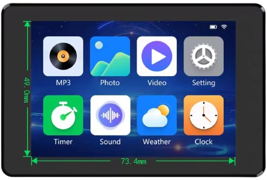

> Discussed here is the **capacitive-touch** *JC3248W535C_I_Y*. There are also versions with resistive touch, and with no touch.

### Benefits

* Affordable
* Lots of memory (512 KB SRAM, 16 MB flash, 8 MB PSRAM)
* Enclosure
* QWIIC connector for I²C
* 1S-LiIon/LiPo battery support plus charger
* Capacitive touch
* SD Card Reader
* Speaker (I²S)

### Specifications

| Feature | Manufacturer specification |
| --- | --- |
| Processor | ESP32-S3-WROOM-1; dual-core, up to 240 MHz |
| SD Card Reader | SPI CS GPIO10; MOSI GPIO11; clock GPIO12; MISO GPIO13 |
| Wireless | Wi-Fi and Bluetooth through the ESP32-S3 |
| Internal memory | 512 KB SRAM, 384 KB ROM |
| External memory | 16 MB flash, 8 MB PSRAM |
| Display | 3.5-inch IPS TFT, AXS15231B controller |
| Resolution | 320 × 480 pixels in portrait; 480 × 320 with landscape rotation |
| Color | 16-bit RGB565, 65,536 colors |
| Display interface | Quad SPI; vendor example uses 40 MHz |
| Touch interface | Capacitive; AXS15231B I²C address 0x3B |
| Visible area | 73.4 × 49.0 mm |
| Module dimensions | 94.5 × 62.0 mm; mounting tabs appear in the photographs |
| Operating input | 5 V |
| Typical consumption | About 150 mA; this is current, despite the PDF calling it “power consumption” |
| Approximate weight | 80 g |
| Temperature | Operating −20 to +70 °C; storage −30 to +80 °C |
| Expansion | microSD/TF, speaker, UART/power, GPIO, battery |

## Interfaces

GPIOs are accessible through three JST 1.25mm and one QWIIC 1.0mm connector on the back of the housing:

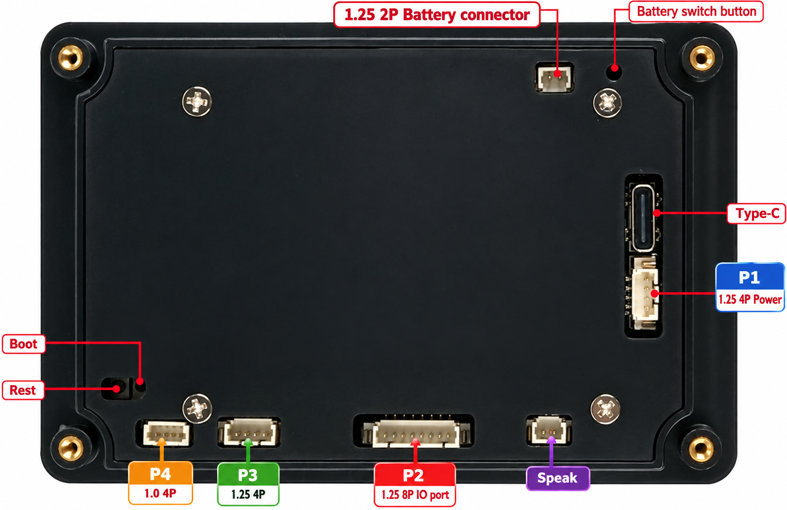

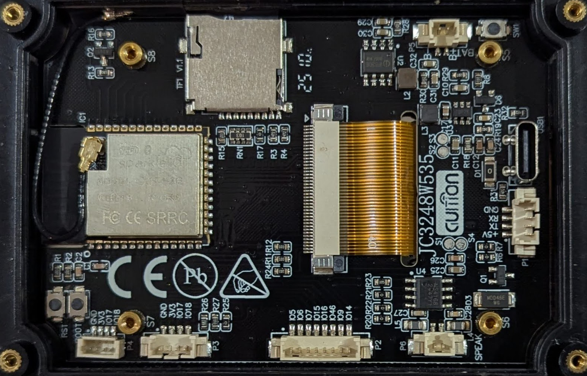

### P1: Power and UART

4-pin JST 1.25 connector, located right next to the USB-C connector. Provides access to the unregulated input voltage and can be used to power the tablet externally.

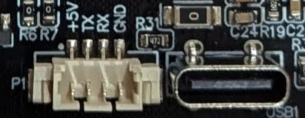

| Label | GPIO | Description |
| --- |  --- | --- |
| `+5V` | | 5V in/out |
| `TX` | `43` |  `U0TXD`; UART0 transmit; also digital I/O |
| `RX` | `44` |  `U0RXD`; UART0 receive; also digital I/O |
| `GND`| | Ground |

### P2: Peripherals

8-pin JST 1.25 connector. Provides GPIOs only, main peripheral bus.

| Label | GPIO | Description |
| --- |  --- | --- |
| `IO5` | `5` |   Digital I/O; `ADC1_CH4`; `TOUCH5`; RTC GPIO. **Tablet: connected to battery-voltage divider.** |
| `IO6` | `6` | Digital I/O; `ADC1_CH5`; `TOUCH6`; RTC GPIO |
| `IO7`| `7` | Digital I/O; `ADC1_CH6`; `TOUCH7`; RTC GPIO |
| `IO15`| `15` |Digital I/O; `ADC2_CH4`; RTC GPIO; `U0RTS` UART0 flow control; `XTAL_32K_P` |
| `IO16`| `16` |  Digital I/O; `ADC2_CH5`; RTC GPIO; `U0CTS` UART0 flow control; `XTAL_32K_N` |
| `IO46`| `46` | Digital I/O; **strapping pin** controlling boot mode/ROM logging; weak pull-down at reset; no ADC or capacitive touch |
| `IO9`| `9` |   Digital I/O; `ADC1_CH8`; `TOUCH9`; RTC GPIO; `FSPIHD` |
| `IO14`| `14` |  Digital I/O; `ADC2_CH3`; `TOUCH14`; RTC GPIO; `FSPIWP` / `FSPIDQS` |

### P3 and P4: I²C

Available both through a 4-pin JST 1.25 and a 1.0mm QWIIC connector. Pins include regulated 3.3V and GND, perfectly suited for I²C bus.

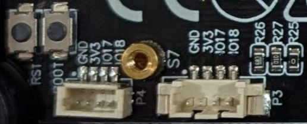

| Label | GPIO | Description |
| --- |  --- | --- |
| `GND`| | Ground |
| `3V3`| | 3.3V regulated |
| `IO17`| `17` |  Digital I/O; `ADC2_CH6`; RTC GPIO; `U1TXD` UART1 transmit |
| `IO18` | `18` |  Digital I/O; `ADC2_CH7`; RTC GPIO; `U1RXD` UART1 receive; `CLK_OUT3` |

### P5: Battery

Connects to an optional 1S LiIon/LiPo battery. Always make sure to connect the battery in correct polarity. Polarity is marked on the PCB. `-` is further away relative to the USB-C connector, `+` is closer located to the USB-C connector.

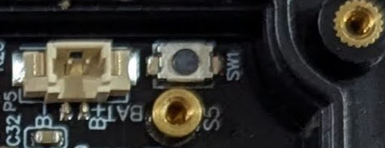

| Reference | Function | Format | Numbered pin assignment |
| --- | --- | --- | --- |
| USB1 | Data and 5 V power | USB Type-C | D− → GPIO19; D+ → GPIO20; VBUS and GND as drawn |
| P1 *(next to USB)* | Power and UART | 1.25 mm, 4 pins | 1 VIN; 2 TXD2 → U0TXD/GPIO43 via 100 Ω; 3 RXD2 → U0RXD/GPIO44 via 100 Ω; 4 GND |
| P2 | Extended GPIO | 1.25 mm, 8 pins | 1 GPIO5; 2 GPIO6; 3 GPIO7; 4 GPIO15; 5 GPIO16; 6 GPIO46; 7 GPIO9; 8 GPIO14 |
| P3 | GPIO/power | 1.25 mm, 4 pins | 1 GND; 2 3.3 V; 3 GPIO17; 4 GPIO18 |
| P4 | GPIO/power | 1.0 mm, 4 pins | 1 GND; 2 3.3 V; 3 GPIO17; 4 GPIO18 |
| P5 | Battery | 1.25 mm, 2 pins | 1 BAT positive; 2 GND/BAT negative |
| P6 | Speaker | 1.25 mm, 2 pins | 1 VON; 2 VOP; both are amplifier outputs |
| TF1 | Storage | microSD/TF slot | SPI CS GPIO10; MOSI GPIO11; clock GPIO12; MISO GPIO13 |

#### Power and Battery

The board can be powered in a number of ways:

* **USB-C:**    
  Powers the board and charges an attached LiIon/LiPo 1S battery.    
* **5V External:**   
  **P1** `+5V` passes through the input MOSFET/protection network to the 5 V rail; no wider input range is established.     
* **Battery:**   
  When a 1S LiIon/LiPo battery is attached to the `BATTERY` (**P5**) connector, and no other power supply is present, the board is powered from the battery.

The battery circuit connects **P5** to an unspecified charger/power-management IC, most likely a [IP5306](https://done.land/components/power/powersupplies/battery/chargers/charge-discharge/ip5306/). 

### P6: Speaker

Connects to a speaker.

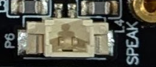

This is a **differential speaker output**: neither lead is GND. The I²S signals are GPIO41/DIN, GPIO42/BCLK, and GPIO2/LRCLK. 

Both AX98357A and NS4168 datasheets are supplied, but U4 has no part number in the drawing. Identify the actual fitted amplifier before relying on a speaker impedance or output-power rating.

## GPIOs

As is the case with many tablet microcontrollers, only limited GPIOs are exposed:

| GPIO | Connector | Description |
| --- | --- | --- |
| `43` | `P1` | `U0TXD`; UART0 transmit; also digital I/O |
| `44` | `P1` | `U0RXD`; UART0 receive; also digital I/O |
| `5` | `P2` | Digital I/O; `ADC1_CH4`; `TOUCH5`; RTC GPIO. **Tablet: connected to battery-voltage divider.** |
| `6` | `P2` | Digital I/O; `ADC1_CH5`; `TOUCH6`; RTC GPIO |
| `7` | `P2` | Digital I/O; `ADC1_CH6`; `TOUCH7`; RTC GPIO |
| `15` | `P2` | Digital I/O; `ADC2_CH4`; RTC GPIO; `U0RTS` UART0 flow control; `XTAL_32K_P` |
| `16` | `P2` | Digital I/O; `ADC2_CH5`; RTC GPIO; `U0CTS` UART0 flow control; `XTAL_32K_N` |
| `46` | `P2` | Digital I/O; **strapping pin** controlling boot mode/ROM logging; weak pull-down at reset; no ADC or capacitive touch |
| `9` | `P2` | Digital I/O; `ADC1_CH8`; `TOUCH9`; RTC GPIO; `FSPIHD` |
| `14` | `P2` | Digital I/O; `ADC2_CH3`; `TOUCH14`; RTC GPIO; `FSPIWP` / `FSPIDQS` |
| `17` | `P3`/`P4` | Digital I/O; `ADC2_CH6`; RTC GPIO; `U1TXD` UART1 transmit |
| `18` | `P3`/`P4` | Digital I/O; `ADC2_CH7`; RTC GPIO; `U1RXD` UART1 receive; `CLK_OUT3` |

### GPIO restrictions and internal pins

* GPIO `5` is connected through `R25` (0 Ω) to a battery divider and used for obtaining the battery voltage (i.e. to show a state-of-charge gauge): `R26 **33 kΩ** above and ``R27` **100 kΩ** below. It is not an isolated general-purpose output. 

  With the divider fitted and unloaded, **battery_V = adc_pin_V × (33 + 100) / 100 = adc_pin_V × 1.33**. This ratio comes from the drawing; it is not ADC calibration. Check populated resistors, ADC attenuation, and calibrated input voltage before implementing measurement.

* GPIO `46` is a **strapping pin**: external wiring must preserve the required reset/download state.     

The exact Arduino-ESP32 3.2.1 generic ESP32-S3 variant defines `TX/RX` as 43/44, `SDA/SCL` as 8/9, and `SS/MOSI/SCK/MISO` as 10/11/12/13. The UART and SD names coincide with the hardware. 

The I²C defaults **do not** match touch, and default SPI **does not** drive the QSPI display. Use explicit pins as the included BSP does.

### Schematics

#### Page 1
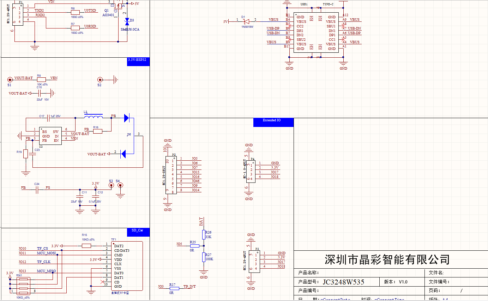

Shows P1 power/UART, USB-C, and the regulator producing 3.3 V. 

`D1` links the internal 5 V rail and USB VBUS as drawn. 

The expansion block shows `P2`/`P3`/`P4`, shared GPIO `17`/`18, the GPIO `5` battery divider, and the GPIO `3` interrupt link. 

The TF block shows a 3.3 V SD socket with pull-ups and SPI signals.

#### Page 2
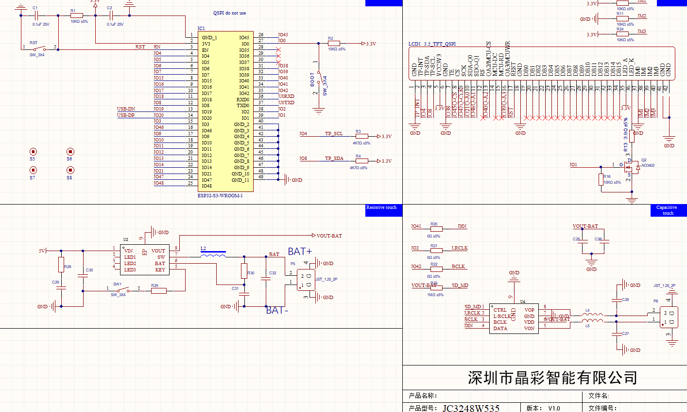

Shows the ESP32-S3 module, BOOT to GPIO `0`, and RESET on `EN`/`RST`. 

The LCD connector exposes QSPI, touch, TE, and backlight. 

GPIO `1` drives Q2 to switch the LED cathode return: `HIGH` enables the backlight. 

The lower-left block is battery charging/power management with its `KEY` switch; the lower-right block feeds I²S into U4 and filters its speaker outputs. The “resistive touch”/“capacitive touch” section headings are misplaced: use nets and components to identify those blocks.

## Programming

### PlatformIO: LVGL color and touch test

Open *examples/lvgl-test* in PlatformIO. 

The complete project includes the supplied vendor display initialization, touch driver, LVGL port, and configuration. No third-party driver with a placeholder repository address is required.

The pinned [pioarduino platform](https://github.com/pioarduino/platform-espressif32/tree/54.03.21) provides **Arduino-ESP32 3.2.1 / ESP-IDF 5.4**, matching the IDF 5 interfaces used by this vendor driver. Standard PlatformIO `espressif32` with Arduino 2.x is not a drop-in substitute. **LVGL 8.4.0** matches the supplied library; do not substitute LVGL 9.

#### platformio.ini

~~~ini
[env:jc3248w535]
platform = https://github.com/pioarduino/platform-espressif32/releases/download/54.03.21/platform-espressif32.zip
board = esp32-s3-devkitc-1
framework = arduino
board_build.arduino.memory_type = qio_opi
board_build.flash_mode = qio
board_build.f_flash = 80000000L
board_upload.flash_size = 16MB
board_upload.maximum_size = 16777216
board_build.partitions = default_16MB.csv
monitor_speed = 115200
build_flags =
    -DBOARD_HAS_PSRAM
    -DARDUINO_USB_MODE=1
    -DARDUINO_USB_CDC_ON_BOOT=1
    -DLV_CONF_INCLUDE_SIMPLE
    -Isrc
lib_deps = lvgl/lvgl@8.4.0
~~~

The generic board is a build target, with tablet-specific 16 MB flash and octal PSRAM overrides. The supplied Arduino settings selected only 8 MB flash despite the manufacturer's 16 MB specification; this configuration follows the specification. Verify actual flash size if your unit differs.

The included `src/lv_conf.h` sets **LV_COLOR_DEPTH = 16** and **LV_COLOR_16_SWAP = 1**. The vendor driver expects this byte order; do not swap pixels again in the application. The full **320 × 480 × 2 = 307,200 byte** RGB565 buffer resides in PSRAM, with DMA transport buffers in internal RAM. BSP buffer sizes are **pixels**; SPI transfer sizes are **bytes**.

#### src/main.cpp

~~~cpp
#include <Arduino.h>
#include <lvgl.h>
#include "display.h"
#include "esp_bsp.h"

static lv_obj_t *status_label;
static const char *names[] = {"RED", "GREEN", "BLUE"};
static const uint32_t rgb[] = {0xFF0000, 0x00FF00, 0x0000FF};
static uint32_t touches = 0;

static void on_press(lv_event_t *event) {
    const uintptr_t index = (uintptr_t)lv_event_get_user_data(event);
    lv_point_t point_px = {0, 0};
    lv_indev_t *input = lv_indev_get_act();
    if (input) lv_indev_get_point(input, &point_px);
    lv_label_set_text_fmt(status_label, "%s #%lu  x=%d y=%d",
        names[index], (unsigned long)++touches, point_px.x, point_px.y);
    Serial.printf("%s: x_px=%d y_px=%d\n", names[index], point_px.x, point_px.y);
}

void setup() {
    Serial.begin(115200);
    if (!psramFound()) {
        Serial.println("Octal PSRAM missing: check board configuration");
        while (true) delay(1000);
    }
    bsp_display_cfg_t cfg = {};
    cfg.lvgl_port_cfg = ESP_LVGL_PORT_INIT_CONFIG();
    cfg.buffer_size = 320 * 480; // pixels; RGB565 uses 307200 bytes
    cfg.rotate = LV_DISP_ROT_NONE; // portrait: x=0..319, y=0..479
    if (!bsp_display_start_with_config(&cfg)) {
        Serial.println("Display/touch initialization failed");
        while (true) delay(1000);
    }
    ESP_ERROR_CHECK(bsp_display_backlight_on());
    if (!bsp_display_lock(0)) return; // 0 = wait indefinitely, milliseconds otherwise
    lv_obj_t *screen = lv_scr_act();
    lv_obj_set_style_bg_color(screen, lv_color_hex(0x000000), 0);
    lv_obj_clear_flag(screen, LV_OBJ_FLAG_SCROLLABLE);
    for (uintptr_t i = 0; i < 3; ++i) {
        lv_obj_t *button = lv_btn_create(screen);
        lv_obj_set_pos(button, 10, 10 + i * 130);
        lv_obj_set_size(button, 300, 120);
        lv_obj_set_style_bg_color(button, lv_color_hex(rgb[i]), LV_PART_MAIN);
        lv_obj_set_style_bg_opa(button, LV_OPA_COVER, LV_PART_MAIN);
        lv_obj_set_style_radius(button, 0, LV_PART_MAIN);
        lv_obj_add_event_cb(button, on_press, LV_EVENT_PRESSED, (void *)i);
        lv_obj_t *label = lv_label_create(button);
        lv_label_set_text(label, names[i]);
        lv_obj_set_style_text_color(label, lv_color_hex(i == 1 ? 0x000000 : 0xFFFFFF), 0);
        lv_obj_center(label);
    }
    status_label = lv_label_create(screen);
    lv_label_set_text(status_label, "Touch RED, GREEN, BLUE");
    lv_obj_set_style_text_color(status_label, lv_color_hex(0xFFFFFF), 0);
    lv_obj_align(status_label, LV_ALIGN_BOTTOM_MID, 0, -25);
    bsp_display_unlock();
}

void loop() {
    delay(20); // vendor port supplies the LVGL task and millisecond tick
}
~~~

Keep the accompanying `.c` and `.h` files in `src/`: main.cpp is the UI, not a complete panel-driver replacement. Built-in demo widgets are disabled. The vendor port supplies the LVGL task and millisecond tick; do not call a second `lv_timer_handler()` or `lv_tick_inc()` from loop().

The tested Python build environment uses PlatformIO Core **6.2.0** and Click **8.1.8**. The pinned platform’s esptool 5.0.0-dev1 fails with newer Click API signatures, so keep this environment separate from ESPHome. Create it on Windows with:

~~~powershell
py -m venv .venv
.\.venv\Scripts\python.exe -m pip install -r requirements-build.txt
.\.venv\Scripts\python.exe -m platformio run
.\.venv\Scripts\python.exe -m platformio run --target upload
.\.venv\Scripts\python.exe -m platformio device monitor --baud 115200
~~~

When using an already compatible PlatformIO environment, the equivalent commands are:

~~~sh
pio run
pio run --target upload
pio device monitor --baud 115200
~~~

**Expected result:** labeled RED, GREEN, BLUE bands from top to bottom. Each press updates its color name, count, and pixel position on-screen and over USB. Portrait x increases rightward from 0 to 319; y increases downward from 0 to 479. Test all four corners, then release/repress each button to check input mapping and release behavior. This exercises one pointer, not multi-touch.

Red/blue reversal points to RGB/BGR order. Broad color corruption suggests RGB565 byte order. Touch selecting another region suggests an axis/rotation mismatch. A lit blank panel calls for checking initialization/QSPI; a dark panel also requires checking power and GPIO1/backlight.

### ESPHome: Color and Touch Diagnostic

*jc3248w535.yaml* is a complete USB-only diagnostic: no Wi-Fi secrets or Home Assistant required. It draws RGB bands and reports the touched band and coordinates in the USB log. The **JC4832W535** preset intentionally follows the official example with this panel's pin mapping; it does not rename the hardware.

Target **ESPHome 2026.9.1**. Its official documentation marks `qspi_dbi` for eventual removal in favor of `mipi_spi`, but the former still supplies this documented board preset. Pin the version; migration needs its own model/initialization check.

[See also here](https://community.home-assistant.io/t/guition-3-5-320x480-jc3248w535en-lcd-dev-board-working-example/774022/7) for a working example.   

~~~yaml
# ESPHome 2026.9.1; USB-only color/touch diagnostic, no Wi-Fi secrets required.
esphome:
  name: jc3248w535-test

esp32:
  board: esp32-s3-devkitc-1
  variant: esp32s3
  flash_size: 16MB
  framework:
    type: esp-idf

logger:
  hardware_uart: USB_SERIAL_JTAG

psram:
  mode: octal
  speed: 80MHz

spi:
  id: display_qspi
  type: quad
  clk_pin: GPIO47
  data_pins: [GPIO21, GPIO48, GPIO40, GPIO39]

i2c:
  id: touch_i2c
  sda: GPIO4
  scl: GPIO8
  frequency: 400kHz
  scan: true

power_supply:
  - id: backlight
    pin: GPIO1
    enable_on_boot: true

display:
  - platform: qspi_dbi
    id: lcd
    model: JC4832W535
    spi_id: display_qspi
    data_rate: 40MHz
    cs_pin:
      number: GPIO45
      ignore_strapping_warning: true
    dimensions:
      width: 320
      height: 480
    rotation: 0
    color_order: rgb
    invert_colors: false
    update_interval: 250ms
    lambda: |-
      it.filled_rectangle(0, 0, 320, 160, Color(255, 0, 0));
      it.filled_rectangle(0, 160, 320, 160, Color(0, 255, 0));
      it.filled_rectangle(0, 320, 320, 160, Color(0, 0, 255));

touchscreen:
  - platform: axs15231
    id: panel_touch
    display: lcd
    i2c_id: touch_i2c
    update_interval: 50ms
    on_touch:
      - lambda: |-
          const int x_px = touch.x;
          const int y_px = touch.y;
          const char *band = y_px < 160 ? "RED" : (y_px < 320 ? "GREEN" : "BLUE");
          ESP_LOGI("touch", "%s: x_px=%d y_px=%d raw=(%d,%d)",
                   band, x_px, y_px, touch.x_raw, touch.y_raw);
~~~

~~~sh
esphome config jc3248w535.yaml
esphome compile jc3248w535.yaml
esphome run jc3248w535.yaml --device COM7
~~~

Replace *COM7* with the device port. Touch the top/middle/bottom bands: logs should report RED/GREEN/BLUE at that position. No transform is applied in portrait. Landscape needs a corresponding touch transform; ESPHome's 270-degree board example swaps XY and mirrors Y. Confirm every corner after changing orientation.

For later Home Assistant use, add Wi-Fi with your own secrets, `api:`, and the current `ota:` platform configuration. The initial test has no network dependencies.

### Factory Recovery

Use a USB data cable and select the ESP32-S3's enumerated USB port. The schematic connects USB directly to the MCU; the supplied CH340 archive does not establish a need for a CH340 driver. If upload cannot connect, hold **BOOT**, press/release **RESET**, release BOOT, and select the download port. Reset after flashing if necessary.

The factory image is `E TOOLS/Burn files/JC3248W535C_I_Y_EN-80M.bin`. The supplied screenshots select **ESP32-S3 / Develop / USB**, then a combined image at **0x0**, **QIO**, **80 MHz**. That address applies to the corresponding combined factory image, not arbitrary application binaries. Back up factory contents if you need to preserve them. The download tool's old `dl_temp` binaries are not recovery images for this board by default.

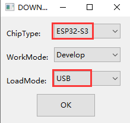
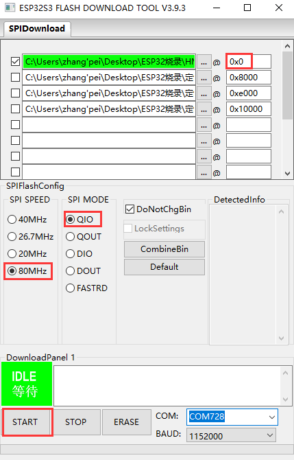
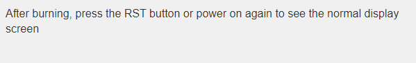

## Materials

- [15231_0626.zip](materials/15231_0626.zip)
- [AX98357AETE T_2021-01-06.PDF](materials/AX98357AETE%20T_2021-01-06.PDF)
- [AXS15231_Datasheet_V0.5_20230306.pdf](materials/AXS15231_Datasheet_V0.5_20230306.pdf)
- [esp32-s3-wroom-1_wroom-1u_datasheet_en.pdf](materials/esp32-s3-wroom-1_wroom-1u_datasheet_en.pdf)
- [esp32-s3_datasheet_en.pdf](materials/esp32-s3_datasheet_en.pdf)
- [JC3248W535 Specifications-EN.pdf](materials/JC3248W535%20Specifications-EN.pdf)
- [Nsiway-NS4168.pdf](materials/Nsiway-NS4168.pdf)

 Original demos, utilities, and factory firmware remain in the source collection. The inventory accounts for them without reproducing build caches or historical logs.

> Tags: ESP32-S3, Guition, JC3248W535, AXS15231B, LVGL, PlatformIO, ESPHome

[Visit Page on Website](https://done.land/components/microcontroller/families/esp/esp32/developmentboards/esp32-s3/guitionjc3248w535?465826101412261030) - created 2026-10-11 - last edited 2026-10-11
