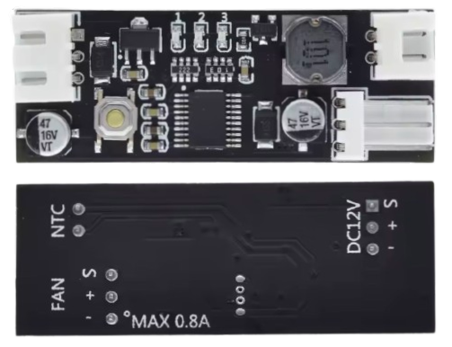
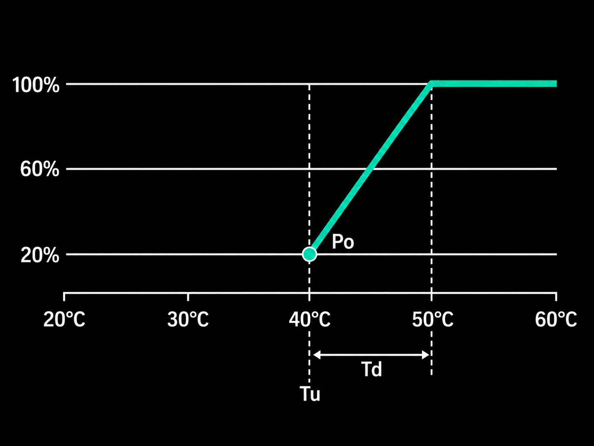
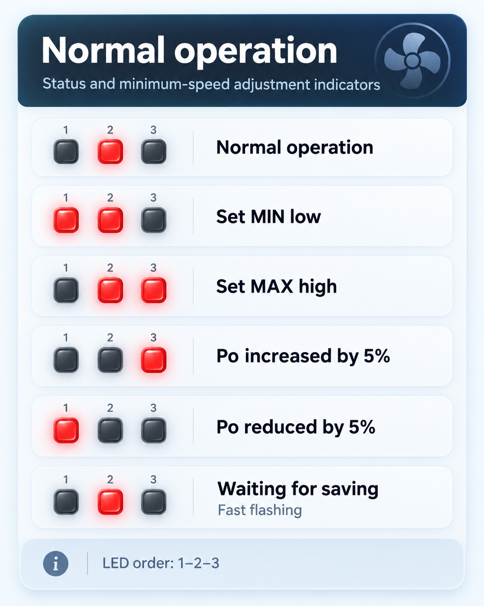
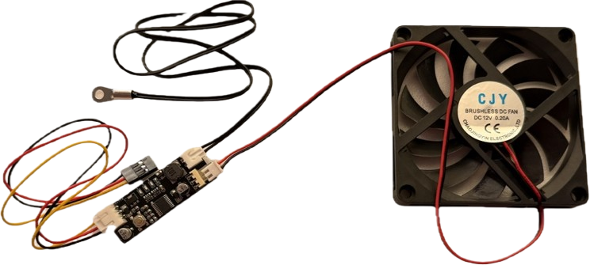
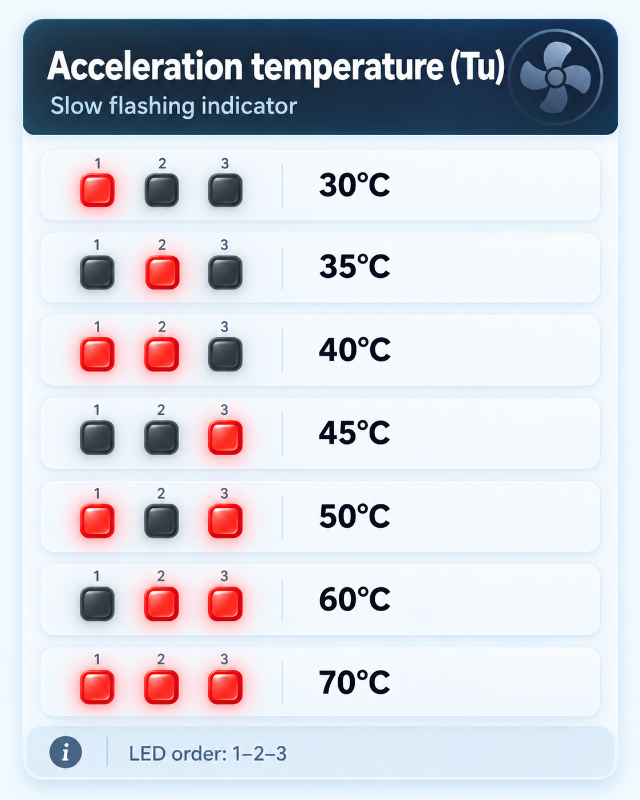
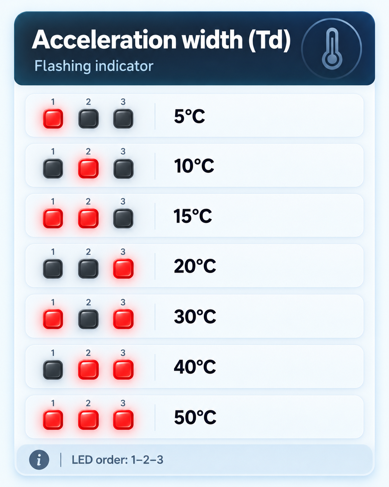

# 2- and 3-Wire Fan Controller

> Temperature-Controlled Fan Controller for 12V 2- and 3-Wire Fans

This very affordable `TS0702H` breakout board converts ordinary 12 V fans into temperature-controlled fans with variable speed.

It comes with a 50K NTC-Sensor and a power cable.

## Overview

This board can handle one or more 12 V fans with a total maximum current of 0.8 A. It has a push button and three red LEDs that are used to configure the board. Configurations are persisted in flash memory.

### Fixed or Variable Fan Speed
The board supports two general modes:

* **Always On:**     
  The fan is always on, and the fan speed can be set to a fixed speed. This is ideal when you have a 12 V fan that may be too powerful or too loud at maximum speed.

* **Temperature-Controlled:**   
  You define a temperature range, and the board starts the fan with a minimum fan speed and increases the fan speed to 100% when the upper temperature range is reached.

### Temperature Control

In temperature-control mode, you define when the fan should turn on, and how fast it should run.

The curve below illustrates such a use case: the fan starts spinning at 40C and gradually increases fan speed until at 50C, fan speed is at 100%.

### Status LED
The board has three red LEDs, clearly marked with `1`, `2`, and `3`. During normal operations, the LEDs signal the status:

The first three rows describe the LEDs during normal operation. If the board is working properly, only LED 2 is turned on. Should LED 1 or LED 3 also be on, then the configuration is corrupt: repeat configuration steps as described below.

The lower three rows describe what the LEDs do in configuration mode (see below).

## Wiring

Attach three cables to the board:

* **12 V Power (black/red/yellow):**    
  Plug in the 3-pin power jack. Only the red and black power wires are needed. The yellow signal wire connects directly to the `TACH` signal of the fan (3-wire fan), or is disconnected (2-wire fan). Connect to a 12 V power supply (supported range: 9-14 V)
* **NTC Probe (black/black):**   
  Plug in the included NTC probe (50K, B=3950), and attach the sensor to the place where you want to monitor heat.   
* **12 V Fan:**   
  Plug in or slide in the 12 V fan connector into the `KF2510`connector. The pitch is 2.54mm and fits 2-pin and 3-pin JST XH as well if you don't mind bending the pins slightly upwards. 

## Configuration

Configuring the board is not self-explanatory, but with the steps below it is no rocket science, either.

### 1. Setting Mode

First you need to set the general mode in which the board should operate (fixed or variable fan speed). For this:

1. Make sure the **board is powered off**.
2. Push and hold the push button.
3. Power on the board while firmly holding the push button until the LEDs start to flash.
4. Release the push button.

Now you can set the mode: with every short press you switch modes. The LEDs show your current selection. You can select mode 1, 2, or 3:

| Mode | Fan Speed | Hysteresis | Description |
| --- | --- |--- | --- |
| 1 | `Fixed` | - | Fan always on, fixed fan speed is configurable |
| 2 |`Variable` | 2C |Fan turns on when needed, fan speed varies with temperature |
| 2 |`Variable` | 5C | as before, but fan turns off only when temperature sinks 5C below the start temperature  |

Long-press the push button to save your selection.

### 2. Setting Temperature Range

If you enabled mode 2 or mode 3, you need to define when to activate the fan, and how fast it should spin.

To better understand how configuration works, let's take a closer look at how temperature control works:

This curve describes how the board should control the fan: 

The fan is turned off until the temperature exceeds 40C. At 40C, the fan starts spinning at 20% speed, ramping up speed with increasing temperature, until the fan speed reaches 100% at 50C.

This curve is defined by three parameters:

* **Start Speed (`Po`):**   
  The fan speed at which the fan should start. In the example curve, this would be **20%**.
* **Start Temperature (`Tu`):**      
  Once the temperature exceeds this temperature, the fan starts. In the example curve, `Tu` is set to **40C**.   
* **Temperature Range (`Td`):**   
  The temperature range defines the range in which the fan speed ramps up from the initial speed (`Po`) to full speed. In the example curve, `Td` is **10C**, so this is just the **temperature difference**, not the upper temperature limit.   
 
If you'd like to configure the board to above curve, the values would be:

`Tu` = 40C    
`Td` = 50C - 40C = 10C    
`Po` = 20%    

#### Translating Temperature Values
Before you can start configuring the board, you need to translate the temperatures into binary codes. 

> [!IMPORTANT]
> Watch out: `Td` is a **temperature difference**, not a temperature! And the translation tables for `Tu` and `Td` are different, do not mix them up.

`Tu` 40C translates to binary `ON` `ON` `OFF`:

Likewise, `Td` 10C translates to binary `OFF` `ON` `OFF`:

So these are the values we need to enter into the board:

| Property | Value | Description |
| --- | --- | --- |
| `Po` | 20% | initial Fan speed once the start temperature is reached |
| `Tu` | `ON` `ON` `OFF` | Start temperature: start the fan at 40C |
| `Td` |  `OFF` `ON` `OFF` | Speed ramp: 100% fan speed at 40+10=50C |

#### Entering Values

1. Make sure the board is **turned on**. LED 2 should be on.
2. Press the push button. The LED flashes fast, and the fan turns on.
3. Double-press the push button multiple times until LED 1 and LED 2 are both on. The fan stops. You now have set the fan start speed `Po` to 0.
4. Press the push button to increase the fan speed in 5% increments. Raise the fan speed at least to a level where the fan starts spinning. This will be the initial fan speed. For 20%, you would press four times.
5. Long-press the button to move to the next setting `Tu`, the start temperature. The LED now blinks slowly.
6. Press the push button multiple times until the LEDs show the binary pattern you need. To set the start temperature to 40C, keep pressing the button until you see `ON` `ON` `OFF`. Double-press to go backwards.
7. Once the LEDs show the correct binary, long-press the button. The LED now blinks faster, and you are ready to set `Td`, the temperature difference.
8. Press the button until the LEDs show the correct binary pattern for `Td`. To set `Td` to 10C, they should show `OFF` `ON` `OFF`.
9. Long-press the button. If your configuration is valid, only LED 2 should be permanently on now.

> Tags: Fan, Cooling Fan, TS0702H

[Visit Page on Website](https://done.land/components/power/cooling/fan/2-wirecontroller?287399101714261932) - created 2026-10-13 - last edited 2026-10-13
