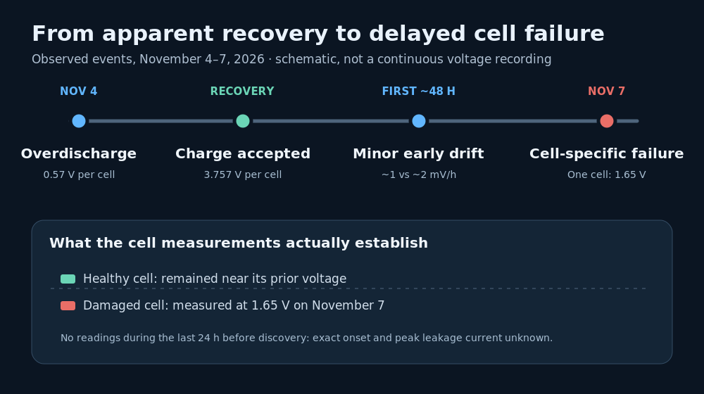
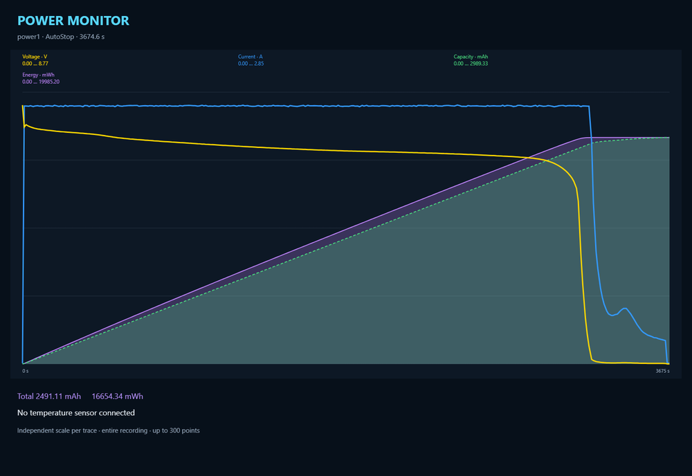
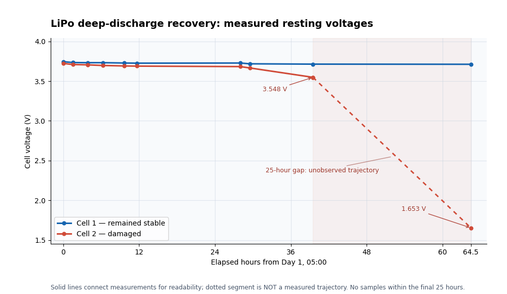
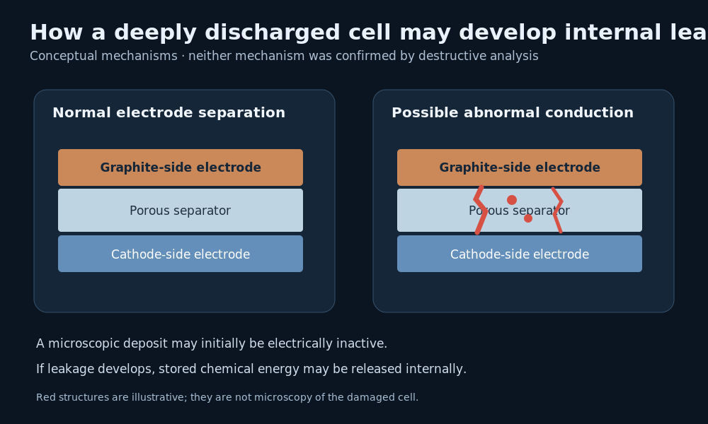

# Deep Discharge with Lithium Batteries  

> Case Study Illustrating Dangerous Deep Discharge in Lithium Batteries

**A two-cell LiPo was accidentally discharged to just 0.57 V per cell.** It initially appeared to recover: the cells charged uniformly, showed no detectable heating or swelling, and retained their original measured AC internal resistance. Over the next two days, serial measurements documented a progressively widening voltage difference between the cells. After a further **25-hour interval without measurements**, one cell was found at **1.653 V**. The other remained near its previous voltage.

The incident is a practical warning: **even brief extreme overdischarge can be followed by serious internal damage, and an apparently successful “revival” is not evidence that the battery is safe to reuse.**

## Overview

During battery testing, a capacity test with a brand new RC LiPo pack was conducted. The battery was fully charged and connected to an electronic load, and a power meter was measuring delivered capacity and energy.

### Accidental Deep Discharge

The electronic load was **accidentally not put into battery mode** where it would stop discharge at a specified safe voltage. Instead, the load discharged the battery without limit.

The very same can occur in a variety of practical scenarios:

- **Bad Devices:**     
  Unprotected or not sufficiently protected LiPo batteries are used in RC cars, drones, or home improvement equipment that do not reliably cut off at an appropriate battery voltage

- **Bad Packs:**   
  **2+S** (multi-cell) batteries are discharged hard to 3.0 V/per cell, and the cells are not perfectly matched, so at least one cell drops far below the cutoff voltage.

  Assume a 14.8V-4S-LiPo: when discharging this pack hard to 12.0 V, this **theoretically** stays within the 3.0 V per cell, however **practically** you cut off the pack at an **average** of 3.0 V per cell. If cells are not perfectly equal, some may still be at 3.3 V whereas another cell may have already dropped to 2.5 V at the same time.

  To prevent this, always cut off with a safety margin. If you notice the voltage drops much faster than normal, or the pack shuts off unexpectedly/prematurely, always assume a bad cell. 

### Battery Resuscitation

At the end of the test, the mishap was immediately recognized, and at a cell voltage of around **0.5 V**, the battery was revived with inital very small currents, then charged to around 40% SOC.

### Assumed Success

It seemed as if resuscitation was successful:

- the pack accepted charge
- no signs of swelling or heating
- both cells in the 2S pack behaved identical
- after charge ended, both cells held their voltage

The reasoning was that the deep discharge 

- lasted only minutes
- occured relatively quickly
- cells had a positive rest voltage (no voltage reversal)
- was treated immediately
- all studies on this topic were based on much more sever discharges, with voltage reversal, and over much longer periods of time

### Catastrophic Failure 

Long-term observation showed no irregularities over the first 24 hours. Only after 24 hrs did the signs of permanent damage begin to manifest, and after 48 hrs, one of the two cells discharged rapidly.

This example illustrates why any lithium based battery should be retired immediately once it had been subject to deep discharge, even if this loss hurts. The example shows that even a minute-long deep discharge damaged internal battery structure and introduced internal short circuits that weren't visible at first but violently manifested later.

If such batteries remain in service, there is a considerable risk that initially small defects will lead to sudden and catastrophic internal discharge events, during use or even during storage, introducing serious fire hazards.

## The incident: a 1C discharge ran too far

The battery was a **2S LiPo**, initially described as **2700 mAh**, with only **two charge cycles** recorded. The pack was accidentally discharged at approximately **1C (2.7 A)** until its terminal voltage collapsed. The load was disconnected soon after the mishap was noticed. When the pack was connected to a charger, **both cells measured 0.57 V** — closely matched and still positive.

The available power-monitor screenshot shows a discharge lasting approximately **3,674.6 seconds (61.2 minutes)**. Its footer reports **2,491.11 mAh** and **16,654.34 mWh** delivered. A readout at the top uses different maxima, so the footer values are quoted rather than treating all displayed numbers as interchangeable. The curve has an extended relatively gradual decline followed by a very steep terminal collapse.

*Figure 2. Original discharge-monitor record. The traces have independent vertical scales and the display is limited to approximately 300 plotted points. It cannot reveal the individual cell voltages or the precise duration below a given threshold.*

The **0.57 V readings were taken after disconnecting the load**, so they do not establish the minimum instantaneous cell voltages under load. The graph also cannot exclude transient reversal of one cell during the final collapse. Nevertheless, the measured matching positive voltages and the short interval before discovery initially appeared encouraging.

> **Capacity clarification:** The pack was originally identified as 2700 mAh, but 2200 mAh was mentioned later in the discussion. The precise rated capacity therefore needs confirmation. The incident's safety conclusion does not depend on resolving that discrepancy; calculations below deliberately avoid treating either nominal value as certain.

## An apparently successful recovery

A cautious recovery charge was initially attempted at **0.1 A**, raising the pack voltage to approximately **6.2 V**. After resting, the voltage appeared stable. Charging was subsequently continued at **2.2 A**, without observable swelling or heating.

Both cells recovered uniformly. Their charger-measured **AC internal resistance was 7.8 mΩ per cell**, unchanged from the pre-incident assessment. This was encouraging because large changes in bulk cell impedance might have indicated severe damage. But a single-frequency AC measurement cannot reliably detect a microscopic leakage pathway or prove that the separator is intact.

The pack was then brought to an approximately **60% indicated state of charge** for passive observation. At **45 minutes after charge termination**, both cells read **3.757 V** and had shown no change at the displayed millivolt resolution over the preceding ten minutes.

At this stage, the findings were superficially reassuring:

- No visible swelling or measurable abnormal heating during recharge.
- Matching cell voltages after extreme overdischarge and during recovery.
- Unchanged **7.8 mΩ** charger AC resistance for both cells.
- Stable initial resting voltages.

But the relevant question was not merely whether the cells could accept charge. It was whether their internal structure could still retain charge safely.

## A subtle early warning — followed by severe self-discharge

Early spot readings suggested that the eventually damaged cell declined slightly faster than the other. The detailed log provides more reliable evidence than assigning a single hourly rate: readings were unevenly spaced and include post-charge relaxation. Temperature variation and meter uncertainty can also influence millivolt-level differences.

The initial asymmetry became meaningful **in retrospect**, when the same cell later suffered severe voltage loss. It cannot retrospectively prove the precise mechanism or that an internal short existed from the first hour.

The full recorded series now shows **progressive divergence before the final collapse**. At Day 1, 05:00, the cells differed by just **22 mV**; by Day 2, 20:30, the difference had widened to **166 mV**. At Day 3, 21:30, the healthy cell was still at **3.712 V** while the damaged cell measured **1.653 V** — a difference of **2.059 V**. This confirms that the warning was not limited to one or two isolated millivolt readings.

### Recorded cell voltages

The original measurements supplied after the incident are reproduced below. Days are numbered consecutively; the calendar date of Day 1 is inferred as November 5 from the case chronology, not independently time-stamped in the measurement log. The values are in volts.

| Observation | Cell 1 (stable) | Cell 2 (failed) | Difference |
|---|---:|---:|---:|
| Day 1, 05:00 | 3.745 | 3.723 | 22 mV |
| Day 1, 06:30 | 3.734 | 3.709 | 25 mV |
| Day 1, 08:50 | 3.732 | 3.705 | 27 mV |
| Day 1, 11:15 | 3.732 | 3.697 | 35 mV |
| Day 1, 14:40 | 3.728 | 3.691 | 37 mV |
| Day 1, 16:40 | 3.726 | 3.689 | 37 mV |
| Day 2, 09:00 | 3.728 | 3.683 | 45 mV |
| Day 2, 10:30 | 3.718 | 3.666 | 52 mV |
| Day 2, 20:30 | 3.714 | 3.548 | 166 mV |
| Day 3, 21:30 | 3.712 | 1.653 | 2,059 mV |

The 3.726 → 3.728 V rise in the stable cell between Day 1 afternoon and Day 2 morning is within the range of meter resolution, thermal effects, and voltage redistribution; it is not evidence of spontaneous charging.

**The timing of the final collapse remains unknown.** The cell was disconnected from the charger and external circuitry during the last interval; the voltage could have declined progressively or rapidly at any point within those **25 hours**. A constant leakage current combined with the nonlinear voltage/SOC curve is one possible explanation. An increasing internal leakage current is another. The measurements do not determine the peak current or the onset time.

Even so, the outcome is unambiguous: **one previously deeply discharged cell developed severe, asymmetric self-discharge while disconnected from external circuitry.** This is not ordinary storage self-discharge or benign post-charge relaxation.

## Where did the energy go?

A fall from about **3.7 V to 1.65 V** represents severe charge depletion, but the associated energy cannot be calculated by multiplying the voltage drop by the rated capacity. A cell's open-circuit voltage is nonlinear with state of charge; the actual discharged capacity and timing are unknown.

If the loss resulted from an internal electronic leakage path or a *soft short*, much of the cell's available electrochemical energy would be released as heat through resistive and electrochemical losses. Parasitic chemical reactions offer another possibility: some energy could instead be retained in new reaction products, with some also appearing as heat. There was no external load during the final 25-hour observation gap to account for the discharge.

A relatively resistive internal path could dissipate energy over hours with little visible change in surface temperature. Conversely, heating localized at a microscopic defect could be much greater than indicated by the pouch temperature. **A cool exterior would not establish that the cell was safe.**

Most importantly, the observed voltage collapse does **not** establish a peak internal current or prove thermal runaway was imminent. The uncertain timing and nonlinear voltage curve prohibit such conclusions. It does establish a serious unexplained internal loss of stored charge.

## The suspected mechanism: copper dissolution and internal leakage

In conventional graphite-anode lithium-ion cells, the negative-electrode current collector is copper foil. Severe overdischarge can raise the negative-electrode potential to a range in which copper corrodes and enters the electrolyte. Copper may subsequently redeposit elsewhere during discharge or recharge. If deposits or other damage create an electronic path through the separator, an internal short circuit can result.

Scientific studies document copper dissolution, redeposition, and internal shorts under severe overdischarge. However, many experiments involve prolonged zero-voltage exposure or cell reversal. They do **not** allow us to infer that this particular pack formed dendrites during its brief low-voltage excursion. Other internal defects or parasitic reactions could also explain the late self-discharge.

The important practical distinction is between **a plausible mechanism** and **an observed failure**. The copper hypothesis remains unconfirmed; the cell-specific severe self-discharge is directly observed.

## Why the planned full-charge test could have been hazardous

Before the final result, while voltages still looked relatively stable, it was tempting to perform a full-charge test. In hindsight, that would have been a potentially dangerous decision.

Charging a compromised cell to its maximum voltage would increase its stored energy and expose it to additional electrochemical stress. If an internal leakage path were to become more conductive, more energy would be available for internal dissipation. During charging, the charger could also supply additional energy into an evolving defect. Neither possibility proves a fire would have occurred, but both increase the potential consequences of failure.

In this instance, the severe failure became unmistakable **after** an initially encouraging observation period, despite a gradually widening early difference. A short-term stability check could therefore have provided **false reassurance** if treated as proof of safety: the recorded divergence was modest at first but measurable over repeated observations, and even the Day 2, 20:30 reading did not reveal how far the damaged cell would fall by the next check.

## What this case establishes — and what it does not

| Directly observed | Not established by the evidence |
|---|---|
| Both cells measured 0.57 V after accidental deep discharge | Their lowest voltages while the load was still attached |
| Initial uniform charging and recovery | Absence of microscopic damage |
| Unchanged charger AC impedance: 7.8 mΩ each | Intact separator or copper collector |
| Widening voltage difference over ten measurements | A validated early-warning threshold based on millivolt differences |
| One disconnected cell later fell to 1.653 V | Exact onset, peak leakage current, or heat generated |
| Severe cell-specific self-discharge | Copper dendrites as the proven microscopic cause |

## Conclusion: isolate deeply overdischarged LiPos; do not “revitalize” them for reuse

This case illustrates a failure mode that is easy to underestimate. A two-cell LiPo experienced a **short-lived but extreme overdischarge**. Both cells then appeared to recover normally, with matching voltages, unchanged measured internal resistance and no obvious heating or swelling. The voltage difference widened from **22 mV** at the first recorded measurement to **166 mV** by the evening of Day 2. When the disconnected pack was checked again **25 hours later**, one cell measured **1.653 V** while the other remained at **3.712 V**.

The case does **not** prove that a specific copper dendrite developed, or that fire was imminent. It proves something operationally important: **apparently reassuring short-term electrical measurements did not exclude serious delayed failure after extreme overdischarge**.

**The practical response to a LiPo found at such an extreme undervoltage should be immediate removal from service and isolation from other batteries and combustible materials — not an attempt to restore it for normal use.** Avoid further charging, cycling or deliberate discharge. Arrange disposal through a facility equipped to accept damaged lithium batteries, and disclose the deep-discharge history. Isolation reduces the potential consequences of failure; it does not make the cell intrinsically safe.

The most dangerous assumption would have been: *“It charged normally, the resistance is unchanged, and the early voltage changes look small — therefore it is safe.”* The subsequent measurements showed exactly why that inference cannot be trusted.

---

### Technical references

1. Ouyang et al., *Mechanism of the entire overdischarge process and overdischarge-induced internal short circuit in lithium-ion batteries*, **Scientific Reports** (2016). [Open-access article](https://pmc.ncbi.nlm.nih.gov/articles/PMC4957210/).
2. Flügel et al., *Cu Dissolution during Over-Discharge of Li-Ion Cells to 0 V: A Post-Mortem Study*, **Journal of The Electrochemical Society** 168, 020506 (2021). [DOI](https://doi.org/10.1149/1945-7111/abdc5f).
3. Dayani et al., *Quantification of the Deep Discharge Induced Asymmetric Copper Deposition in Lithium-Ion Cells by Operando Synchrotron X-Ray Tomography*, **Advanced Materials Technologies** (2023/2024). [DOI](https://doi.org/10.1002/admt.202301246).
4. Hendricks et al., *Copper Dissolution in Overdischarged Lithium-ion Cells: X-ray Photoelectron Spectroscopy and X-ray Absorption Fine Structure Analysis*, **Journal of The Electrochemical Society** (2020). [DOI](https://doi.org/10.1149/1945-7111/ab697a).

*Reporting note: This is a single-pack observational case study, not a controlled experiment. The ten resting-voltage readings are reproduced from the user-provided log; the discharge values come from the original monitor screenshot. Lines between points are graphical interpolation only, not recovered measurements. The figures distinguish observations from illustrative mechanisms.*

> Tags: Deep Discharge

[Visit Page on Website](https://done.land/components/power/powersupplies/battery/batterytypes/rechargeable/deepdischarge?177419110809260405) - created 2026-11-08 - last edited 2026-11-08
