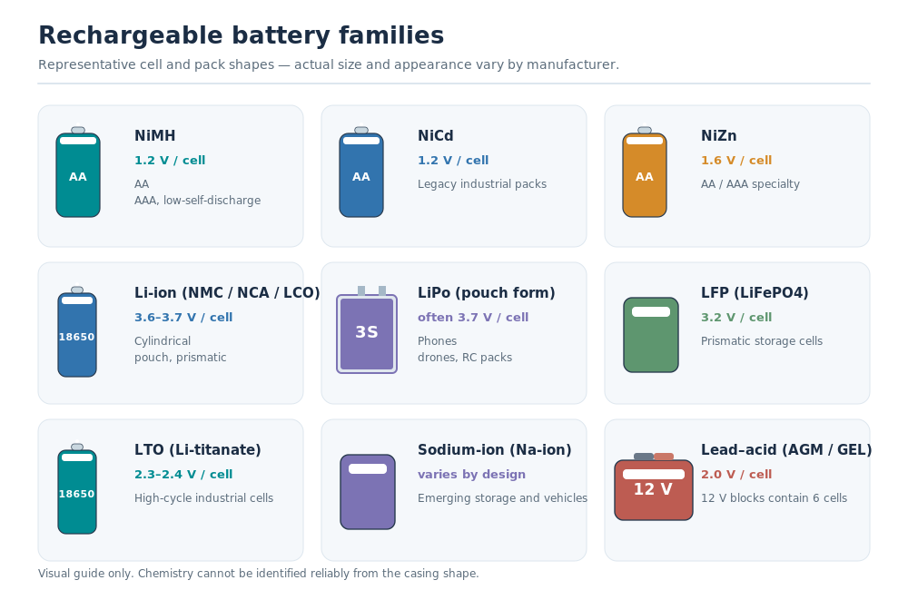
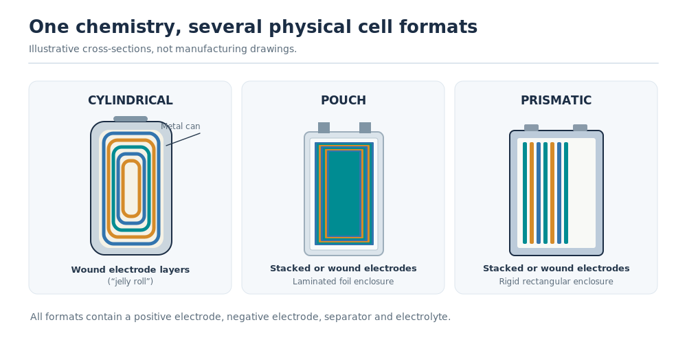
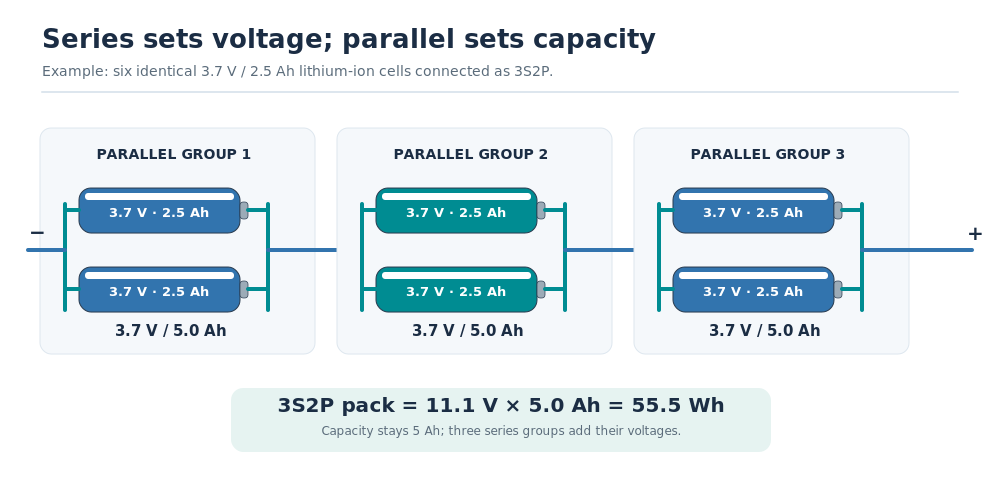
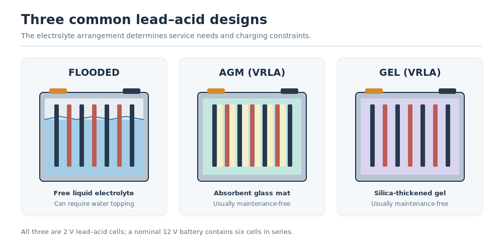
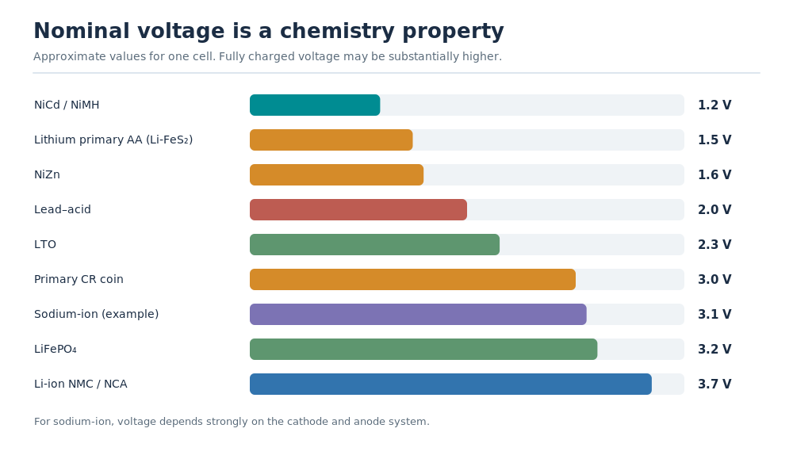
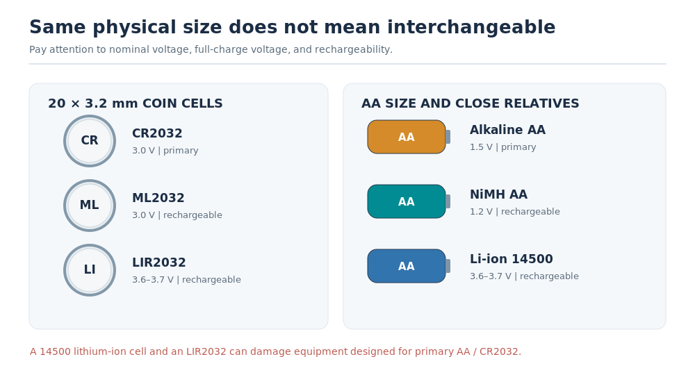
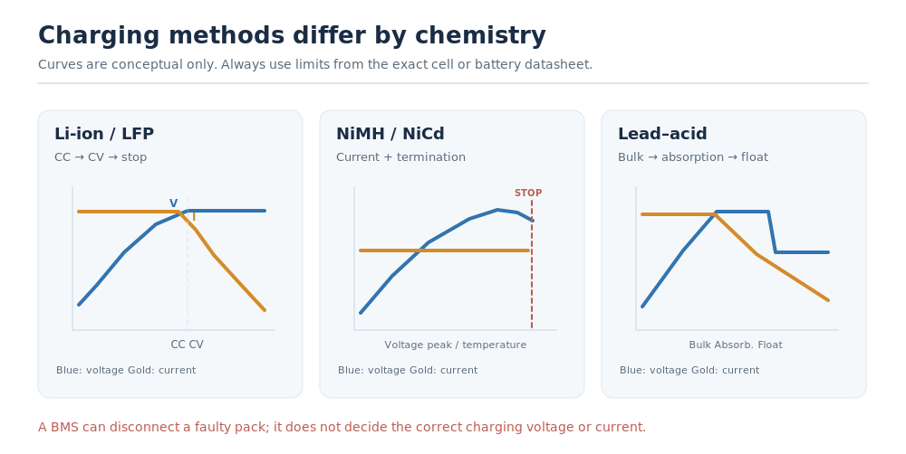
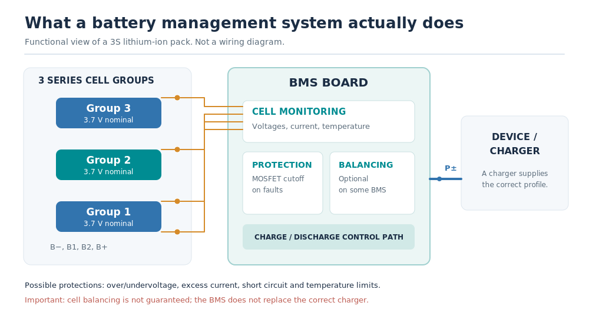
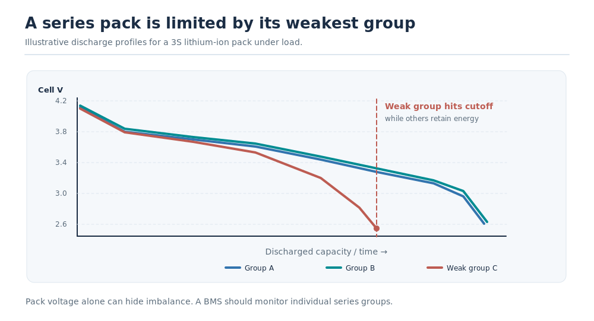

# Rechargeable Batteries: Cells, Chemistries, Packs, and Safe Charging

> Rechargeable cells are everywhere, and they differ in forms and shapes, but the basic principle is the same: electrochemical reactions store energy during charging and release it during discharge.

Rechargeable does not mean reversible forever. Chemical aging, calendar time, temperature, charging voltage, and current gradually affect capacity, internal resistance, and usable energy. Choosing a battery therefore requires more than looking at its capacity in mAh.

This guide focuses on practical selection, compatibility, charging, and the interpretation of real-world measurements. It also briefly covers non-rechargeable batteries because several common cell types look alike but are not interchangeable.

## Cells, Packs, and Batteries

These terms are often mixed up in everyday language, but the distinction matters when measuring or repairing a battery.

| Term | Meaning | Practical consequence |
| --- | --- | --- |
| Cell | One electrochemical unit with positive and negative electrodes and an electrolyte. | Its nominal voltage is primarily determined by its chemistry. |
| Battery | Technically, one or more connected cells; in everyday language, the complete unit supplied to the user. | A single AA cell can be called a battery, as can a 12 V automotive battery. |
| Pack | Cells connected in series, parallel, or both, with mechanical and electrical connections. | Pack voltage, capacity, and maximum current depend on the configuration and individual cells. |
| Primary cell | A cell designed for one-time use. | Must not be recharged unless the manufacturer expressly specifies otherwise. |
| Secondary cell | A rechargeable cell. | Needs a charging method matched to its chemistry and design. |
| PCM | Protection circuit module, often used for a single lithium-ion cell. | Can disconnect the cell on certain faults; it is not itself a charger. |
| BMS | Battery management system. | May monitor cell/group voltages, current and temperature; may implement protection, balancing, and state estimation. Capabilities vary. |
| Balancing | Reducing differences in state of charge between series-connected cell groups. | Not every BMS balances, and balancing cannot repair a defective cell. |
| Capacity | Electric charge, usually in Ah or mAh. | Useful for comparisons at the same voltage, load and test conditions. |
| Energy | Delivered energy, in Wh or mWh. | Usually better than mAh for comparing batteries with different voltages. |
| Power | Rate at which energy is delivered, in W. | A high-energy cell is not necessarily capable of high current. |
| C-rate | Current relative to nominal capacity. | For a 2.5 Ah cell, 1C is 2.5 A and 2C is 5 A. |
| Cycle life | Charging/discharging use before a defined aging threshold, often 80% of original capacity. | Cycle figures only make sense with their depth of discharge, temperature and end-of-life criterion. |

### Cell construction: cylindrical, pouch, and prismatic

The housing shape does not identify the chemistry. NMC, LFP, sodium-ion and other systems can appear in different formats. Cylindrical cells typically use wound electrodes; pouch cells use a flexible laminated enclosure; prismatic cells use a rigid rectangular case with wound or stacked electrode assemblies.

Typical cylindrical dimensions are encoded in names such as 18650 (about 18 × 65 mm), 21700 (about 21 × 70 mm), and 14500 (about 14 × 50 mm). These are size designations, not voltage or chemistry guarantees. A 14500 lithium-ion cell is close in size to an AA battery but has a radically different voltage.

### Series and parallel: what 3S2P actually means

The notation xSyP describes x series-connected groups containing y parallel-connected cells each. For example, 3S2P consists of six cells arranged as three groups of two cells in parallel.

With identical 3.7 V, 2.5 Ah cells:

- 1S1P: 3.7 V, 2.5 Ah, approximately 9.25 Wh.
- 1S2P: 3.7 V, 5.0 Ah, approximately 18.5 Wh.
- 3S1P: 11.1 V, 2.5 Ah, approximately 27.75 Wh.
- 3S2P: 11.1 V, 5.0 Ah, approximately 55.5 Wh.

Series connections add voltage, not Ah. Parallel connections add Ah and available current capability, assuming compatible cells. Adding cells increases total energy in either arrangement. Actual usable energy is lower than the nominal calculation when losses, cell mismatch, voltage sag, or protective cutoffs intervene.

The weakest series group limits the usable pack capacity. Cells connected in parallel tend to equalize their voltage, but that does not make it safe to connect cells at substantially different voltages or with unknown condition.

### Capacity versus energy: why Wh matters

A 2,500 mAh NiMH cell at 1.2 V nominal stores approximately 3.0 Wh, while a 2,500 mAh lithium-ion cell at 3.7 V nominal stores approximately 9.25 Wh. Their mAh ratings are identical, but their energies are not.

For an estimate, energy in Wh = nominal voltage in V × capacity in Ah. During a real discharge test, the more accurate calculation integrates the measured voltage and current over time:

`Energy (Wh) = ∫ V(t) × I(t) dt / 3600`, when time is measured in seconds.

A weak or high-resistance cell can deliver fewer Wh even if a low-current capacity test reports an acceptable Ah value: under load, its voltage falls further, reducing delivered energy or triggering an early cutoff. Always compare batteries using the same cutoff, temperature, current or power, and charge/discharge procedure.

## The Main Rechargeable Chemistries

Cell chemistry determines the nominal voltage, charging method, energy density, safety characteristics, and much of the battery's aging behavior. The following sections group batteries by their electrochemistry rather than by the shape of their packaging.

### Lead–acid: flooded, AGM, and GEL

Lead–acid is one of the oldest rechargeable battery systems and remains useful where low cost, reliability, and high surge current matter more than size and weight. Each cell has a nominal voltage of 2.0 V; a common 12 V battery contains six cells in series.

The electrodes use lead and lead dioxide, with sulfuric acid as the electrolyte. The technology is mature and highly recyclable, but heavy. Its usable capacity depends strongly on discharge current, depth of discharge, and temperature. A starter battery designed for occasional high current is not equivalent to a deep-cycle battery designed for repeated discharge.

| Lead–acid type | Construction | Good at | Limitations |
| --- | --- | --- | --- |
| Flooded (wet) | Liquid sulfuric-acid electrolyte; vented. | Automotive starting and cost-sensitive storage. | May require water maintenance; spill and gas hazards; requires ventilation. |
| EFB (enhanced flooded battery) | Improved flooded construction for frequent engine starts. | Start-stop vehicles without AGM requirements. | Not interchangeable with AGM in every vehicle; requires correct charging/system coding. |
| AGM | Acid absorbed in fiberglass mats; valve-regulated lead–acid (VRLA). | High current, start-stop systems, UPS, vibration resistance. | More sensitive to excessive charging voltage than many flooded types. |
| GEL | Acid immobilized with silica; usually VRLA. | Appropriate deep-cycle and standby applications. | Charging voltage limits and charge acceptance can differ from AGM. |

AGM stands for Absorbent Glass Mat, not AGB. GEL and AGM are commonly called sealed or maintenance-free batteries, but they are not hermetically sealed: safety valves can vent gas under abnormal or excessive charging. Even VRLA batteries need appropriate installation and ventilation.

Charging generally involves a bulk phase, an absorption phase, and—when suitable—maintenance at a lower float voltage. For illustration, common room-temperature lead–acid charging settings are around 2.35–2.45 V per cell for absorption and 2.25–2.30 V per cell for float. Those are not universal settings: GEL, AGM, flooded and specific battery models may require different limits and temperature compensation. Use the battery's data sheet.

Practical choice: lead–acid remains sensible for existing 12 V vehicle systems, standby power, and cost-sensitive installations where its weight is acceptable. It is unattractive for handheld devices and frequent deep cycling unless the battery was designed for that duty.

### Nickel–cadmium (NiCd, sometimes called NiCad)

NiCd uses a nickel-based positive electrode and a cadmium-based negative electrode. Nominal voltage is 1.2 V per cell. Its strengths are ruggedness, high-current capability, and tolerance of demanding operating conditions. NiCd remains in some specialist equipment and legacy industrial systems.

- Advantages: durable, good power delivery, and relatively tolerant of electrical abuse compared with many lithium-ion designs.
- Disadvantages: toxic cadmium, lower energy density than modern lithium-ion, and regulatory restrictions on many applications.
- Typical uses: legacy power tools, emergency and industrial equipment, and specialist installations.

NiCd is associated with the memory effect, but the familiar rule that it must be fully discharged before every recharge is wrong. Voltage depression and crystalline effects can occur under certain repeated cycling or overcharge conditions; occasional controlled conditioning may help particular NiCd packs. Routine deep discharge before every recharge wastes cycles and can reverse weak cells in multi-cell packs.

### Nickel–metal hydride (NiMH)

NiMH replaced NiCd in many consumer applications without the environmental problems caused by cadmium. It uses a nickel oxyhydroxide positive electrode and a hydrogen-absorbing metal-alloy negative electrode. Like NiCd, its nominal cell voltage is 1.2 V.

- Advantages: widely available in AA and AAA formats, good current delivery, no cadmium, and generally little practical memory-effect concern.
- Disadvantages: lower energy density than most lithium-ion designs, heat generation near the end of charge, and considerable variation in self-discharge and cycle life between products.
- Typical uses: rechargeable household AA/AAA cells, cameras, flashlights, toys, and other replaceable-battery equipment.

Modern low-self-discharge (LSD) NiMH batteries retain their charge much better during storage than older conventional NiMH cells. They are often an excellent everyday replacement for primary alkaline AA or AAA batteries. Although alkaline cells are labeled 1.5 V, their voltage declines during use; NiMH cells maintain a comparatively flat voltage around 1.2 V. Most devices accept this, although some voltage-sensitive appliances and inaccurate battery-level indicators do not.

NiMH charging differs fundamentally from lithium-ion charging. A suitable charger detects the end of charge using a small voltage peak/drop, temperature change, safety timers, or a combination of these. Do not charge NiMH cells using a standard 4.2 V lithium-ion CC/CV charger. Good chargers supervise individual AA/AAA cells instead of blindly charging mismatched cells in pairs.

Practical choice: low-self-discharge NiMH is usually the first rechargeable chemistry worth trying in conventional AA/AAA equipment. Deep-discharging it before every recharge is unnecessary and can be harmful.

### Nickel–zinc (NiZn)

NiZn cells have a nominal voltage of about 1.6 V, higher than NiMH. Their AA and AAA formats can help in equipment that performs poorly with 1.2 V NiMH cells. However, a freshly charged NiZn cell may be above the voltage that some devices expect from an alkaline cell.

- Advantages: higher voltage in familiar AA/AAA sizes and useful power delivery.
- Disadvantages: specialized charger required; compatibility is not universal; cycle life and discharge-end behavior can be less forgiving than NiMH.
- Typical uses: selected cameras, lights, measuring instruments, and other devices explicitly tolerant of their voltage range.

Do not use a NiMH/NiCd charger for NiZn unless it explicitly supports NiZn. Also check the maximum tolerated voltage of the device rather than assuming that any AA-shaped cell is interchangeable.

### Conventional lithium-ion: LCO, LMO, NMC, and NCA

Lithium-ion is a family of rechargeable chemistries, not a single fixed recipe. Lithium ions move between the electrodes during charging and discharging. Commercial cell designs differ mainly in electrode materials, capacity, current delivery, thermal behavior, and longevity.

| Abbreviation | Main chemistry | Typical nominal voltage | Characteristic applications and trade-offs |
| --- | --- | --- | --- |
| LCO | Lithium cobalt oxide | About 3.6–3.7 V | High specific energy; traditionally used in compact electronics. |
| LMO | Lithium manganese oxide | About 3.7 V | Good power delivery; sometimes blended with other chemistries. |
| NMC / NCM | Lithium nickel manganese cobalt oxide | About 3.6–3.7 V | Widely used in vehicles, tools, and electronics; adjustable balance of energy, power and lifetime. |
| NCA | Lithium nickel cobalt aluminum oxide | About 3.6 V | High energy density; used in selected vehicle and other high-energy cells. |

A common 3.6–3.7 V lithium-ion cell is charged with a chemistry- and model-specific constant-current/constant-voltage (CC/CV) profile, frequently to 4.20 V. Some high-voltage cells instead allow 4.30 V or 4.35 V (or another stated limit); others require lower limits. These are not interchangeable charging settings. The discharge cutoff also varies, commonly around 2.5–3.0 V depending on cell and load.

- Advantages: high energy density, low self-discharge, and many capacity/current/format options.
- Disadvantages: aging accelerates with high temperature, high voltage and heavy use; overcharging, severe overdischarge, internal defects or physical damage can cause dangerous failures.
- Typical uses: laptops, smartphones, power tools, electric vehicles, power banks, and portable electronics.

A cylindrical 18650 battery is not inherently a safer or lower-power chemistry than a pouch cell: both may use similar electrode materials. Check the actual cell type and manufacturer's limits, not its casing.

### Lithium-polymer (LiPo): mostly a format distinction

The term lithium-polymer originally refers to polymer-containing electrolyte systems. In consumer and RC markets, however, "LiPo" commonly means a lightweight laminated pouch lithium-ion cell, often with chemistry closely related to conventional Li-ion. It is therefore misleading to treat LiPo as a separate cathode chemistry with universally higher energy density or shorter life.

Pouch cells can be extremely thin or shaped to fit a product. RC packs are often optimized for high discharge current, while smartphone pouches prioritize energy density. Neither property follows automatically from the pouch.

- Advantages: flexible dimensions, low package weight, and specialized high-power designs.
- Disadvantages: pouches need mechanical support; swelling, puncture and poor handling can be hazardous; some hobby packs lack an integrated protection circuit.
- Typical uses: phones, tablets, drones, RC models, and slim electronics.

An RC pack described as 3S LiPo is usually about 11.1 V nominal, assuming 3.7 V nominal cells. It typically has a main power connector and a balance connector. A balance connector is not itself a BMS: a compatible balance charger must control charging, monitor individual series groups, and enforce the pack's limits. Never rely solely on the advertised C-rating without considering cell quality, wiring, connectors and temperature.

### Lithium iron phosphate (LiFePO₄, LFP)

LFP belongs to the lithium-ion family, but its lithium-iron-phosphate positive electrode changes both voltage and behavior. A typical cell is rated at 3.2 V nominal and charged to a maximum around 3.65 V, subject to its data sheet. Four cells in series make a nominal 12.8 V pack.

- Advantages: strong cycle-life potential, good thermal stability, relatively flat discharge voltage, and no nickel or cobalt in the LFP cathode.
- Disadvantages: lower energy density than many high-energy NMC/NCA cells; a dedicated charging profile and compatible protection settings are required.
- Typical uses: solar and home storage, RV/boat auxiliary batteries, UPS, and electric vehicles.

LFP is less prone to thermal runaway than several other lithium-ion chemistries, but "cannot burn or explode" is too strong. A damaged or improperly managed LFP battery can still produce fire, gas, very high currents, and serious hazards.

The flat voltage plateau is useful for power delivery but makes state-of-charge estimation from resting voltage less precise over much of the discharge. Low-temperature charging also requires attention: many LFP products prohibit charging below 0 °C unless their design specifically supports it, for example through battery heating. The permitted charge current and voltage always come from the pack or cell specification.

### Lithium titanate (LTO)

LTO is another lithium-ion variant, named for the lithium-titanate negative electrode rather than the positive electrode. Typical cells run near 2.3–2.4 V nominal and have a substantially different operating voltage range than conventional Li-ion or LFP cells.

- Advantages: excellent cycle-life potential, fast-charge capability in suitable designs, low internal resistance, and good low-temperature performance.
- Disadvantages: substantially lower energy density, more cells required for a given voltage, and often higher upfront cost.
- Typical uses: high-cycle industrial storage, transit applications, and specialist backup systems.

LTO cells often charge to approximately 2.7–2.85 V, depending on the model. A 4.2 V lithium-ion charger would be wholly inappropriate. High claimed cycle lives still depend on temperature, charge/discharge rates and manufacturer-defined testing conditions.

### Sodium-ion (Na-ion)

Sodium-ion cells use sodium-ion movement rather than lithium-ion movement. Several cathode and anode systems exist, so a single universal nominal voltage or charge limit is misleading. Many contemporary designs operate around 3 V nominal, but the exact voltage window must be taken from the cell manufacturer.

- Advantages: reduces reliance on lithium; can use widely available sodium resources; promising cold-temperature performance in some commercial designs.
- Disadvantages: technology and supply chains are still developing; energy density and long-term field performance vary considerably between products.
- Typical uses: stationary storage, certain mobility applications, and emerging electric-vehicle systems.

Sodium-ion is no longer only a laboratory concept. Commercial products and vehicle programs had been announced by 2026, including CATL's Naxtra technology. That does not mean sodium-ion can be substituted directly for an LFP or NMC battery. Even if the nominal pack voltage looks similar, the appropriate charging limits, BMS calibration and discharge cutoff can differ.

### Other rechargeable and industrial battery systems

Not every rechargeable technology fits in a portable cell. A few older or more specialized systems are worth knowing, even if most people will never encounter them in a consumer product.

| System | Typical characteristic | Why it is still interesting |
| --- | --- | --- |
| Nickel–iron (NiFe, Edison cell) | About 1.2 V per cell; very robust, but high self-discharge, low efficiency and water-maintenance requirements. | Long-lived stationary systems and historical installations. |
| Silver–zinc (AgZn) | About 1.6 V per cell; high specific power/energy for selected designs, but expensive and often limited cycling. | Aerospace, defense and specialist equipment. |
| Nickel–hydrogen (NiH₂) | Nickel-based chemistry with hydrogen stored under pressure. | Very long-lived space applications; not a common household cell. |
| Vanadium redox-flow battery | Energy stored in liquid electrolyte tanks and pumped through an electrochemical stack. | Stationary storage where power and energy capacity can be scaled separately. |
| Zinc–bromine flow battery | Industrial flow-battery system with different materials and operating requirements. | Another approach to long-duration stationary energy storage. |
| Sodium–sulfur (NaS) | High-temperature rechargeable technology, operating at several hundred °C. | Grid storage; not appropriate for portable electronics. |

"Solid-state" and "silicon–carbon" are also increasingly encountered in battery marketing. Solid-state refers to electrolyte and cell architecture rather than a single fixed electrochemistry. Silicon–carbon usually describes changes to the negative electrode of a lithium-ion cell, not a completely separate family with a universal voltage or charging method. Neither label removes the need for exact cell specifications and suitable protection.

## Comparison: Which Chemistry Fits Which Task?

The ranges below are broad, indicative cell-level comparisons, not purchasing specifications. Cycle life assumes a manufacturer-defined aging limit, often 80% remaining capacity; depth of discharge, temperature, charge voltage and use conditions can change it dramatically. The format of the cell also affects measured Wh/kg.

| Rechargeable type | Nominal V/cell | Indicative specific energy | Broad cycle-life tendency | Sensible uses |
| --- | ---: | --- | --- | --- |
| Lead–acid | 2.0 | Low, often 30–50 Wh/kg | Hundreds; highly depth-of-discharge dependent | Cars, UPS, standby power |
| NiCd | 1.2 | Low–medium, often 40–60 Wh/kg | Hundreds to well over 1,000 in suitable designs | Legacy/specialist industrial equipment |
| NiMH | 1.2 | Medium, often 60–120 Wh/kg | Several hundred to 1,000+ depending on model | AA/AAA replacements |
| NiZn | 1.6 | Medium; strongly product-dependent | Typically less predictable than good LSD NiMH | Voltage-sensitive AA/AAA equipment |
| LCO / LMO / NMC / NCA | 3.6–3.7 | High, often 140–280 Wh/kg across designs | Hundreds to a few thousand depending on cell | Electronics, tools, EVs |
| LiPo pouch | Commonly 3.7 | Determined by underlying Li-ion chemistry and construction | Not a separate chemistry-based rating | Slim devices, RC, drones |
| LFP | 3.2 | Medium–high, often 90–180 Wh/kg | Often several thousand in suitable designs | Storage, RV, auxiliary batteries |
| LTO | 2.3–2.4 | Low, often 50–90 Wh/kg | Several thousand, sometimes much more | High-cycle or high-power systems |
| Sodium-ion | Product-specific, often near 3 V | Emerging range, roughly 100–175 Wh/kg in reported designs | Product-specific; verify test conditions | Emerging storage and mobility |

Some quick decisions follow naturally: for household AA/AAA devices, start with low-self-discharge NiMH; for lightweight portable electronics, conventional Li-ion is usually the energy-density choice; for frequently cycled stationary storage, LFP is often attractive; and for repeated high-current industrial cycling, LTO deserves consideration if size and cost are acceptable. Replacing a lead–acid battery with lithium is not automatically plug-and-play: the charger, load, temperature behavior, BMS and vehicle or equipment electronics must all be compatible.

## Non-Rechargeable and Specialty Cells That Are Easy to Confuse

Non-rechargeable batteries belong to a separate category. Some are included here because their form factors or labels closely resemble rechargeable counterparts.

| Type | Rechargeable? | Typical nominal voltage | Common examples | Practical warning |
| --- | --- | ---: | --- | --- |
| Alkaline (zinc–manganese dioxide) | No | 1.5 V | LR6 AA, LR03 AAA | Do not charge in a regular rechargeable-battery charger. |
| Lithium manganese dioxide (Li-MnO₂) | No | 3.0 V | CR2032, CR2025, CR123A | CR means a primary lithium cell; do not recharge. |
| Lithium iron disulfide (Li-FeS₂) | No | 1.5 V | FR6 lithium AA, FR03 lithium AAA | Lithium chemistry does not necessarily mean a 3 V or 3.7 V cell. |
| Lithium thionyl chloride (Li-SOCl₂) | No | About 3.6 V | ER14505 and industrial sensor batteries | Usually designed for low, long-duration current; not rechargeable. |
| Silver oxide | No | About 1.55 V | SR-series watch cells | Often stable voltage in a small package; not rechargeable. |
| Zinc–air | Usually no | About 1.4 V | PR-series hearing-aid cells | Requires oxygen from air to operate. |
| ML2032 | Yes | 3.0 V | Rechargeable backup coin cell | Requires its own charging specification; not a generic CR2032 substitute. |
| LIR2032 | Yes | 3.6–3.7 V | Rechargeable lithium-ion coin cell | Up to about 4.2 V fully charged; unsafe as a blind CR2032 substitute. |

The names CR2032, ML2032 and LIR2032 all imply approximately the same physical size (20 mm diameter, 3.2 mm thickness), but not identical chemistry, charging behavior, voltage or capacity. A device using a CR2032 should not receive an LIR2032 merely because the cell fits. The same warning applies to an AA-sized 14500 lithium-ion cell: the voltage difference can destroy equipment.

There are also regulated rechargeable "1.5 V lithium AA" products containing a lithium-ion cell and voltage-conversion electronics. Their external output may imitate an AA primary battery, but charging and low-battery indication depend on the particular product; these should not be confused with bare 14500 cells.

## Charging: Why There Is No Universal Battery Charger

A charger must match the chemistry and its exact voltage and current limits. The name "lithium" alone is insufficient information.

| Cell chemistry | Typical full-charge approach | Key caution |
| --- | --- | --- |
| Flooded / AGM / GEL lead–acid | Bulk, absorption, and possibly float; temperature-compensated. | Choose the correct battery profile, especially for GEL and VRLA. |
| NiCd | Controlled-current charging with end-of-charge detection and temperature/time protection. | Do not intentionally overcharge or reverse weak cells. |
| NiMH | Controlled current; sensitive voltage-peak/drop and/or temperature/time termination. | Avoid crude timer-only chargers or prolonged overcharge. |
| NiZn | Dedicated NiZn charger. | Higher voltage than NiMH; not charger-compatible by default. |
| Conventional 3.6–3.7 V Li-ion | CC/CV, often 4.20 V maximum per cell, then terminate. | High-voltage and special cell types have different limits. Do not float-charge like lead–acid. |
| LFP | CC/CV, commonly 3.65 V maximum per cell, then terminate. | Not compatible with an ordinary 4.20 V/cell Li-ion setting. |
| LTO | CC/CV, often around 2.7–2.85 V maximum per cell. | Follow exact cell data; not compatible with conventional Li-ion settings. |
| Sodium-ion | Manufacturer-specific voltage/current profile, commonly CC/CV-based. | No universal cutoff or charge voltage exists across sodium-ion designs. |
| Rechargeable coin cells (ML / LIR) | Type-specific, usually low-current charging. | Never assume two 2032-sized cells share a charging profile. |

For lithium-ion cells, CC means the charger initially limits current while voltage rises. At the specified maximum voltage, CV holds that voltage as current tapers. Charging should end according to the manufacturer's termination condition. Keeping a lithium-ion cell indefinitely at a full-charge voltage is not the same as a suitable lead–acid float stage and can accelerate aging.

Charging speed is often expressed in C. For a 2,500 mAh battery, 0.5C is 1.25 A and 1C is 2.5 A. A high advertised discharge C-rating does not imply that the cell supports the same charging C-rate. A 30C discharge-rated RC pack might still be limited to charging at 1C unless its manufacturer permits more.

Temperature matters. Many ordinary lithium-ion and LFP cells must not be charged below 0 °C without a manufacturer-approved method; charging below the permitted temperature may cause lithium plating and permanent damage. Heat also accelerates aging. Treat charge-temperature limits as part of the specification, not as optional recommendations.

### Storage and routine care

| Type | Sensible storage practice |
| --- | --- |
| Lead–acid | Keep adequately charged to limit sulfation; use the correct temperature-compensated maintenance charge where specified. |
| NiMH | Store cool and dry; low-self-discharge cells can be stored charged for convenient use. Recharge before use if needed. |
| Conventional Li-ion / LiPo | For extended storage, a partial state of charge, often around 30–60%, and moderate, stable temperatures reduce aging. Avoid storing hot or fully discharged. |
| LFP | Avoid prolonged extreme temperature and voltage. Follow the manufacturer's storage SOC guidance, particularly for packs with a BMS drawing standby current. |
| Other lithium-ion, sodium-ion and specialty cells | Follow the cell manufacturer's storage voltage/SOC and temperature range; these cannot be inferred safely from a generic chemistry name. |

Do not deliberately discharge a lithium-ion pack below its supported cutoff just to reach a desired storage level. In storage, the BMS may still draw current, and a pack left near empty can become dangerously overdischarged over time.

## What a BMS Does—and Does Not Do

A BMS may be a tiny protection board attached to a single cell, a compact circuit in a notebook battery, or a complex network that supervises hundreds of series-connected groups. The abbreviation tells you little about its actual features.

Common functions include:

- Monitoring each series group's voltage, pack current and one or more temperature sensors.
- Disconnecting charge or discharge under specified undervoltage, overvoltage, overcurrent, short-circuit or temperature conditions.
- Balancing series groups, when the hardware and firmware actually implement it.
- Estimating state of charge (SOC), full-charge capacity (FCC), health (SOH) and cycle count, where supported.
- Communicating with a device or charger, for example over SMBus, I²C, CAN or another interface.

Protection, charging and balancing are three different functions. A BMS may prevent charging beyond a safety threshold, but an external charger must still regulate the normal charging voltage and current. A protection-only board may have no balancing circuitry; a balance charger may provide group monitoring without a permanently installed BMS. The exact combination depends on the product.

Even a sophisticated BMS cannot restore lost cell capacity or eliminate the risk posed by a defective, internally shorted cell. It also cannot necessarily measure every individual cell when several cells are wired in parallel: it may only see their shared group voltage.

A bare single lithium-ion cell can be sold without electronic protection for use in engineered packs or specialized equipment. That does not make it automatically appropriate for direct consumer use; the complete system needs appropriate protection. NiMH and lead–acid batteries often use other protective arrangements rather than the same kind of cell-by-cell lithium-ion BMS.

## Why One Weak Cell Can Ruin an Entire Pack

In a series pack the same current passes through each series group. If one group has lower actual capacity, excessive internal resistance, or unusual self-discharge, that group can reach its discharge limit long before the others. The BMS or device must then stop discharge, leaving energy unused in the healthier groups.

For example, a 3S pack might report a plausible total voltage while one group has already reached an unsafe low voltage. Conversely, a total pack-voltage measurement cannot prove that all three groups are healthy. A proper pack assessment includes individual group voltages and, where practical, their behavior under load.

### A practical inspection and test sequence

1. Identify the exact battery chemistry and the manufacturer's voltage, current, and temperature specifications. Do not infer these solely from shape or sales labels.
2. Inspect the pack externally for swelling, deformation, leaks, corrosion, damaged insulation or suspicious heat. Stop testing if these are present.
3. Measure open-circuit voltage after an appropriate rest period. For a multi-series lithium pack, check individual group voltages if the design safely exposes them.
4. Check current capability and voltage sag under a controlled load within the specified limits. Measure temperature and compare similar groups or cells.
5. Measure delivered capacity in Ah and energy in Wh at a documented current or power, cutoff voltage, and temperature.
6. Where a smart battery interface exists, compare reported design capacity, full-charge capacity, cycle count, temperatures and faults against external measurements. Reported data is useful but not proof of actual performance.
7. Watch for rapid self-discharge or an individual group falling much faster than its neighbors after a normal, safe rest period. This can indicate a serious cell defect.

Do not try to recover a deeply overdischarged lithium-ion pack solely because it briefly accepts charging and shows normal voltage. Internal damage, copper dissolution and latent short-circuit risk may not be detectable from terminal voltage or a single capacity test. A swollen, leaking, damaged, overheated or suspiciously self-discharging pack should be removed from service and handled according to applicable safety and recycling guidance.

## Quick Selection Guide

| Need | Usually start with | Check before buying or substituting |
| --- | --- | --- |
| Rechargeable AA / AAA for most household devices | Low-self-discharge NiMH | Device voltage tolerance and charger quality. |
| AA / AAA device that rejects 1.2 V cells | NiZn or a specifically compatible regulated 1.5 V rechargeable product | Maximum voltage, charging system, and low-battery behavior. |
| Lightweight consumer electronics | Li-ion, often NMC/LCO-family pouch or cylindrical cells | Mechanical fit, protection, correct voltage limits. |
| Drones and RC vehicles | High-discharge lithium-ion / LiPo packs | Genuine continuous C-rating, balance charging, connector and wiring limits. |
| Portable power tools | High-power Li-ion cells | Continuous current capability, cooling and pack protection. |
| Solar or home storage | LFP | Cycle duty, temperature, inverter/charger and BMS compatibility. |
| Existing vehicle starter system | Correct flooded, EFB or AGM specification | Vehicle charging strategy and any battery registration requirements. |
| UPS with existing lead–acid charging | Correct VRLA/AGM/GEL replacement | Float voltage, physical fit, ventilation and discharge specifications. |
| Very frequent cycling / high power / demanding temperatures | LTO, or another application-rated system | Cost, lower nominal voltage and dedicated charging hardware. |
| Long-life low-power sensor | Suitable primary lithium chemistry may be preferable | Shelf life, pulse current, operating temperature and whether recharging is possible. |

## Final Notes

The most useful battery specification is not simply "large capacity." It is a combination of usable Wh, acceptable current and voltage range, temperature limits, realistic aging behavior, and a charging/protection system matched to the cells. Chemistry sets the broad boundaries, but the particular cell and pack design determine the result.

For a quick rule of thumb: use NiMH when replacing ordinary AA/AAA cells, select lithium-ion when weight and energy density matter, consider LFP for repeated storage duty, and keep lead–acid where it fits the application and existing charging system. Never treat similar cell dimensions or connector shapes as evidence of electrical compatibility.

## References and Further Reading

- [Battery University: Summary Table of Lithium-based Batteries](https://www.batteryuniversity.com/article/bu-216-summary-table-of-lithium-based-batteries)
- [Battery University: Types of Lithium-ion](https://www.batteryuniversity.com/article/bu-205-types-of-lithium-ion)
- [Battery University: Summary Table of Lead-based Batteries](https://www.batteryuniversity.com/article/bu-214-summary-table-of-lead-based-batteries/)
- [Battery University: Charging Lead Acid](https://www.batteryuniversity.com/article/bu-403-charging-lead-acid/)
- [Battery University: Charging Nickel-metal-hydride](https://www.batteryuniversity.com/article/bu-408-charging-nickel-metal-hydride/)
- [Panasonic Energy: Eneloop NiMH Frequently Asked Questions](https://www.panasonic.com/global/energy/products/eneloop/de/faq.html)
- [Panasonic Energy: Coin Lithium Technologies](https://www.panasonic.com/global/energy/products/battery/coin_lithium_technologies.html)
- [Energizer: L91 lithium iron disulfide AA datasheet](https://data.energizer.com/pdfs/l91.pdf)
- [ANSMANN: NiZn battery and dedicated charger](https://shop.ansmann.de/en/nizn)
- [CATL: Commercial sodium-ion storage system announcement, June 2026](https://www.catl.com/en/news/6861.html)
- [CATL: Sodium-ion vehicle program, February 2026](https://www.catl.com/en/news/6720.html)
- [Lidea Battery: LIR2032 rechargeable coin-cell specifications](https://www.lideapower.com/product_details/23.html?l=en)

Tags: Battery, Rechargeable, Cell, Pack, BMS, PCM, Balancing, Lead-Acid, EFB, AGM, GEL, VRLA, NiCd, NiMH, NiZn, Li-ion, LCO, LMO, NMC, NCA, LiPo, LiFePO4, LFP, LTO, Sodium-ion, Na-ion, CR2032, LIR2032, ML2032, CR123A, C-rate, Cycle Life, Charging

Tags: Battery, Rechargeable, Primary Cell, Pack, Cylindrical Cell, Pouch Cell, Prismatic Cell, BMS, PCM, Balancing, Capacity, Energy, C-rate, Cycle Life, Self-Discharge, Charging, Lead-Acid, EFB, AGM, GEL, VRLA, NiCd, NiMH, NiZn, NiFe, AgZn, NiH2, Li-ion, LiPo, LCO, LMO, NMC, NCA, LiFePO4, LFP, LTO, Sodium-ion, Sodium-Sulfur, Vanadium Redox Flow, Zinc-Bromine, Alkaline, Li-MnO2, Li-FeS2, Li-SOCl2, Silver Oxide, Zinc-Air, CR2032, CR123A, ML2032, LIR2032, 14500, 18650, 21700

[Visit Page on Website](https://done.land/components/power/powersupplies/battery/batterytypes/rechargeable?305628121809244816) - created 2024-12-08 - last edited 2026-11-08
