# IP2366 Board Cooling and Performance

> Cooling and Heat Sink Requirements for Full Performance

Operating the [IP2366 Display Board](https://done.land/components/power/powersupplies/battery/chargers/charge-discharge/ip2366/boards/displayboard/) at high wattage produces excessive heat. Its maximum 140 W rating requires a combination of passive heat sinks and active cooling.

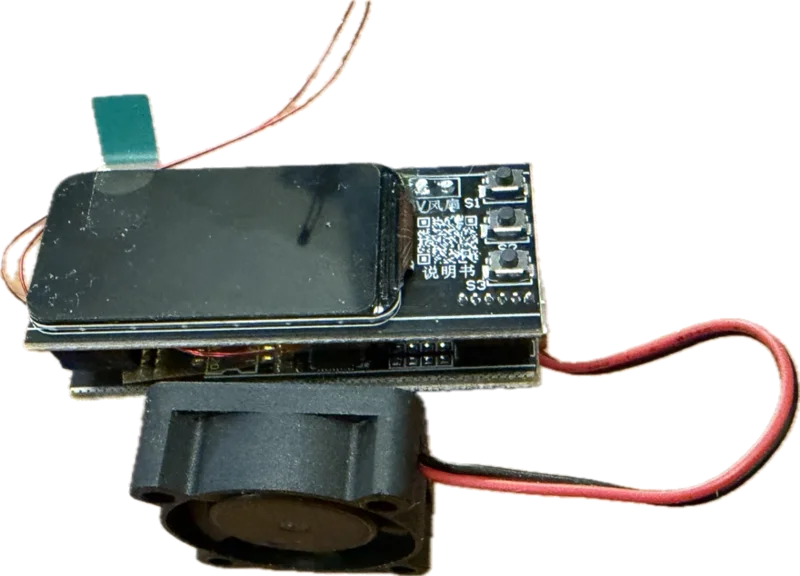

## Overview

The [IP2366 power management chip](https://done.land/components/power/powersupplies/battery/chargers/charge-discharge/ip2366/) and the power electronics consisting of MOSFETs and inductor work at high efficiency, but even at >90% efficiency, significant excess heat is produced and can sum up to almost 14 W. 

The board is rated for up to 140 W power but due to its minimal size does not provide adequate thermal mass to dissipate heat.

So when you operate the board without adding a cooling concept, as soon as you exceed 30 W, you will see the internal thermal protection in the IP2366 activate in intervals. At around 100 W, for example, the chip cuts power every few seconds, rests a few seconds for cool down, then repeats. This obviously is severely impacting charging and hurts the longevity of chip and components.

Fortunately, adding an effective cooling concept is neither hard nor expensive.

| Cooling Concept  |  Maximum Power | Remarks |
| --- | --- | ---  |
| none | 30 W | assuming sufficient passive air flow |
| small heat sinks | 45 W | assuming sufficient passive air flow |
| small heat sinks + 2006 fan | 60 W | 5 V fan, 20 mm size, 6 mm thickness |
| small heat sinks + 3010 fan | 100 W | 5 V fan, 30 mm size, 10 mm thickness |
| heat sinks + 2x 3010 fan | 140 W | any increase in fan airflow allows for 140 W, you can also use a stronger single fan and/or a considerable larger thermal mass |

The display board comes with a temperature-controlled 5 V fan connector already, and adding small heat sinks and fitting a 5 V fan is all that is left to do. 

If 100 W power is sufficient, you can keep the two-PCB sandwich design and produce surprisingly small housings:

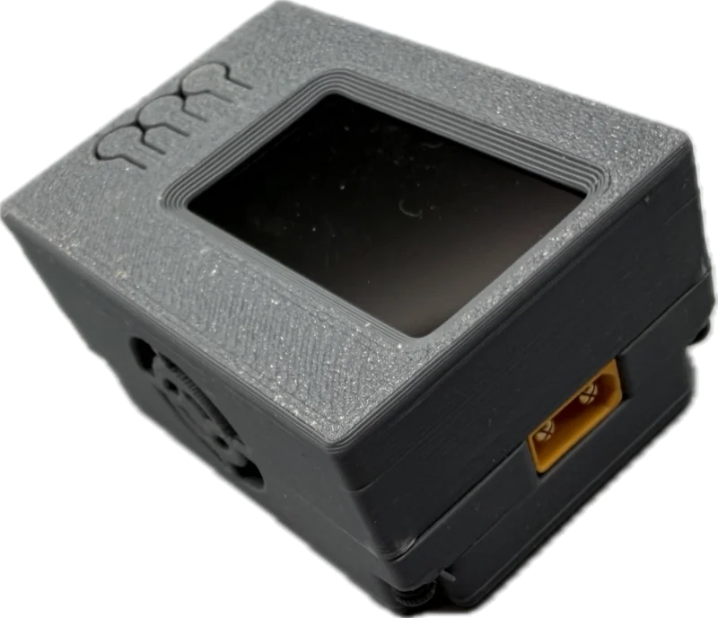

## Cooling Concepts

Operating this board (and IP2366-based solutions in general) must therefore keep three parameters in sync:

- **Power Reduction:**    
  IP2366 is configurable, and you do not need to run it at full 140 W. In fact, even 30 W - its lowest setting - may be plenty of power for many use cases. Translated to i.e. 3S batteries, it allows for roughly 3 A of charging currents.    

  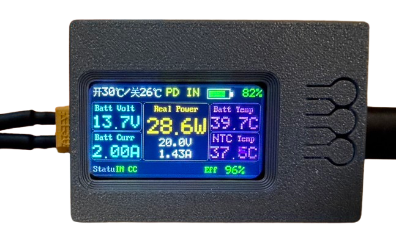

  At 30 W maximum output, the board does not require any additional cooling and can be operated as-is, enabling extremely small fan-less designs.

- **Passive Cooling:**   
  The **mandatory first step** in your cooling concept should be adding small passive heat sinks to all affected components: IP2366 chip, MOSFETs, and inductor. If you want to keep the original two-PCB design, choose flat heat sinks, and insulate their top properly, i.e. with Kapton tape, to not cause chor circuits when adding the PCBs back together.

  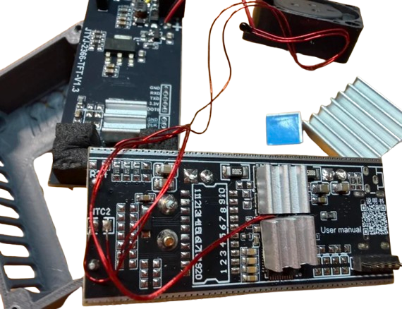

  Adding passive heat sinks is *always* required. An active fan alone is not sufficient, regardless of how strong it is, due to the poor thermal conductance of the affected components. With passive cooling alone, you can increase operating power to around 45 W if your housing allows for sufficient passive air flow.

- **Active Cooling:**    
  Active cooling becomes key once you exceed 45 W but is always benefitial. Since the display board comes with a 5 V fan output, all you need is a 2- or 3-wire 5V fan (when using a 3-wire fan, remove the yellow `TACHO` wire). 
  
  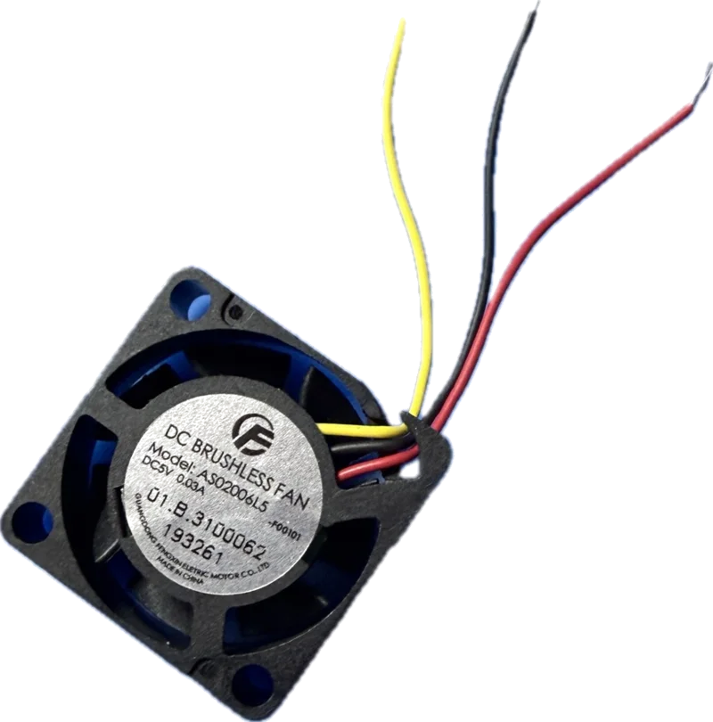

  The smallest effective fan is **2006** (up to 60 W). Larger and/or stronger fans allow for higher power (i.e. **3010** for up to 100 W).

  **IMPORTANT:** Adding just a fan and skipping heat sinks will not work well. The components under thermal stress need a way to rapidly transfer heat, and their plastic housings cannot adequately transfer much heat directly to the air.

## Fitting Heat Sinks

The most efficient cooling concept for me was the combination of small heat sinks and a fan. If you want to skip the fan, you need to use significantly larger heat sinks.

Heat sinks need to be placed on the IP2366 chip, on the MOSFETs and the cubic inductor marked `220`: 

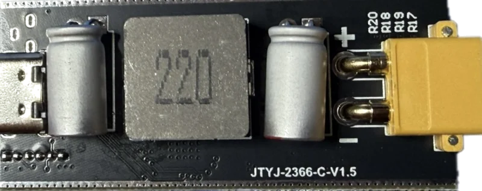

The IP2366 is most important as it cuts off power when it gets too hot. I also placed a heat sink on the Puya MCU however that is really not necessary.

As you see in the picture, the size of the heat sinks can be rather small. It is more important to use good thermal adhesive, and to position the "fins" of the sinks in the direction of fan airflow.

### Insulation

Since heat sinks electrically conduct, if you want to keep the original two-PCB sandwich design, make sure you insulate the sinks or the opposing surface properly, i.e. with Kapton tape.

### NTB Thermal Sensors

There are two NTC thermal sensors, one connected to each PCB. Place the NTC sensor of the display board next to the heat sinks. This sensor controls the fan speed. The other sensor that is connected to the base board is supposed to control battery temperature but often is not needed when building a stand-alone charger. In this case, place the other sensor next to other heat sinks so you can monitor your cooling concept.

## Fitting Fan

The display board and its firmware implements a temperature-controlled 5V fan and exposes two solder pads. When soldering the fan, make sure you (a) use correct polarity, and (b) connect fan wires from the backside. Space on the front side is limited, especially when you later plan to enclose the board.

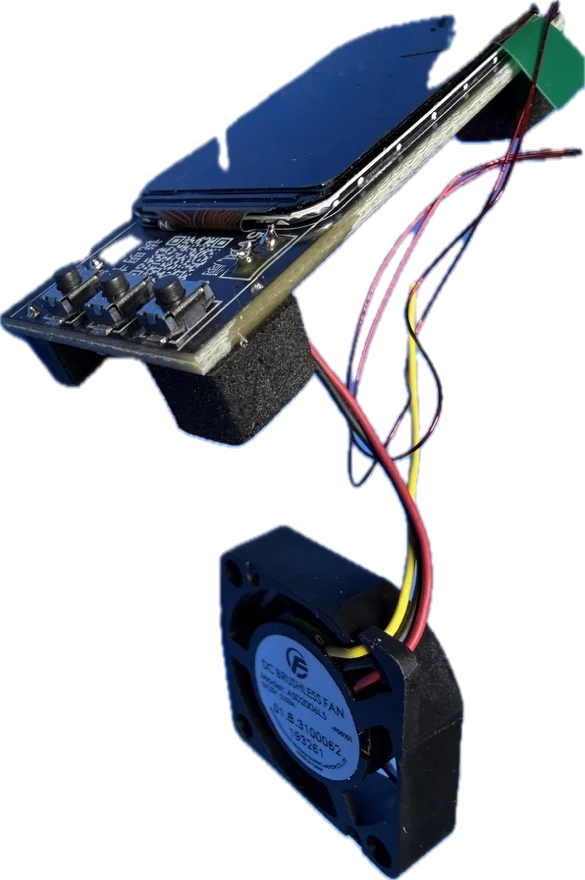

### Fan Direction
The direction of air flow is crucial: the fan needs to blow air onto the heat sinks. Typically, the labeled side of fans is the side that needs to face the heat sinks. If you accidentally mount the fan in the wrong direction, you'll immediately notice as there is almost no cooling effect, and the IP2366 will go into thermal shutdown quickly.

> [!NOTE]
> Suitable 5 V fans are typically marked with a four-digit number where the first two digits are the size and the second two are the width of the fan. If you want to fit the fan into the original 3D printed housing (see below), you need a `2006` (`2010` will not fit). If you want more than 60 W, design your own larger housing and use `3010`. Larger fans won't work well because the air flow must focus on the space between the two PCBs. Rather than using larger fans, use two smaller fans instead.   

### Enable Fan

Do not forget to activate the fan in the device settings. You can specify the activation and the shutdown temperature for the fan.

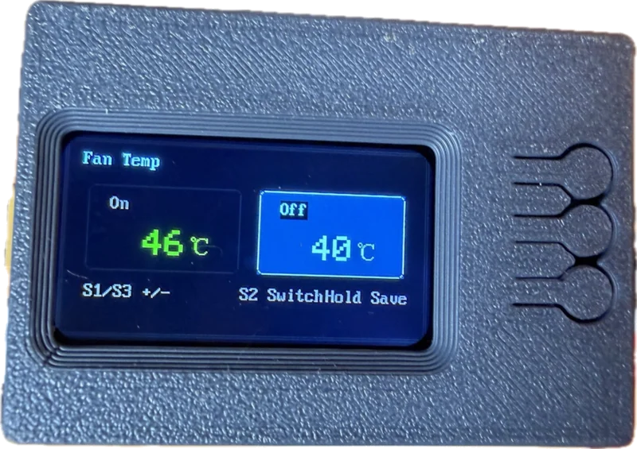

With higher power settings and relatively small heat sinks, you may want to activate the fan early (i.e. 30 degrees celsius) as temperature is rising quickly anyway. If you activate the fan only at higher temperatures, there may already be too much heat build-up for the fan to remove.

## Housing

The original developers of this board also [supply a `STL` design file](materials/housing_1.47.stl) for a small 3D-printable housing.

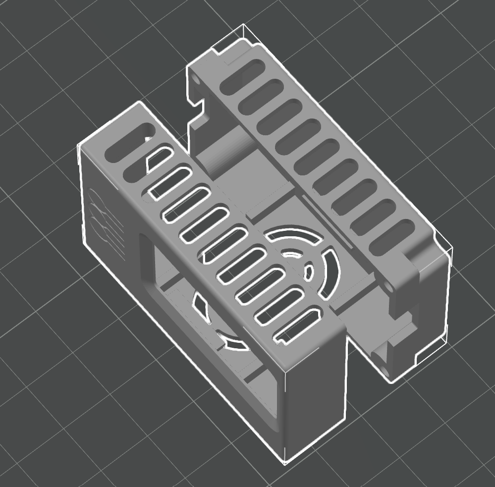

The housing provides space for a `2006` 5 V fan (`2010` does not fit). 

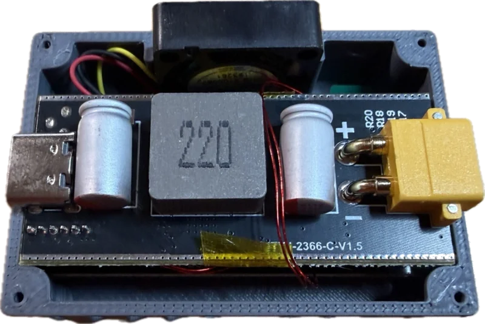

Four `M2` screws secure the cover:

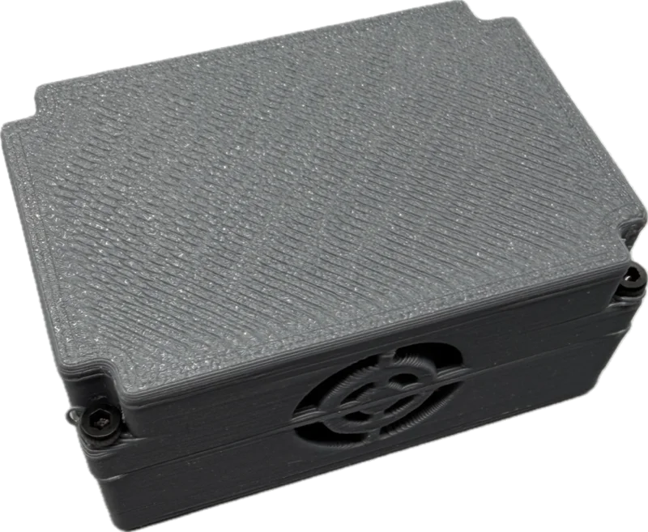

This gives you an extremely small universal charger, and provided you have added small heat sinks and the fan, it can operate continuously at a maximum of 60 W.

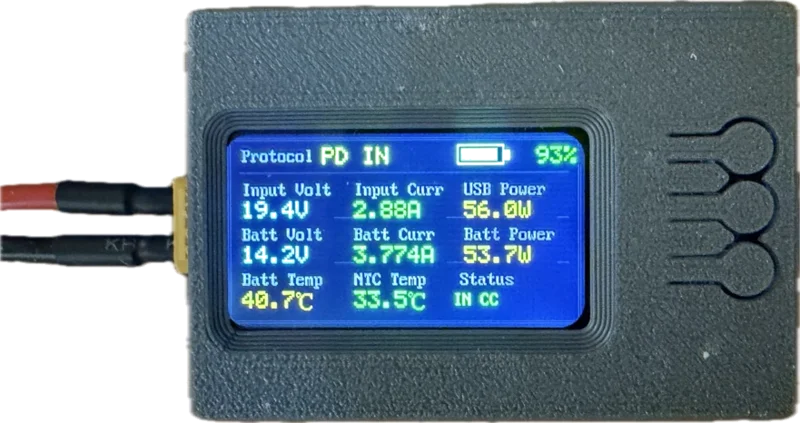

You do need a larger housing with a more powerful fan if you want to take advantage of the full 140 W that the IP2366 supports.

> Tags: IP2366, Charger, Cooling, Heat Sink, Fan, Power

## Materials

* [3D Housing STL File for 1.47" Display Version](materials/housing_1.47.stl)

[Visit Page on Website](https://done.land/components/power/powersupplies/battery/chargers/charge-discharge/ip2366/boards/displayboard/coolingandperformance?187586111406265209) - created 2026-11-05 - last edited 2026-11-05
