# Programmable Charger

> A Touchscreen, Browser-Controlled and ESP-NOW-enabled 2–6S Lithium Battery Charger Built Around an I²C-Capable IP2366 Board.

The [IP2366 Display Board](https://done.land/components/power/powersupplies/battery/chargers/charge-discharge/ip2366/boards/displayboard/) is a capable and very affordable board with a working I²C interface. Out-of-the box, it is a capable powerbank controller.

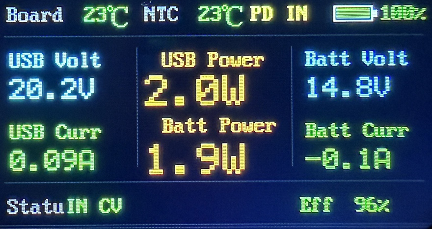  

Thanks to its I²C interface, it can be repurposed for a variety of things, for example as a universal 2-6S Lithium battery charger.

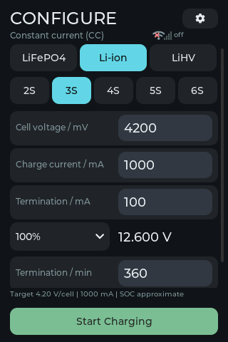

The [firmware can be found here](materials/firmware.bin), and the sources are available on github (click github button at the bottom of this page) in the *Source Code* subfolder.

## Overview

First of all, you do need the [IP2366 board with a display](https://done.land/components/power/powersupplies/battery/chargers/charge-discharge/ip2366/boards/displayboard/). There is also a cheaper display-less board that uses LEDs instead. However, the IP2366 on the display-less board has **no I²C functionality**, even if you remove the LED resistors.

> Of course, you can use *any* board with I²C-compatible IP2366, but the board I am using here is very affordable, is guaranteed to support I²C, and exposes all necessary pins.   

### I²C
I²C allows anyone to send instructions to the IP2366. This is how the display daughter board controls the chip, and this is also how you can modify the IP2366 behavior. 

To change the functionality and turn the powerbank controller i.e. into a universal charger, there are two routes:

* **Change Firmware for Existing MCU:**     
  The Puya microcontroller on the daughter board is fully programmable and exposes the SWD pins to upload new firmware. And in fact, the designer of this board claims the existing firmware is open-source.   
  
  So the most elegant approach would be to keep the daughter board and reprogram its firmware to create a universal charger.

  The board designers keeps all source code and tools in a Chinese **QQ Group** with the **ID 170681020**. QQ groups serve as a Chinese *github* but are open only for Chinese nationals. 

  So unless someone with access to QQ groups can help out, this route is closed.    
* **Create Your Own Controller:**    
  By removing the daughter board altogether, you get access to the raw I²C pins of the IP1266 controller. Adding your own controller opens up a variety of options, as now you can program the IP2366 in any way you want, and you can use any microcontroller of your choice.

  Using this route has a number of advantages: select your favorite microcontroller, possibly with much more RAM and radio support, and stay in your comfort zone. You are now also free to use any display size you want, and optionally add touch screens.

### Hardware Overview

In this project, I am using the affordable and readily available [Guition JC3248W535 3,5" ESP32-S3 Touch Display Board](https://done.land/components/microcontroller/families/esp/esp32/developmentboards/esp32-s3/guitionjc3248w535/) as a host controller:

* Plenty of RAM
* Large Display
* Enclosure
* Touch Screen
* Radio for Remote Control

This tablet is then connected via I²C to the base board of the [IP2366 Display Board](https://done.land/components/power/powersupplies/battery/chargers/charge-discharge/ip2366/boards/displayboard/). 

The daughter board with the display and the original Puya microcontroller is not used.

### Design Objective

Using the IP2366 board as a universal charger that leverages the IP2366 capabiliies:

* **Strings:**   
  Support 2-6S batteries    
* **Chemistry:**   
  Support all lithum chemistries, including LiFePo4, LiIon, LiPo, LiHV
* **Charging Current:**   
  Support charging currents in the range of 100 mA to 9.5 A.    
* **Storage:**   
  Support charging batteries to a configurable percentage, i.e. 50% for storage.    
* **Monitoring:**    
  Monitor battery charging with a V-I-Graph and temperature, and lower charging current and/or abort charging when temperature exceeds a threshold.  
* **Dead Batteries:**    
  Include support for trying to charge 0 V-batteries with a much reduced "reviving" current.

#### Control
The device should be controllable in a variety of ways:

* **Manual:**  
  via touch screen, i.e. to intuitively and easily configure and run the charger stand-alone     
* **Remote:**   
  via web interface, i.e. to check the charger status from elsewhere   
* **Automated:**   
  via *ESPNow* radio, i.e. for automated testing or lab scenarios

The choice for wireless *ESPNow* remote control was based on simplicity. It has a very low latency and works reliably in close range.

Using a wired solution like I²C would have defeated the purpose, because then you could as well directly access the IP2366 board over its own I²C interface. In fact, this project keeps the interaction with the IP2366 separated in a library, so if you want I²C, simply skip the tablet host controller, and instead use the library to interface your lab gear directly with the IP2366.

One challenge with *ESPNow* is that it has dependencies with WiFi (must use the same radio channel), and when the unit is connected to home WiFi (vs. its own hotspot), the WiFi channel can change any time. This needed to be addressed by implementing a fallback where the tablet actively searches for a new radio channel if ESPNow heartbeat breaks.

## Wiring

Wiring is extremely simple.

### I²C

#### Tablet
On the tablet side, [connector `P3`/`P4`](https://done.land/components/microcontroller/families/esp/esp32/developmentboards/esp32-s3/guitionjc3248w535/#p3-and-p4-ic) is used. You either need a QWIIC 1.0 or a JST 1.25 4-pin connector.

  

Pin assignment follows the [QWIIC Standard](https://www.cable-tester.com/i2c-pin-out-qwiic-from-sparkfun-electronics/).

| Connector Pin (left to right)  | Assignment |
| --- | --- |
| `GND` | Ground |
| `VCC` | 3.3V |
| `IO17` | `SDA`|
| `IO18`| `SCL` |

#### IP2366 Board

The IP2366 base board has a 1.25 mm pitch 6-pin header that is normally used to connect the daughter board.

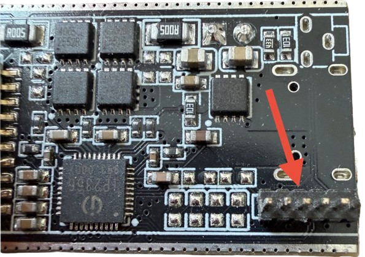  

Pins are (from left to right, from inside to outside):

| Pin | Description | Remark |
| --- | --- | --- |
| 1 | `GND` | |
| 2 | `ENABLE` | not used by the original display board |
| 3 | `INT`| keep `HIGH` to prevent IP2366 from sleeping |
| 4 | `SDA` | I²C |
| 5 | `SCL`| I²C |
| 6 | `BAT+` | **WARNING:** battery pack voltage, can be very high and powerful. Short circuits are dangerous and can destroy the board. Use with suitable buck converter to power the host. 

One of the simplest ways to connect these pins is using a 6-pin JST 1.25 connector: the pitch matches, and the connector slides firmly on the pins. You can of course also solder wires to the pins.

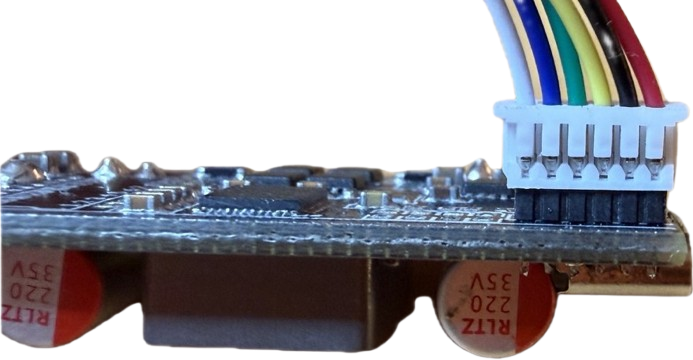

#### Pull-Up Resistors

The IP2366 board does not use I²C pull-up resistors, so you need to provide them. The datasheet recommends 2.3K resistors. I used 10K resistors with no issues.

### Keep-Awake: `INT`

You need a way to keep the IP2366 awake even when it does not charge so it stays responsive, i.e. to initiate another charging cycle. Else, you would have to manually "wake up" the chip by unplugging and re-plugging the USB-C power cable.

There are two routes you can take:

* On the IP2366 board, pull `INT` to `HIGH`. This prevents the charger from going into standby mode.
* Turn off *Automatic Standby* via I²C register `0x09`, bit 7	(`En_Standby`):	0 = disable standby; 1 = allow standby.

I opted for both. To pull `INT` to `HIGH` with the tablet, you need another GPIO. Connector `P2` exposes 8 additional GPIOs and requires a 8-pin JST 1.25 connector:

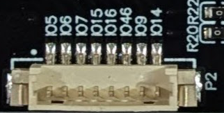  

For the `INT` signal, I selected `IO6`. 

**IMPORTANT:** `IO5` is already used internally by the tablet to determine the battery voltage through a voltage divider.

> [!NOTE]
> If you have no 8-pin connector at hand, you may want to try and skip this connection altogether. The firmware already disables sleep via I²C, and that should be good enough. Only when the IP2366 does become unresponsive after charging completed, add this connection.   

## Objectives

The objective is to turn an affordable IP2366 powerbank/charger board into a configurable laboratory battery charger. A Guition ESP32-S3 touchscreen tablet replaces the original display daughterboard, sets the charging parameters through I²C, and presents measurements, charging history and results. The IP2366 performs the electrical CC/CV regulation; the tablet supervises configuration, session timing, communication and user interaction.

The same charger can be operated locally, from a browser, or by other ESP32 equipment through the LabLink ESP-NOW protocol. All three routes use the same controller and validation rules. The display is useful on its own, the web dashboard makes long sessions convenient to monitor, and ESP-NOW provides a starting point for coordinated lab automation.

The implementation supports **2–6 series cells**, LiFePO₄, conventional Li-ion/LiPo and LiHV voltage settings, and a **100 W battery-side application limit**. Its purpose is configurable charging and monitoring, rather than replacing the battery pack's BMS or providing cell balancing. Pack-specific voltage and current limits still come from the battery specification. A pack described simply as “LiHV” does not necessarily permit 4.4 V per cell.

The original article also outlined ambitions such as temperature-dependent current reduction and a dedicated dead-battery revival procedure. These should not be confused with completed features: the present firmware displays temperature but does not implement a temperature-based charging algorithm, and its explicit no-battery override is not a qualified battery-revival program.

## Features

### 1. Touchscreen configuration for several lithium chemistries

The CONFIGURE screen selects chemistry, series-cell count, per-cell end voltage, charging current, target charge percentage, termination current and maximum duration. LiFePO₄, Li-ion/LiPo and LiHV use different defaults and charging-reference curves. The firmware checks the profile as a whole, including the relationship between requested charging current and termination current, before enabling the charger. No chemistry or series-cell count is silently selected on a fresh setup.

### 2. Validated ranges and a 100 W charging limit

Series-cell count is 2–6S. The configurable per-cell end voltage is 2500–4400 mV in 10 mV steps; charging current is 100–9700 mA in 100 mA steps; termination current is 50–750 mA in 50 mA steps. These are interface limits, not a guarantee that every combination is suitable for a battery or that every board/supply can deliver the maximum. The application reduces effective current to stay within its 100 W target-voltage policy and separately stops an active charge if raw measured battery power exceeds 100 W. The chip's power setting is configured with the agreed 140 W headroom.

### 3. Partial-charge and storage targets

Target charge level is selectable from 0 to 100% in 10% steps. At 100%, the entered cell voltage is used as-is. Below 100%, the firmware obtains a voltage from the selected chemistry's charging curve, caps it at the entered cell voltage, and rounds down to the IP2366's 10 mV step. This reduced voltage is programmed into the chip as its CV target. Reaching that voltage starts CV taper; it does **not** immediately end the session. Normal completion comes from the IP2366. The earlier experimental full-voltage/software-cutoff approach was reverted.

### 4. Explicit review before starting

Start Charging opens a summary showing charging voltage, string count, cell voltage, charge level, termination current and termination time. CANCEL is red and OK is green. For partial targets, the effective target voltage is also identified, so the full configured voltage is not mistaken for the programmed partial-charge voltage. Starting requires confirmation of the reviewed profile; changed or stale settings are rejected instead of being applied silently.

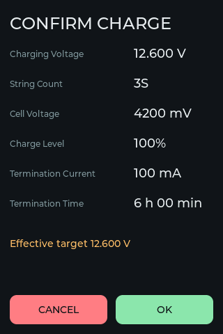

### 5. Numeric keyboard with clear and cancel

Numeric entry opens an on-screen keyboard. CLEAR empties the selected input without closing the keyboard; CANCEL restores the value from before editing and closes it. The keyboard's checkmark uses the same soft green as the other confirmation buttons. Settings dialogs also provide explicit Apply and Cancel actions. These controls make accidental field taps recoverable without starting a charge.

### 6. Maximum charging duration

The CONFIGURE field **Termination / min** is the software maximum duration, expressed in whole minutes. Its built-in default is **360 minutes: six hours**. Valid values are 1–65535 minutes. When elapsed time exceeds the selected limit, the tablet stops charging and reports “Termination time reached.” This is distinct from current-based completion: the timeout ends a session even if the chip has not declared the battery full. A displayed 150 minutes / 2 h 30 min is a restored or edited setting, not the built-in default.

### 7. Live voltage, current, power, temperature and delivered totals

The charging screen shows pack voltage, charging-current magnitude, instantaneous power, elapsed time and NTC temperature. The power tile stacks delivered **mAh above mWh**. The second header row shows chemistry and the configured mDNS name before the WiFi indicator. The tablet's compact layout keeps the readings visible while the graph covers the entire charging session. The browser shows the same metrics with more space; its power label is “Charging power.”

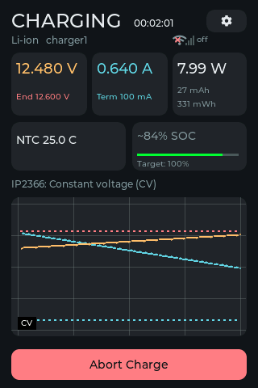

### 8. Full-session graph rather than a moving window

The graph retains the beginning of a charge instead of discarding old points after 300 samples. PSRAM stores twelve hours of one-second source history, satisfying the original requirement for at least ten hours. A reduced projection preserves both traces' extrema and timestamps: up to 240 plotted points on the tablet and 300 in the browser. Beyond the raw-storage capacity, progressive compaction retains the full session span with reduced detail. The graph remains available after completion and while preparing another charge, until a new charge starts or the tablet reboots; history is not a flash-backed session archive.

### 9. Independent graph scales and dotted references

Voltage uses a fixed session scale from the chemistry's discharge-end pack voltage through the effective target plus 1 V. Current runs from zero through effective charging current plus 300 mA. A red dotted horizontal line identifies the charge-voltage target, and a cyan dotted line identifies termination current. Voltage is orange and current cyan, matching the numeric readings. Each trace has its own vertical scale: a crossing of the two lines has no physical voltage/current equivalence.

### 10. Measured CC/CV transition markers

Gray vertical lines and white CC/CV labels in black rectangles mark **estimated behavior**, independently of the chip's state register. Falling current near the target indicates CV; rising voltage below the target with sufficiently steady current indicates CC. A three-sample median suppresses isolated spikes, and trends are fitted over approximately 5–10 seconds at the normal sampling rate. A new mode must then remain supported for at least five seconds before a marker is committed. The first confirmed mode labels the graph's beginning. Detection has a deliberate delay; ambiguous periods keep the last confirmed mode.

Marker X positions use elapsed timestamps and the same full-session duration as the traces. They are not indexed into the 300-point projection. Dense labels may be skipped or grouped to avoid overlap. These markers describe observed trends, not a change to the actual charger regulation or protection logic.

### 11. Chip-reported status remains visible

The text below the tablet's temperature/SOC row is prefixed **IP2366:** and decodes register 0x31. Relevant states include standby, trickle, constant current, constant voltage, waiting, full and charging timeout. The initial Charger/CONFIGURE view also exposes chip status. This status can differ from the measured graph markers: the chip has been observed to report CV well before a visible current taper. Completion still uses the chip's completion flag, not a graph marker or an SOC estimate.

### 12. Warning icons and communication-fault handling

Warnings use an icon plus an explicit message in the appropriate dialog, status area or Summary. Initial detection retries once per second and advances automatically when the charger is found. After a failed IP2366 register transaction, the driver probes address **0x75**. Failure to acknowledge produces “IP2366 was disconnected.” If the address responds but register communication fails for more than five consecutive attempts, the warning is “IP2366 communication instable.” Active sessions stop and do not resume automatically after recovery.

Other visible warnings include missing battery confirmation, WiFi/AP fallback, remote-owner heartbeat loss and unconfirmed charger disable. “Charger disable NOT confirmed” means the firmware attempted to stop but could not verify it through the hardware connection; it is not shown merely because charging is active. Warning icons/messages are implemented, but there is **no separate timestamped warning-event marker track** on the graph.

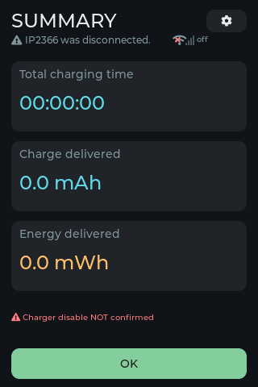 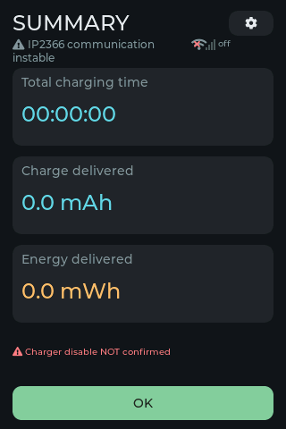

### 13. Charging-based SOC estimation and target-relative progress

SOC uses manufacturer charging-terminal-voltage references: LiFePO₄ and Li-ion at approximately 1C, and the approved LiHV reference at 0.5C. The same tables are used in reverse for percentage-based voltage targets. Capacity and actual C-rate are generally unknown, so voltage-derived SOC is approximate and cannot replace a coulomb-counting fuel gauge. Temperature, current, pack resistance and CV taper all affect its interpretation.

Before IP2366 confirms completion, the displayed estimate is capped at **target minus one percentage point**: 99% for a 100% goal, or 69% for a 70% goal. After completion it may reach, but not exceed, the selected target. The vivid green progress bar is relative to that target: 60% SOC toward a 70% goal fills 85.7% of the bar. A zero-percent goal is handled without negative values or division by zero.

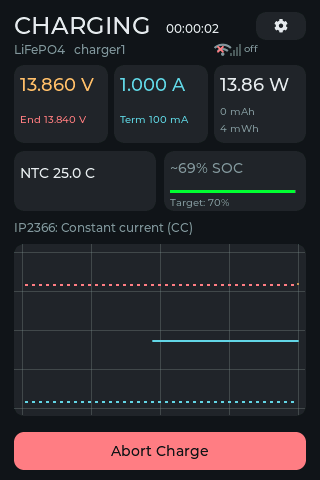

### 14. Voltage and current calibration

Settings offers **Voltage Calibration (mV)** and **Current Calibration (mA)**, each defaulting to zero and accepting signed offsets from −5000 through +5000. The voltage offset applies to the **whole pack**, not each cell. Offsets are added once to telemetry: for example, 12525 mV plus −105 mV displays 12420 mV. Corrected readings feed visible values, power, graph/SOC/trend estimates, delivered mAh/mWh and ESP-NOW telemetry. Results clamp to the unsigned measurement range to avoid negative wraparound.

Calibration does not alter the chip's voltage/current setpoints, hardware completion flag, startup pack checks, or the raw-measurement power protection. Diagnostics retains both raw ADC and corrected readings. Changes during a session apply going forward: old graph points and accumulated totals are not recalculated, and the interval spanning the calibration change is omitted. Both offsets persist independently of charger-profile persistence.

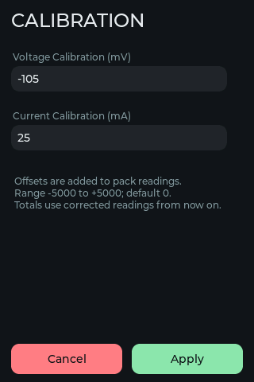

### 15. NTC temperature monitoring

The fitted sensor model is **10 kΩ at 25 °C, B3850**, not the initially assumed 50 kΩ NTC. The firmware reads the chip's actual 20 µA / 80 µA excitation indication before and after the NTC voltage reading and derives resistance and temperature from a stable sample. Diagnostics exposes the raw voltage, bias and inferred resistance. Unusable readings are marked unavailable. Temperature is monitoring-only in this firmware; the pack BMS and any board-level protection remain responsible for their own limits.

### 16. Persistent preferences and optional charger defaults

WiFi, ESP-NOW, friendly name, mDNS, calibration and the persistence checkbox are always saved when applied, independently of charging. **Persist charger config** controls only the charge profile: the selected chemistry, cells, voltage, current, percentage, termination current and duration become saved defaults when a charge is started. Editing a profile without starting does not save it as the next boot default. Restoring preferences never automatically starts a charge.

### 17. Recovery when the tablet reboots during charging

Before initialization disables/resets charger operation, the tablet takes a read-only snapshot when charge enable is on and measured battery current is greater than zero. Cell count, target voltage, charge current and termination current come from the chip. Saved chemistry and percentage information is recovered only if it matches that snapshot. Without a match, register-derived defaults are offered for review. This makes manual resumption convenient while keeping the deliberate stop and explicit Start after reboot.

### 18. WiFi, mDNS, access point and fallback

WiFi can join an existing network or create an access point. Its setup dialog edits SSID, password and mDNS/AP name; the default mDNS name is **charger1**, giving **http://charger1.local/** where mDNS is supported. The network status also provides an address for direct access. Join/reconnection failure falls back to an access point after approximately 15 seconds and warns on the tablet. The header shows WiFi state and signal strength numerically in dBm; disabled WiFi uses a crossed-out icon. The firmware's bundled connection defaults can be changed in Settings.

### 19. Responsive browser interface

The browser has separate **Charger, Graph, Summary, Settings and Diagnostics** tabs. It follows the tablet's colors and typography while using the browser's available width; it is not a transmitted pixel-for-pixel screenshot. Compact JSON carries state and history, while JavaScript renders cards, controls and the graph locally. There is no framework or font CDN dependency. The interface works at desktop and mobile widths and can configure, review, start and abort a charge through the same controller as the touchscreen.

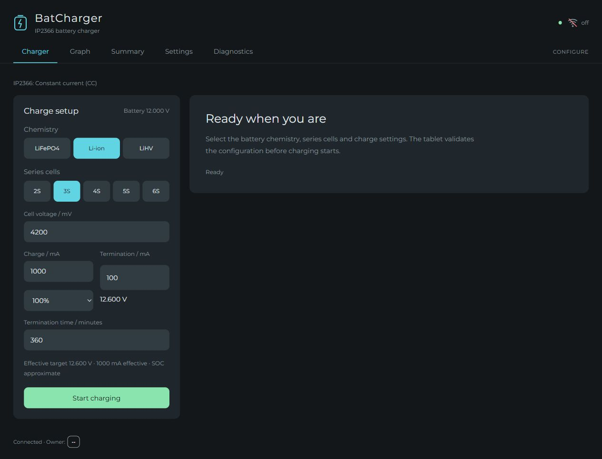

### 20. Web graph, retained results and PNG/PDF export

The web Graph tab can be revisited after a charge ends. It shows voltage, current, charging power, NTC temperature, SOC/progress, elapsed time, mAh and mWh, together with full-session traces and mode markers. **Save as PNG** and **Save as PDF** sit in the upper right, above the voltage/current legend and aligned with chip status. The browser generates the export locally. The Summary tab reports results; energy there is presented in Wh. Its footer shows connection status and a rounded white owner badge: TABLET, WEB or REMOTEHOST. This identifies the session's start origin; it is distinct from whether a browser is connected.

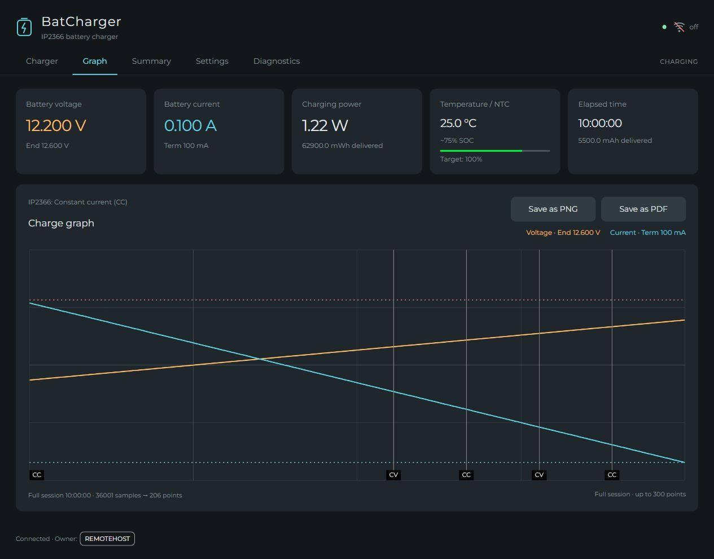

*This synthetic ten-hour stress fixture illustrates full-span reduction and marker placement. Its deliberately constructed curves and event positions are not a physical CC/CV measurement.*

### 21. Browser responsiveness without blocking charging

Charger access and LVGL run on the main task. A separate web/network task serves coherent cached snapshots and submits typed commands through bounded queues; it does not directly operate the charger. ESP-NOW forwarding has its own bounded radio task. Browser requests are serialized through response-body consumption, interrupted read requests may retry once, and control POSTs are never blindly replayed. This prevents a lost HTTP response from silently issuing another Start. Browser connection errors therefore need not mean the tablet's charging task has stopped.

### 22. ESP-NOW / LabLink lab automation

ESP-NOW provides unencrypted local communication between ESP32 lab devices. Discovery advertises equipment category **0x0001 Charger**, a stable ID derived from the station MAC, a per-boot ID, channel and a friendly name. **Settings → ESPNow setup** edits the friendly name, default **Charger**, with a 31-byte limit. It is independent of the WiFi/mDNS name. Multiple instruments may share a friendly name because unique IDs distinguish them. No wire-format change was needed to expose the name in the tester.

The category scheme is extensible: 0x0002 Electronic Load, 0x0003 Current Meter, 0x0004 SMBus Adapter, 0x0005 Power Supply and 0x0006 USB PD Trigger. Capabilities describe access, units, ranges and steps. Charger telemetry and complete-profile Start/Abort commands use explicit units and versioned, bounded messages; the hardware's unsigned current magnitude is not invented into a signed charge/discharge measurement.

### 23. Subscribers, ownership and channel recovery

Up to eight distinct client identities can subscribe per charger boot. An ESP-NOW-started charge is owned by the initiating device/boot/session and expects a heartbeat about once per second. Loss of valid owner heartbeats stops that charge after approximately ten seconds; manual and web sessions continue when an ESP-NOW observer disappears. Commands and confirmations are bound to identity/session and protected against duplicate execution and stale replays. Recovery does not automatically restart a stopped charge.

WiFi and ESP-NOW share the radio channel. The charger follows its configured WiFi/AP channel; it does not hop away from that network to follow an observer. The tester/client searches permitted channels and reacquires the selected instrument after a channel change. ESP-NOW without WiFi networking uses the project's default channel 6.

### 24. Separate tester tablet and extensible device screens

A second identical tablet can run **LabEspNowTester**. Devices discovers instruments and displays the advertised friendly name, type and unique ID. Selecting a device opens its device-specific screen; Inspect and Log provide shared diagnostic functions. Charger capability/configuration reads, telemetry, explicit control and owner-loss behavior can be exercised without making the tester a practical end-user instrument. Registered screens can match category/capabilities or exact device ID, with a generic read-only fallback for unknown devices. Current-meter support is an extension of the shared LabLink package; it does not add meter hardware code to the charger tablet.

### 25. Reusable driver, register enforcement and diagnostics

The separate IP2366Control library encapsulates charger on/off, configuration, voltage/current reads, validation and masked register updates. It preserves unrelated/reserved bits, verifies writes and treats failed reads as invalid. The chip's automatic standby is disabled through 0x09 bit 7, and GPIO6 keeps INT high through 10 kΩ. Live status and target-voltage checks run at 500 ms; the remaining configured fields are audited at 2000 ms. Disputed read-only status registers are not “corrected” with writes.

Gear opens Settings by default, with Diagnostics as the other tab. Diagnostics shows firmware version, raw/corrected measurements, current-limit encoding, status/fault bytes, NTC bias and communication evidence. No USB serial terminal is required for normal configuration, monitoring or diagnostics. Completion, abort and faults attempt to disable the charger and retain the stop reason; the UI reports whether disable was actually confirmed.

## Parts list

| Quantity | Part | Purpose / selection |
| --- | --- | --- |
| 1 | I²C-capable IP2366 display-version charger board | The build uses the display-board base with its six-pin daughterboard header. Remove the original controller/display daughterboard from that header. Do not assume a visually similar LED-only IP2366 board supports I²C. |
| 1 | Guition JC3248W535C_I_Y ESP32-S3 tablet | Capacitive-touch 3.5-inch 320 × 480 display, enclosure, 16 MB flash and 8 MB PSRAM. The touchscreen and display wiring are internal. |
| 1 | Four-pin tablet cable | Use P3's 1.25 mm connector or P4's 1.0 mm QWIIC connector, checking actual pin markings/orientation. They expose the same signals. |
| 1 | Eight-pin 1.25 mm P2 cable | Provides GPIO6 for INT keep-awake. Only the required GPIO6 wire is used in this build. |
| 1 | Six-pin 1.25 mm connection to IP2366 header | Suitable mating harness as demonstrated in the original article, or soldered wires. Verify the actual board and contact fit. |
| 3 | 10 kΩ resistors | Two I²C pull-ups to tablet 3.3 V and one GPIO6-to-INT resistor. |
| As needed | Wire, insulation, secure battery connector and suitable protection | Battery-current wiring is separate from the low-current signal harness and must suit the pack/current. |
| 1 | USB-C PD supply and appropriately rated cable | Powers the IP2366 charging input. Available battery power depends on supply, negotiated voltage, cable and conversion losses; 140 W chip configuration is not proof of delivered power. |
| 1 | Regulated 5 V / USB-C tablet supply | A separate tablet supply keeps the signal harness simple. Do not connect the pack-voltage header pin to the tablet's 3.3 V or 5 V input. |
| 1 | Suitable protected 2–6S battery | Pack chemistry, allowed voltage/current and BMS behavior must match the selected configuration. |
| As fitted | 10 kΩ / B3850 NTC and its existing board connection | Temperature monitoring as used in this project; this guide does not redefine the board's protection wiring. |
| Optional | Second identical tablet | Runs the separate LabEspNowTester firmware. Not required for touchscreen or web operation. |

The [tablet board reference](https://done.land/components/microcontroller/families/esp/esp32/developmentboards/esp32-s3/guitionjc3248w535/) and [IP2366 display-board article](https://done.land/components/power/powersupplies/battery/chargers/charge-discharge/ip2366/boards/displayboard/) provide photographs and hardware background. The original README's Puya/SWD discussion is an alternative controller-development route; it is not part of this tablet build.

## Wiring

### Signal schematic

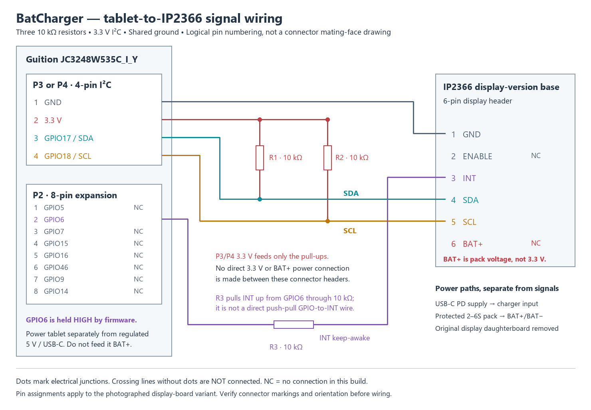

[Open the scalable SVG schematic](images/wiring.svg). Pin numbers are logical assignments, not a statement about which face of a plug is being viewed. Match the board's markings and the photographs before wiring.

### Tablet four-pin I²C connector: P3 or P4

P3 is the four-pin 1.25 mm connector; P4 is the four-pin 1.0 mm QWIIC connector. Both expose the same nets. This firmware explicitly assigns **GPIO17 = SDA** and **GPIO18 = SCL**; it does not rely on a generic ESP32 board's default I²C pin names. Internal touchscreen I²C remains on GPIO4/GPIO8 and is independent.

| Tablet pin | Function | Connect to |
| --- | --- | --- |
| 1 | GND | IP2366 display-header pin 1, GND |
| 2 | 3.3 V | Upper ends of the two 10 kΩ I²C pull-ups only |
| 3 | GPIO17 / SDA | IP2366 display-header pin 4, SDA; also one 10 kΩ pull-up to 3.3 V |
| 4 | GPIO18 / SCL | IP2366 display-header pin 5, SCL; also one 10 kΩ pull-up to 3.3 V |

Each I²C signal needs its own pull-up. The **10 kΩ values are the demonstrated project build**, not a promise that every cable length/capacitance meets timing with them. The IP2366 I²C interface is 3.3 V. Tablet 3.3 V is used as the pull-up reference, not as a power supply for the charger's battery circuit.

### Tablet eight-pin expansion connector: P2

| P2 pin | GPIO | Use here |
| --- | --- | --- |
| 1 | GPIO5 | Not connected; already used internally by the tablet's battery-voltage divider |
| 2 | GPIO6 | Through **10 kΩ** to IP2366 INT, header pin 3 |
| 3 | GPIO7 | Not connected |
| 4 | GPIO15 | Not connected |
| 5 | GPIO16 | Not connected |
| 6 | GPIO46 | Not connected; strapping pin |
| 7 | GPIO9 | Not connected |
| 8 | GPIO14 | Not connected |

GPIO6 is driven HIGH during operation, pulling INT up **through** the resistor. The path is GPIO6 → 10 kΩ → INT, not a direct push-pull connection to INT and not a resistor to pack voltage. This retains the agreed keep-awake connection while the firmware also disables automatic standby. The original article discusses omitting INT as an alternative; the schematic here documents the complete build with INT connected.

### IP2366 display-board six-pin header

The source article's photographed board exposes the following header assignments. Its display daughterboard is not used in this build; the tablet becomes the controller.

| Header pin | Signal | This project |
| --- | --- | --- |
| 1 | GND | Common ground with tablet P3/P4 pin 1 |
| 2 | ENABLE | Not connected |
| 3 | INT | P2 pin 2 / GPIO6 through 10 kΩ |
| 4 | SDA | Tablet GPIO17 |
| 5 | SCL | Tablet GPIO18 |
| 6 | BAT+ | **Not connected to the tablet harness**; this is battery-pack voltage |

Supply the IP2366 through its intended charging-power input and connect the pack to its intended battery terminals. Power the tablet from regulated 5 V/USB-C. The signal harness shares ground; it does not connect charger BAT+ to tablet 3.3 V. This distinction matters particularly with a 6S pack, whose voltage is far above tablet logic and supply limits. Connector pin 2 ENABLE is left unused rather than assigned an unverified function.

### Bring-up

Check the two pull-ups, common ground, SDA/SCL mapping, INT resistor and connector orientation before applying power. Firmware uses 7-bit I²C address **0x75**; 0xEA/0xEB are the corresponding direction-bearing bus bytes, not alternate 7-bit addresses. On boot, allow the automatic detection screen to advance. Use Gear → Diagnostics for version and raw readings, and compare a known voltage/current/temperature before trusting displayed measurements. A successful I²C read does not establish analog measurement accuracy.

## Firmware challenges and how they were addressed

The main challenge was treating the IP2366 as a real hardware interface rather than assuming conventional I²C and register behavior. Its documented preparation delay after address acknowledgment is awkward to express with the pinned Arduino Wire implementation, so charger communications use a dedicated open-drain software-I²C transport. Low-byte-first ADC pair reads, final NACK, delay handling, bounded recovery and masked readback were made explicit in the driver. GPIO17/18 serve this bus while GPIO4/8 continue to serve touch. The standalone driver keeps this hardware contract out of screen and web code.

Register persistence and startup required equal care. Clearing LOADOTP does not justify trusting settings forever; active status and desired writable settings are checked on their appropriate schedules. Startup initially mistook a transient missing-input indication for permanent input loss, so the controller gained a bounded waiting/recovery path. Later, boot-time read-only snapshots and saved-profile matching allowed useful defaults to survive a tablet restart during charging, without automatically resuming a charge.

Analog interpretation caused two distinct problems. The thermistor was actually 10 kΩ/B3850, and the IP2366 could use different excitation currents; assuming 50 kΩ and a fixed bias produced a convincingly formatted but wrong temperature. Voltage/current telemetry also proved different from independent measurements, particularly at low current. Diagnostics now exposes the raw evidence, and optional signed offsets correct telemetry/accounting while leaving raw protection and hardware regulation separate. A single offset is an approximation; an error that changes with current or voltage is not fully characterized by one calibration point.

SOC and phase indication needed more than cosmetic fixes. Rest/discharge curves were replaced by documented charging references, yet unknown capacity still prevents precise C-rate compensation. The display therefore labels SOC as estimated and prevents it from claiming the target before hardware completion. An experiment that retained full CV voltage and stopped on measured target voltage was reverted after premature cutoff behavior; percentage targets again program the chip's reduced CV voltage. Separately, early/chattering register CV reports motivated noise-filtered, sustained measured-trend markers. The raw status remains visible as IP2366 status so these two meanings are not conflated.

The first web implementation mirrored the framebuffer and exposed transfer/encoding problems, including a collision with Arduino's `word` macro. It was replaced by a lightweight JSON/JavaScript dashboard. Separating the network task from hardware/UI access and serializing browser requests improved responsiveness while preserving a single control path. Full-session graph reduction replaced a 300-point moving window; explicit timestamps keep both traces and markers aligned over long sessions. ESP-NOW added shared-radio channel recovery, per-session ownership, bounded queues and duplicate/replay handling so that a disappearing observer does not accidentally stop a manually started charge.

One compatibility observation remains unresolved: a particular 4S Lenovo LiHV pack accepted charging from a bench supply with the requested parameters but accepted little current from the IP2366 before it reported completion. The observed difference included the IP2366's ramping startup. No documented ramp-disable register was found in the supplied register map. This remains a startup/BMS interaction hypothesis, not a proven defect or a reason to bypass pack protection or ignore completion flags.

## Using the charger

1. Wait for automatic IP2366 detection and initialization.
2. Select chemistry, series cells and the pack manufacturer's allowed cell voltage/current on CONFIGURE.
3. Choose target percentage, termination current and **Termination / min**. Set 360 for six hours.
4. Enable **Persist charger config** if this started profile should become the saved default. Configure WiFi/ESP-NOW/calibration separately as needed.
5. Tap Start Charging, review the summary, then confirm. A missing/near-zero battery presents a separate **No battery detected. Proceed anyway?** decision; it is not automatic revival.
6. Watch the live graph/readings. Use Abort Charge to stop deliberately. Completion, timeout or faults retain a reason and totals.
7. Open Summary for results. In the browser, Graph remains independently accessible after the session.

## Additional simulated screens

### Tablet settings, WiFi and ESP-NOW

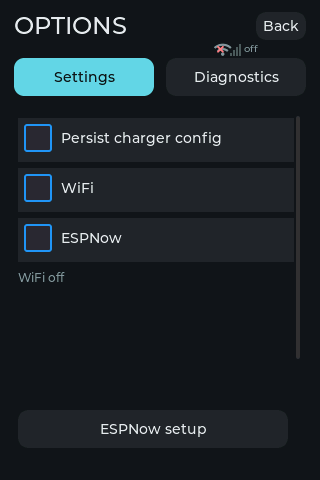 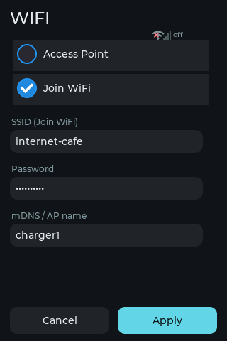 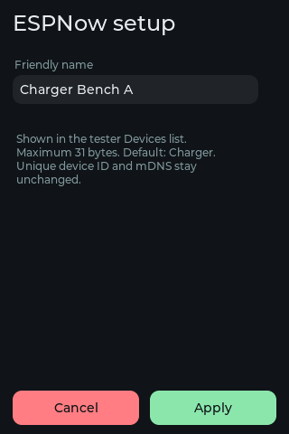

### Tablet results and diagnostics

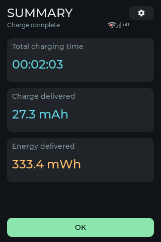 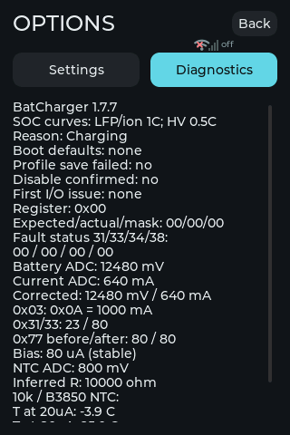 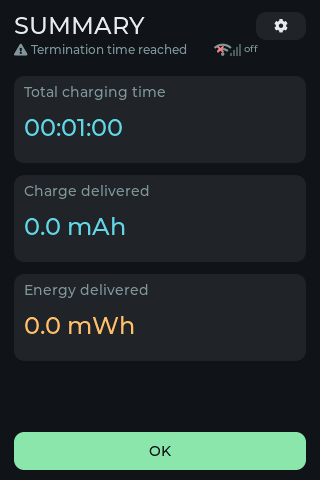

### Browser settings and results

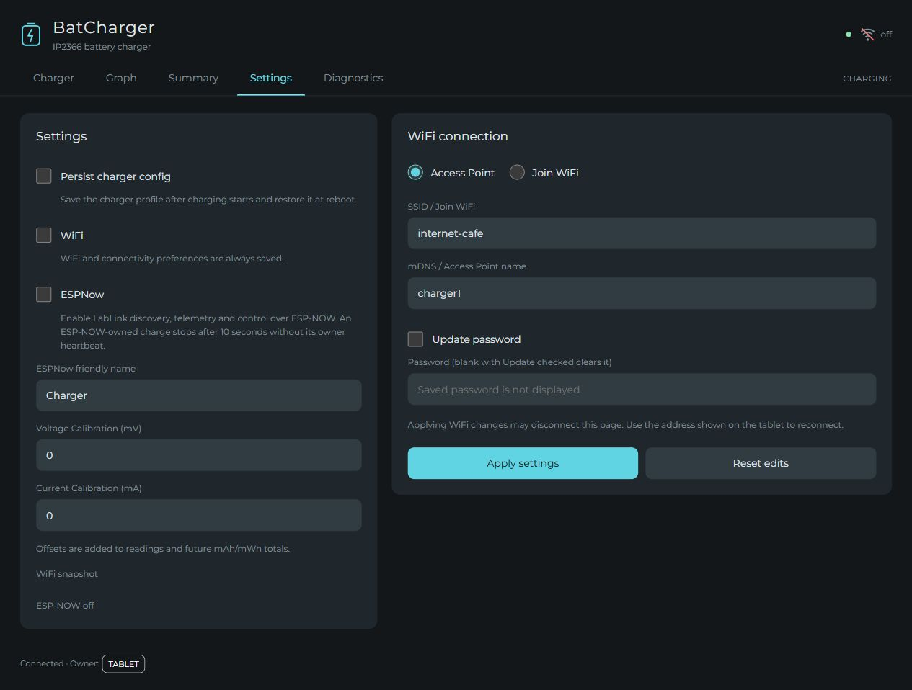

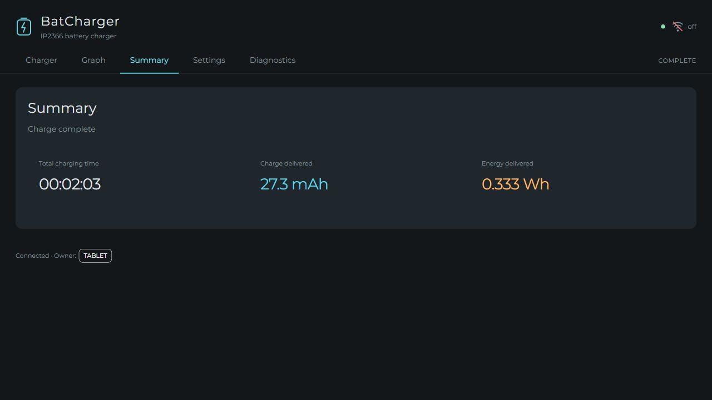

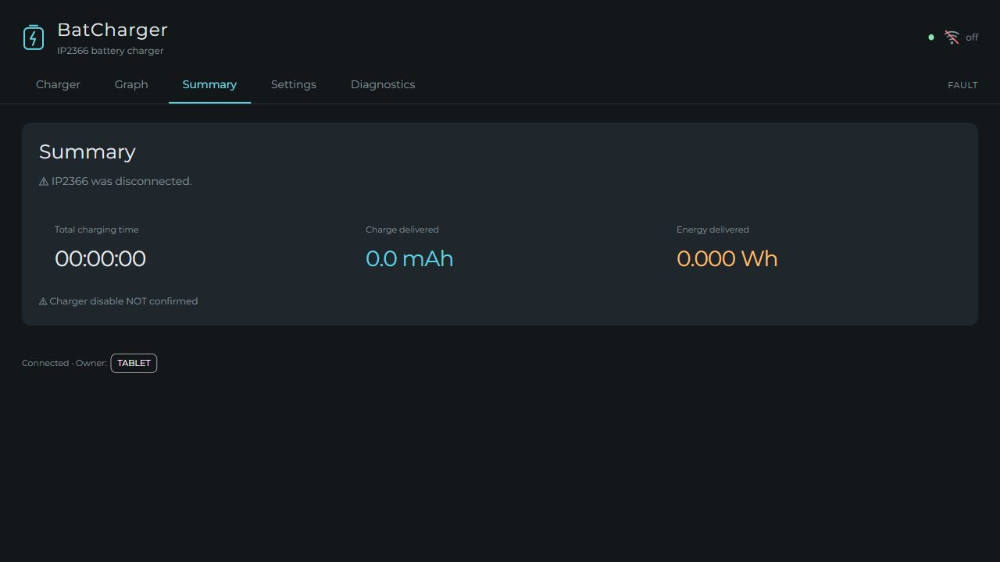

### Mobile browser

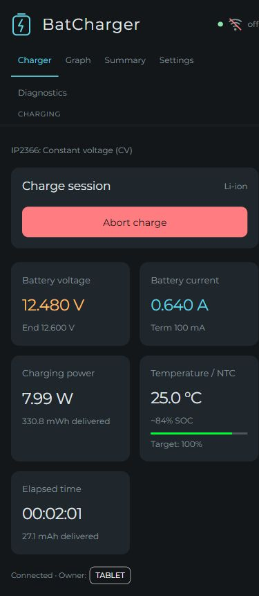

### Screenshot index

| Tablet simulation | Browser simulation |
| --- | --- |
| [Configuration](images/tablet-configure-ready.png) | [Configuration](images/web-configure.jpg) |
| [Start review](images/tablet-confirm-charge.png) | [Start review](images/web-confirm-charge.jpg) |
| [Numeric keyboard](images/tablet-keyboard-clear.png) | [Active Charger tab](images/web-charger.jpg) |
| [Live charge](images/tablet-charging.png) | [Live Graph tab](images/web-graph.jpg) |
| [Ten-hour full history](images/tablet-graph-ten-hours.png) | [Full-history markers and exports](images/web-graph-full-session.jpg) |
| [Partial-target SOC cap](images/tablet-graph-target-capped.png) | [Summary](images/web-summary.jpg) |
| [Settings](images/tablet-settings.png) | [Settings](images/web-settings.jpg) |
| [WiFi](images/tablet-wifi-setup.png) | [Diagnostics](images/web-diagnostics.jpg) |
| [ESP-NOW setup](images/tablet-espnow-setup.png) | [Fault/warning](images/web-warning.jpg) |
| [Calibration](images/tablet-calibration-edit.png) | [Mobile layout](images/web-mobile.jpg) |
| [Diagnostics](images/tablet-diagnostics.png) | |
| [Missing charger](images/tablet-missing.png) | |
| [No-battery decision](images/tablet-no-battery.png) | |
| [Disconnected](images/tablet-disconnected.png) | |
| [Unstable communication](images/tablet-unstable.png) | |
| [Remote owner lost](images/tablet-espnow-owner-lost.png) | |
| [Timed stop](images/tablet-timed-stop.png) | |

> Tags: IP2366, Charger, Firmware, QQ, Display, Puya, PY32F030K28, JTYJ-2366-C, I²C, QQ Firmware
