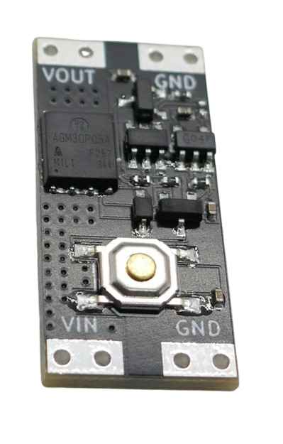
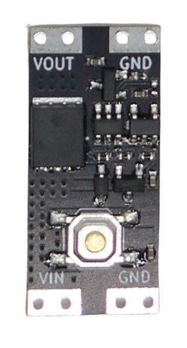
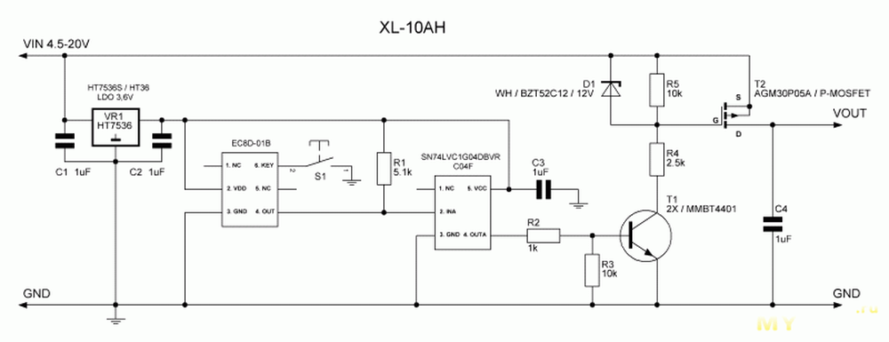

 
# XL-10AH

> Extremely Power-Efficient Bistable Switch With Quiescent Current Of Just 120nA Supporting  4.5–26 V 

The *XL-10AH* is a small breakout board with a highly power-efficient *bistable switch* at a quiescent current of just *1.3uA* that can switch up to **10 A** and supports a voltage range of **4.5-26 V**.

Because of this wide voltage range, it uses an on-board voltage regulator (unlike its "smaller sibling" [XL-10AL](https://done.land/components/signalprocessing/switch/bistableswitch/xl-10al/)).

The board is designed for manual operation via a push button. You can also control it from a microcontroller by pulsing the push button `LOW`. 

> [!NOTE]
> The primary difference between this **XL-10AH** and the [XL-10AL](https://done.land/components/signalprocessing/switch/bistableswitch/xl-10al/) is the voltage that can be switched. If you want to switch 3.3 V circuitry, i.e. to add a way for a microcontroller to turn itself off, use **XL-10AL**. That said, this **XL-10AH** has also worked well for switching 3.3 V circuitry, however its On-Resistance may be higher at this voltage.

## Overview
The board comes with four solder pads: *Vin* and *GND* are connected to the power supply (i.e. a battery), and *Vout* and *GND* are connected to the device you want to control. The voltage you feed in is the voltage you get out. 

A *push button* can be used to manually *toggle* the switch. 

When the built-in push button is pressed, it essentially pulls a pin in the circuitry to *low*. That's why you can toggle the switch via a *GPIO* or an external push button just as easily:

* **Programmatically:** pull down either one of the two marked solder pads **for a short period of time** with a microcontroller *GPIO*, simulating a button press.
* **External Button:** connect an external momentary push button (*normally open*) to *GND* and one of the two solder pads marked *GPIO low*.

### EC8D-01B
The [EC8D-01B](materials/EC8D-01B_English_Essentials.pdf) used on this board is an ultra-low-power electronic toggle-switch controller that changes its output state each time a momentary pushbutton is pressed. 

It operates at 2–5 V, consumes at most 2 µA in standby, and provides an active-low output (LOW when ON, high-impedance when OFF) suitable for controlling external switching circuitry.

### State Control
The board is a simple **toggle switch** so each new pulse to `GND` toggles its state. There is no built-in way to determine the active state because the board was designed for manual button operation.

If you want to use this board with microcontroller boards, i.e. to turn the microcontroller off programmatically, you may want to know the actual switch state.

To do so, you can utilize the state of `OUT`:

| Latched state |	Pin 4 (`OUT`) |
| --- | --- |
| OFF	|High impedance |
| ON |	Pulled LOW |

When `OUT` is pulled `HIGH`, the board uses the internal voltage regulator voltage (around 3.6 V), so unlike with [XL-10AL](https://done.land/components/signalprocessing/switch/bistableswitch/xl-10al/), 3.3 V microcontrollers do not need a protective diode necessarily.

## Voltage and Current

The vendor markets this *bistable switch* as *power switch* for *high currents* of up to *10A*, and the published specs apply to **high current use cases only**:

| Item | Value |
| --- | --- |
| **Current** | **max. *10A*** |
| Voltage | *3.5-5.4V* |
| Voltage Drop | max. *130mV* |
| Quiescent Current | *300nA* |

> For currents *>5A*, the voltage should be *>4V*, and an additional *heat sink* may be required.

### Microcontroller Use-Case
With **low currents** (around *200mA*, as is common in microcontroller projects), the specs look quite differently:

| Item | Value |
| --- | --- |
| **Current** | **max. *200mA*** |
| Voltage | *2.8-5.4V* |
| Voltage Drop | none |
| Quiescent Current | *120-300nA* |

### High Currents
This board can switch surprisingly high currents of up to *10A*, however when current exceeds *a few Ampere*, the voltage must be higher than *4.5V*. 

At lower voltages, the *MOSFET* can only handle *small* currents. If the *current* exceeds the transport capabilities of the *MOSFET*, its *resistance* raises, and the *MOSFET* heats up, causes a *voltage drop*, and can be destroyed.

> Tags: 3.3V, Bistable Switch, Low Power, Microcontroller, ESP32, Quiescent Current, Voltage Drop, MosFET, Vgs

[Visit Page on Website](https://done.land/components/signalprocessing/switch/bistableswitch/xl-10al?649702101615241329) - created 2024-10-14 - last edited 2026-10-26
