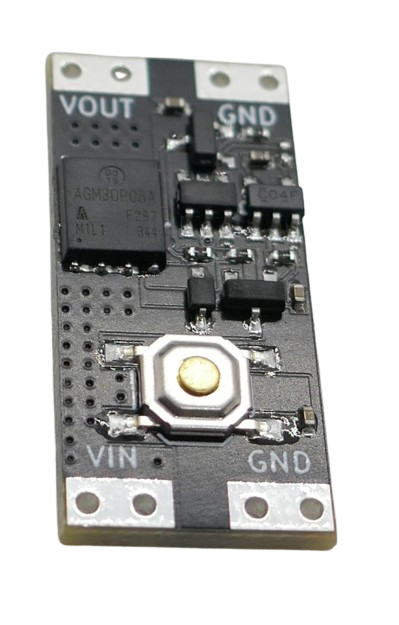
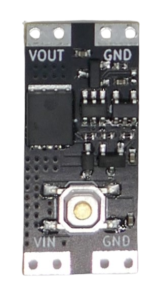
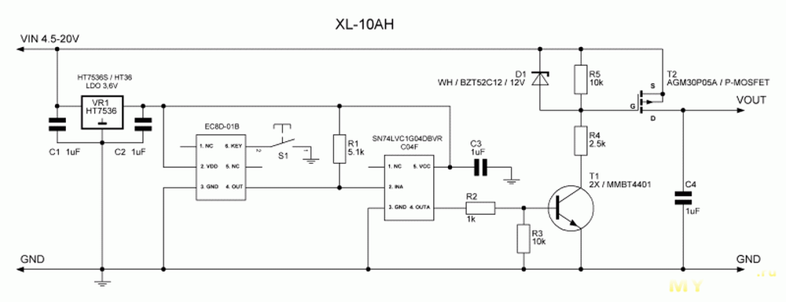
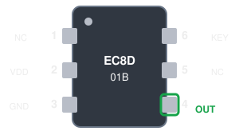

# XL-10AH
> Extremely Power-Efficient Bistable Switch With Quiescent Current Of Just 1.3µA Supporting 4.5–26 V 

The *XL-10AH* is a small breakout board with a highly power-efficient *bistable switch* at a quiescent current of just *1.3µA* (vendor measurement at *12 V*) that can switch up to **10 A** and supports a rated voltage range of **4.5-26 V**.

Because of this wide voltage range, it uses an on-board voltage regulator (unlike its "smaller sibling" [XL-10AL](https://done.land/components/signalprocessing/switch/bistableswitch/xl-10al/)).

The board is designed for manual operation via a push button. You can also control it from a microcontroller by pulsing the push button `LOW`. 

> [!NOTE]
> The primary difference between this **XL-10AH** and the [XL-10AL](https://done.land/components/signalprocessing/switch/bistableswitch/xl-10al/) is the voltage that can be switched. If you want to switch 3.3 V circuitry, i.e. to add a way for a microcontroller to turn itself off, use **XL-10AL**. That said, this **XL-10AH** has also worked well for switching 3.3 V circuitry, however its On-Resistance may be higher at this voltage.

## Overview

The board comes with four solder pads: *Vin* and *GND* are connected to the power supply (i.e. a battery), and *Vout* and *GND* are connected to the device you want to control. The voltage you feed in is the voltage you get out. 

A *push button* can be used to manually *toggle* the switch. 

When the built-in push button is pressed, it essentially pulls a pin in the circuitry to *low*. That's why you can toggle the switch via a *GPIO* or an external push button just as easily:

* **Programmatically:** pull down either one of the two marked solder pads **for a short period of time** with a microcontroller *GPIO*, simulating a button press.
* **External Button:** connect an external momentary push button (*normally open*) to *GND* and one of the two solder pads marked *GPIO low*.

### EC8D-01B

The [EC8D-01B](materials/EC8D-01B_English_Essentials.pdf) used on this board is an ultra-low-power electronic toggle-switch controller that changes its output state each time a momentary pushbutton is pressed. 

It operates at 2–5 V, consumes at most 2 µA at 3 V without load **for the controller IC itself** (not the entire module), and provides an active-low output (LOW when ON, high-impedance when OFF) suitable for controlling external switching circuitry.

### State Control

The board is a simple **toggle switch** so each new pulse to `GND` toggles its state. There is no dedicated status output pad, but you can determine the latched state by tapping into the switch controller's output.

If you use this board with microcontrollers, i.e. to let a microcontroller turn itself off programmatically, knowing the actual switch state can be particularly useful.

To do so, you can read pin 4 (`OUT`) of the EC8D-01B. Unlike the XL-10AL, this pin does **not** drive the power MOSFET gate directly: it feeds an inverter and NPN transistor driver. Its **5.1 kΩ pull-up resistor (R1)** connects to the on-board **HT7536 regulator's nominal 3.6 V output**, not to VIN.

| Latched state | EC8D-01B pin 4 (`OUT`) | Voltage at the board's `OUT` node (VIN present) |
| --- | --- | --- |
| OFF | High impedance | Approximately 3.6 V, via R1 |
| ON | Pulled LOW | Approximately 0 V |

You can solder to pin 4 or the connected R1/inverter-input node shown in the schematic. This senses the **commanded latch state**, rather than independently confirming that VOUT is delivering power.

#### Reading `OUT` With a 3.3 V Microcontroller

A nominal **3.6 V** is at the [ESP32 GPIO HIGH input limit of VDD + 0.3 V](https://documentation.espressif.com/esp32_datasheet_en.html) when the ESP32 runs at 3.3 V. A direct connection often works in practice while the ESP32 is powered, but there is no tolerance margin and the regulator can output slightly more than 3.6 V. It is therefore worth **measuring the voltage** instead of assuming that every board outputs exactly 3.6 V. See the [HT7536 regulator specifications](https://www.holtek.com.tw/webapi/11842/HT75xx-3v150.pdf).

For additional margin, use the same **1N4148 diode** circuit described for the [XL-10AL](https://done.land/components/signalprocessing/switch/bistableswitch/xl-10al/): anode to the ESP32 input with its own 3.3 V pull-up, cathode (striped end) to `OUT`. The GPIO reads **LOW when ON** and **HIGH when OFF**.

> [!NOTE]
> The XL-10AH needs VIN and a common GND for this measurement. If the module is unpowered, an ESP32 input with a pull-up also reads HIGH: that alone cannot distinguish an OFF latch from missing VIN. Also consider an unpowered ESP32 when making a direct GPIO connection, since the module can then feed current into its input-protection circuitry.

## Voltage and Current
The vendor markets this *bistable switch* for loads of up to *10A*. Unlike the XL-10AL, the XL-10AH includes a regulator and a separate MOSFET gate driver to support higher input voltages. Its [published specifications](https://www.laskakit.cz/user/related_files/datasheet_xl-10ah_l_v1_en.pdf) are:

| Item | Value |
| --- | --- |
| **Current** | **up to *10A*** (vendor test at *12V* for *30 minutes*) |
| Voltage | *4.5-26V* (vendor rating) |
| Voltage Drop | *120mV* (measured at *12V*, *10A*) |
| Quiescent Current | *1.3µA* (OFF state, measured at *12V*) |

> [!IMPORTANT]
> The vendor **does not recommend continuous 10A use below 7V**, because of overheating. Even at higher voltages, the 10A figure is based on a *30-minute test*, not a verified continuous-duty thermal rating. Check the actual MOSFET temperature and voltage drop under your operating conditions.

> [!NOTE]
> The reverse-engineered XL-10AH schematic shown above is labeled **VIN 4.5–20V**, whereas the vendor specification states **4.5–26V**. This discrepancy has not been resolved by independent testing; take particular care near the advertised upper voltage limit.

### Microcontroller Use-Case

With **low currents** (around *200mA*, as is common in microcontroller projects), the voltage drop should be far smaller than the vendor's *120mV at 10A* figure. It is not literally zero, however, and no specific low-current voltage-drop measurement is available here.

| Item | Value |
| --- | --- |
| Example Load Current | *200mA* (not a maximum) |
| Rated Input Voltage | *4.5-26V* |
| Voltage Drop | Load-dependent; not separately measured at *200mA* |
| Quiescent Current | About *1.3µA* at *12V* in the OFF state; varies with VIN |

The *XL-10AH* has reportedly also worked at *3.3V*, but that is **outside its rated input range**, and the regulator and gate-drive circuitry may behave differently there. For reliable low-voltage operation, the [XL-10AL](https://done.land/components/signalprocessing/switch/bistableswitch/xl-10al/) is the better choice.

### High Currents

This board can switch surprisingly high currents of up to *10A* under the vendor's test conditions. At lower voltages the P-channel MOSFET may not be driven as effectively, so its ON-resistance and heating can increase. For **sustained 10A** operation, follow the vendor's warning about supply voltages **below 7V**, and verify thermal performance in the actual installation.

> Tags: 3.3V, Bistable Switch, Low Power, Microcontroller, ESP32, Quiescent Current, Voltage Drop, MosFET, Vgs

[Visit Page on Website](https://done.land/components/signalprocessing/switch/bistableswitch/xl-10ah?159457101127265250) - created 2026-10-26 - last edited 2026-10-26
