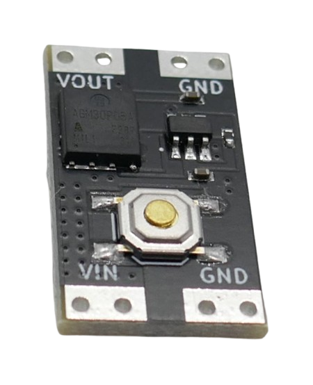
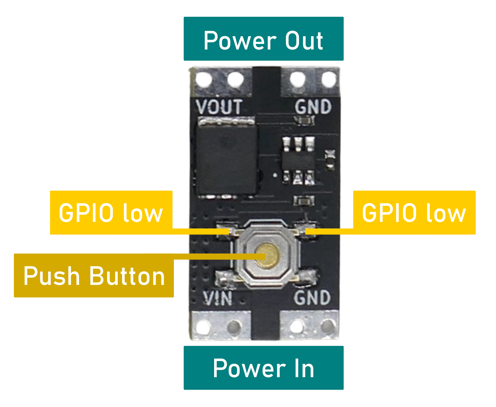
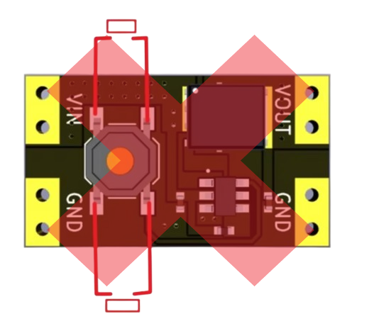
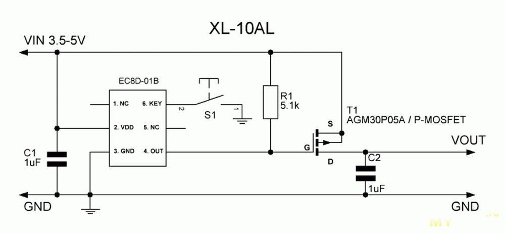
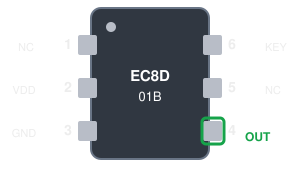
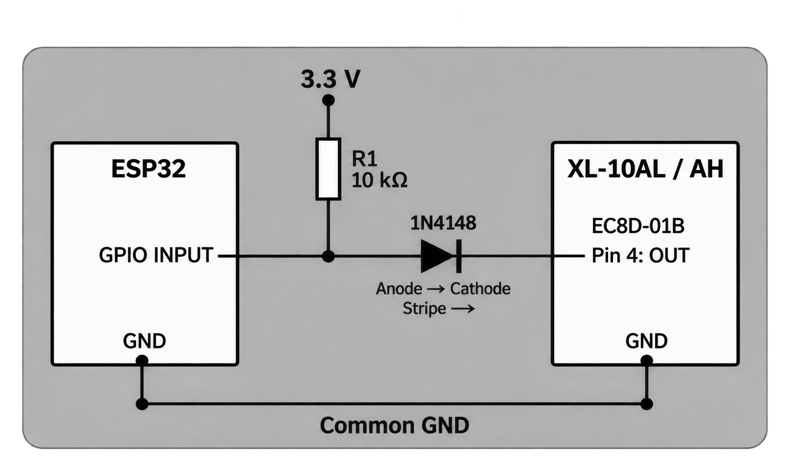
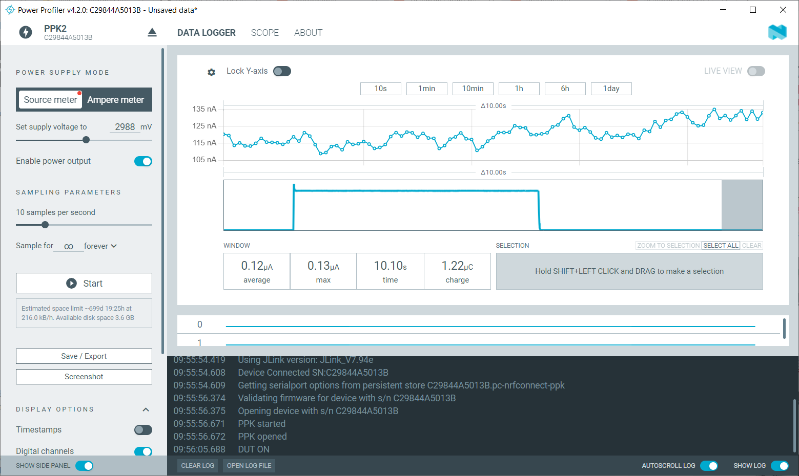

 

# XL-10AL

> Extremely Power-Efficient Bistable Switch With Quiescent Current Of Just 120nA That Works With 3.3V

The *XL-10AL* is a small *12.8x22.7mm* breakout board with a highly power-efficient *bistable switch* that works both with *3.3V* and *5V* microcontrollers at just *120-350nA* quiescent current.

> [!NOTE]
> The **10AL** in *XL-**10AL*** stands for **10A** and **l***ow*, and there is also a *XL-10A***H**. The **H** stands for **h***igh* and refers to the *voltage range*: it can handle voltages from *4.5-26V* (i.e. if you wanted to switch *12V car electric*) 

## Overview

The board comes with four solder pads: *Vin* and *GND* are connected to the power supply (i.e. a battery), and *Vout* and *GND* are connected to the device you want to control. The voltage you feed in is the voltage you get out. 

A *push button* can be used to manually *toggle* the switch. 

When the built-in push button is pressed, it essentially pulls a pin in the circuitry to *low*. That's why you can toggle the switch via a *GPIO* or an external push button just as easily:

* **Programmatically:** pull down either one of the two marked solder pads **for a short period of time** with a microcontroller *GPIO*, simulating a button press.

* **External Button:** connect an external momentary push button (*normally open*) to *GND* and one of the two solder pads marked *GPIO low*.

### Caveat

The vendor has published instructions on how to connect external buttons and added this **misleading image** for illustration:

It appears as if you could *toggle* the *bistable switch* either by *pulling up* one pin, or by *pulling down* another pin. That's however not the case.

The labels *VIN* and *GND* in the image refer to the power connectors and do not relate to the push button. Both *left* push button contacts are interconnected, and both *right* push button contacts are interconnected as well.

So *both external push buttons* in this drawing do exactly the same and *short-circuit* the built-in push button.

Since the *left* side of the push button is connected to *GND*, *toggling* is performed by pulling the *right* side of the push button to ground - either by pressing the *built-in push button*, or by short-cutting the *built-in push button* with an external button, or by pulling either one of the right contacts to *low*.

### EC8D-01B

The [EC8D-01B](materials/EC8D-01B_English_Essentials.pdf) used on this board is an ultra-low-power electronic toggle-switch controller that changes its output state each time a momentary pushbutton is pressed. 

It operates at 2–5 V, consumes at most 2 µA at 3 V without load **for the controller IC itself** (not the entire module), and provides an active-low output (LOW when ON, high-impedance when OFF) suitable for controlling external switching circuitry.

### State Control

The board is a simple **toggle switch** so each new pulse to `GND` toggles its state. There is no dedicated status output pad, but you can determine the latched state by tapping into the switch controller's output.

If you use this board with microcontrollers, i.e. to let a microcontroller turn itself off programmatically, knowing the actual switch state can be particularly useful.

To do so, you can read pin 4 (`OUT`) of the EC8D-01B. In the XL-10AL, this pin connects directly to the P-channel MOSFET gate and to a **5.1 kΩ pull-up resistor (R1) tied to VIN**:

| Latched state | EC8D-01B pin 4 (`OUT`) | Voltage at the board's `OUT` node (VIN present) |
| --- | --- | --- |
| OFF | High impedance | Approximately VIN, via R1 |
| ON | Pulled LOW | Approximately 0 V |

You can solder to pin 4 or the connected R1/MOSFET-gate node, as shown in the schematic. This senses the **commanded latch state**, rather than independently confirming that VOUT is delivering power.

> [!NOTE]
> The module must have VIN and share GND with the microcontroller. With VIN disconnected, `OUT` does not give a valid latch indication; an ESP32 input with a pull-up would read HIGH even if the module is unpowered.

#### Caveat: 3.3 V Microcontrollers

In the OFF state, R1 pulls `OUT` up to `VIN`. Since the board is rated for 3.5–5.4 V, that could put **5 V on an ESP32 GPIO** if you connected it directly.

To isolate the GPIO from this higher voltage, use a diode. It blocks current from the module's HIGH pull-up while allowing `OUT` to pull the GPIO `LOW` when the switch is `ON`.

Use a standard **1N4148 signal diode**, with its **anode connected to the ESP32 GPIO** (pulled up to the ESP32's own 3.3 V) and its **cathode (striped end) connected to `OUT`**. The pull-up can be an external **10 kΩ** resistor as in the drawing, or the ESP32's internal pull-up; this resistor is separate from the module's 5.1 kΩ R1.

The GPIO then reads **LOW when ON** and **HIGH when OFF**, as long as the XL-10AL is powered. Configure the GPIO as an input with a pull-up, not as an output.

## Voltage and Current

The vendor markets this *bistable switch* as *power switch* for *high currents* of up to *10A*, and the published specs apply to **high current use cases only**:

| Item | Value |
| --- | --- |
| **Current** | **max. *10A*** |
| Voltage | *3.5-5.4V* |
| Voltage Drop | max. *130mV* |
| Quiescent Current | *300nA* |

> For currents *>5A*, the voltage should be *>4V*, and an additional *heat sink* may be required.

### Microcontroller Use-Case

With **low currents** (around *200mA*, as is common in microcontroller projects), actual measurements look quite differently. These are **observed test conditions**, not new maximum ratings:

| Item | Value |
| --- | --- |
| Test Current | *200mA* (not a maximum) |
| Tested Voltage Range | *2.8-5.4V* (below 3.5 V is outside the vendor rating) |
| Voltage Drop | No noticeable drop at the tested current |
| Quiescent Current | *120-300nA* (depending on operating conditions) |

### 3.3V Microcontroller

Operating the *XL-10AL* with *3.3V* is officially *out of spec* but entirely possible: as long as you switch *small currents*, the MosFET works just fine. 

With currents around *200mA* (as is common in microcontroller projects),  voltages below *3V* perform well, and the quiescent current in *off* state is much smaller than *300nA* (around *120nA*). Another benefit is the absence of any noticeable *voltage drop*.

To verify, the graph below shows a measurement series at *2.98V* input voltage (simulating a nearly empty *LiIon battery*), and drawing a current of *200mA*:

The graph in the middle shows that *200mA* could be delivered ok in *on* state. In *off* state, the quiescent current is merely *120nA* in the average.

### High Currents

This board can switch surprisingly high currents of up to *10A*, however when current exceeds *a few Ampere*, the voltage must be higher than *4.5V*. 

At lower voltages, the *MosFET* can only handle *small* currents. If the *current* exceeds the transport capabilities of the *MosFET*, its *resistance* raises, and the *MosFET* heats up, causes a *voltage drop*, and can be destroyed.

> Tags: 3.3V, Bistable Switch, Low Power, Microcontroller, ESP32, Quiescent Current, Voltage Drop, MosFET, Vgs

[Visit Page on Website](https://done.land/components/signalprocessing/switch/bistableswitch/xl-10al?649702101615241329) - created 2024-10-14 - last edited 2026-10-26
