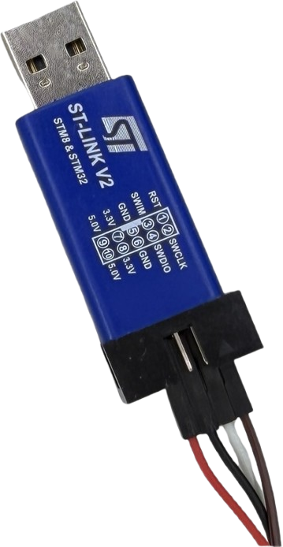
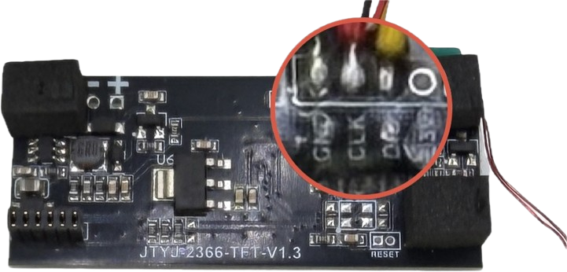
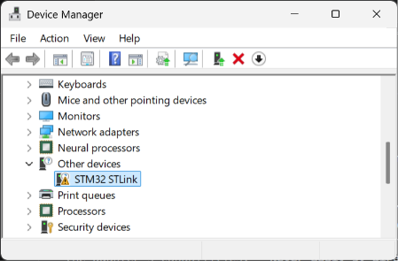
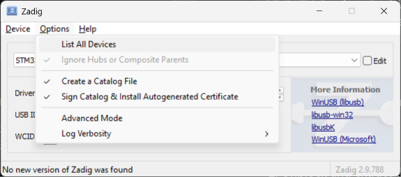
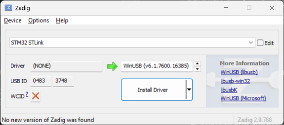
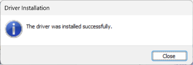

 
# SWD Debug Probe

> Direct Hardware-Level Access to Microcontrollers through Serial Wire Debug (SWD)

An **SWD Debug Probe** connects a PC to a microcontroller to flash firmware, read memory, and debug programs. 



It targets STM32 microcontrollers, but can also work with other ARM Cortex-M devices, including Puya PY32, provided the debugging software and probe firmware support them. 

Connections to the microcontroller typically use either **UART** or **SWD** (*Serial Wire Debug*). In this article, I am using **SWD** to connect to a running microcontroller externally, and extract its firmware. **SWD** requires just three wires: `GND`, `SWDIO`, and `SWCLK`.





## Overview

**SWD Debug Probes** range from inexpensive USB adapters to professional debugging tools. The **ST-Link V2 Mini**, available from AliExpress for around €3, is one of the cheapest options and provides basic firmware flashing, memory access, and debugging, primarily for STM32 microcontrollers. 

Alternatives include **CMSIS-DAP probes**, which offer broader compatibility with ARM Cortex-M devices, **J-Link** from SEGGER, which provides faster transfers and advanced debugging features, and **ST-Link V3**, which offers higher performance and additional interfaces. 

For occasional firmware extraction, programming, and hobby electronics projects, the inexpensive ST-Link V2 Mini is often sufficient, provided the target MCU is supported by the software and its memory is not readout-protected.

## ST-LINK V2 Mini

The **ST-Link V2 Mini** is an inexpensive USB programming and debugging adapter. It connects a PC to a microcontroller through the **SWD (Serial Wire Debug)** interface, allowing users to upload firmware, read flash memory, and debug programs. 

### Connections

The compact ST-Link V2 Mini USB dongle typically provides six connections: **3.3V, 5V, GND, SWDIO, SWCLK, and RST**.

| Pin | Function | Description |
|---|---|---|
| 3.3V | Power | 3.3V output to power the target board |
| 5V | Power | 5V output for compatible target boards |
| GND | Ground | Common ground between adapter and target |
| SWDIO | Data | Bidirectional SWD data line |
| SWCLK | Clock | SWD clock signal |
| RST | Reset | Optional MCU reset connection |

At the other end, a USB-A connector plugs directly into the PC.

### Powering Microcontroller

The ST-LINK adapter itself is powered through the USB port. It provides both `3.3V` and `5V` pins that can be used to power the microcontroller under test. 

However, do this only if the **microcontroller has no own power supply**.

If the microcontroller runs on its own power supply, **leave the adapter's `3.3V` and `5V` power outputs disconnected**. Just connect `GND` to establish a common ground, along with `SWDIO` and `SWCLK` for communication. Else, both power supplies may fight each other.

These instructions apply to the common six-pin ST-Link V2 Mini clones with power outputs. Other ST-Link models may have a dedicated target-voltage sensing input that must be connected even when the target is independently powered.

## Installation

Simply plug in the adaoter in any USB-A port on your PC.


### Verify Correct Installation
The adapter LED immediately gives you a status:

| LED | Status |
| --- | --- |
| on | installtion successful |
| blinking | driver missing |
| off | hardware problem |


The common reason for a blinking LED is a missing driver on your PC. Either dig deeper and diagnose the issue in the sections below, or just move to the installation section and install the ST-LINK driver.

#### Inspect Device Manager
To verify that the adapter is correctly working, on Windows open *Device Manager* (i.e. run `devmgmts.msc`).

If the device manager reports **STM32 STLink** in section *Other devices*, and has marked this entry with a warning symbol, then there is no driver installed for this adapter:



#### PowerShell Diagnostics
Alternately, run this PowerShell script:

````powershell
Get-PnpDevice -PresentOnly |
  Where-Object FriendlyName -match 'ST.?Link|STM32|Unknown USB' |
  Select-Object -Property Status, Class, FriendlyName, InstanceId
````

If the driver is missing, the result reports an error state:

````
Status Class FriendlyName InstanceId                        
------ ----- ------------ ----------                        
Error        STM32 STLink USB\VID_0483&PID_3748\000000000001
````

#### Diagnosing Error

If your adapter is in an error state, run this PowerShell code to find out why:

````powershell
Get-PnpDevice -InstanceId 'USB\VID_0483&PID_3748\000000000001' |
  Get-PnpDeviceProperty -KeyName DEVPKEY_Device_ProblemCode, DEVPKEY_Device_DriverProvider |
  Select-Object -Property KeyName, Data 
````

If the device driver is missing, the problem code is `28`, and the driver name is empty:

````
KeyName                       Data
-------                       ----
DEVPKEY_Device_ProblemCode      28
DEVPKEY_Device_DriverProvider     
````
### Install Driver
If the driver for the adapter is missing, download and install it:

1. Download the official ST-Link USB driver [STSW-LINK009](https://www.st.com/en/development-tools/stsw-link009.html?utm_source=chatgpt.com) from STMicroelectronics.    
2. Unblock and extract the downloaded ZIP file.    
3. Run `dpinst_amd64.exe` for Windows 11 (64-bit).    
4. Unplug and reconnect the ST-Link V2 Mini.    

Unfortunately, the ST Microelectronics webpage did not work for me: a spinner ran forever, and I never got a chance to download the actual driver. So I used *Zadig* instead. 

#### Zadig to the Rescue
*Zadig* is a free, open-source Windows utility that installs or replaces USB device drivers, such as *WinUSB*, *libusbK*, and *libusb-win32*. It is commonly used to make USB devices accessible when the original driver is missing.

1. Download [Zadig](https://zadig.akeo.ie/). Make sure you *unblock* the downloaded executable via its file properties, or else Windows may refuse to launch it.   
2. Run *Zadig* with **Administrator privileges**.   
3. Select `Options → List All Devices`.    

    

4. Select `STM32 STLink` (verify 0483:3748).

    

5. Choose `WinUSB` as the driver, and click `Install Driver`. The driver installation may take a minute or two.    

    

6. Unplug the adapter, then plug it back in, and verify correct installation again (see section above).

When the driver installaton succeeded, the PowerShell script from above should return ProblemCode `0` now:

````
KeyName                         Data
-------                         ----
DEVPKEY_Device_ProblemCode         0
DEVPKEY_Device_DriverProvider libwdi
````

## OpenOCD

**OpenOCD** (*Open On-Chip Debugger*) is a free, open-source tool that lets a PC communicate with microcontrollers through debug adapters such as the ST-Link V2 Mini. 

It supports programming firmware, reading flash memory, inspecting registers, and debugging running programs. 

While the ST-Link Adapter provides the physical USB-to-SWD connection, OpenOCD handles communication with the microcontroller and provides commands to access its memory. 

### Installation

1. Download the Windows 64-bit ZIP from [xPack OpenOCD – GitHub releases](https://github.com/xpack-dev-tools/openocd-xpack/releases?utm_source=chatgpt.com). Choose the archive ending in `win32-x64.zip`.    
2. Unblock the ZIP and extract it to a folder, such as `C:\Tools\OpenOCD`.    
3. Open this folder, then open the `bin` subfolder and look for `openocd.exe`. Right-click the file and copy its path to the clipboard with `Copy as Path` in the context menu.    
4. Open a PowerShell console, and run this (replace the path with your path):

````powershell
& "C:\tools\xpack-openocd-0.12.0-7\bin\openocd.exe" --version
````

The result should look like this:

````
xPack Open On-Chip Debugger 0.12.0+dev-02228-ge5888bda3-dirty (2025-10-04-22:44)
Licensed under GNU GPL v2
For bug reports, read
        http://openocd.org/doc/doxygen/bugs.html
````

## Wiring

SWD communication generally requires only `GND`, `SWDIO`, and `SWCLK` when the target board is independently powered. 

**IMPORTANT:** Before wiring the adapter to the microcontroller (board), **power both devices off**. So unplug the adapter from your PC before you change its wirings. 

Here is a general illustration, the actual adapter may look different, and the pins on the microcontroller board may be labeled different:


### Example
In this example, I am debugging an `Puya PY32F030` microcontroller on a board that is externally powered.

| ST-Link V2 Mini | Puya PY32F030 Board | Description |
|---|---|---|
| GND | GND | Common ground |
| SWCLK | CLK | SWD clock |
| SWDIO | DIO | Bidirectional SWD data |

### Test Connection

Create a sample configuration. This is what I am using for `Puya PY32F030`:

````
source [find interface/stlink.cfg]
transport select swd
adapter speed 100

swd newdap py32 cpu
dap create py32.dap -tap py32.cpu
target create py32.cpu cortex_m -dap py32.dap
````

Save it as a text file, i.e. `C:\tools\xpack-openocd-0.12.0-7\config\py32-test.cfg`.

Next, use OpenOCD to test the connection. In PowerShell, run this (again, adjusting paths so they match your setup):

````powershell
& "C:\tools\xpack-openocd-0.12.0-7\bin\openocd.exe" `
  -f "C:\tools\xpack-openocd-0.12.0-7\config\py32-test.cfg" `
  -c "init; targets; shutdown"
````

The result should look similar to this:

````
xPack Open On-Chip Debugger 0.12.0+dev-02228-ge5888bda3-dirty (2025-10-04-22:44)
Licensed under GNU GPL v2
For bug reports, read
        http://openocd.org/doc/doxygen/bugs.html
Info : STLINK V2J37S7 (API v2) VID:PID 0483:3748
Info : Target voltage: 3.256346
Info : clock speed 100 kHz
Info : SWD DPIDR 0x0bc11477
Info : [py32.cpu] Cortex-M0+ r0p1 processor detected
Info : [py32.cpu] target has 4 breakpoints, 2 watchpoints
Info : [py32.cpu] Examination succeed
Info : [py32.cpu] starting gdb server on 3333
Info : Listening on port 3333 for gdb connections
shutdown command invoked
````

## Reading Firmware

One of the use cases of this adapter is the ability to read out the firmware on a microcontroller, i.e. to create a backup, or to reverse-engineer it.

### Test Read-Protection

Some microcontroller setups protect their firmware from reading, so the first step is to verify the read protection status.

First, let's check the current microcontroller state. Run this PowerShell code:

````powershell
& "C:\tools\xpack-openocd-0.12.0-7\bin\openocd.exe" `
  -f "C:\tools\xpack-openocd-0.12.0-7\config\py32-test.cfg" `
  -c 'init; poll; puts [py32.cpu curstate]; shutdown'
````

The result should be:

````
running
````

Now we are ready to test flash read:

````powershell
& "C:\tools\xpack-openocd-0.12.0-7\bin\openocd.exe" `
  -f "C:\tools\xpack-openocd-0.12.0-7\config\py32-test.cfg" `
  -c 'init; poll; halt; puts [py32.cpu read_memory 0x08000000 32 1]; resume; shutdown'
````

If the flash is readable, you should get one 32-bit word:

````
0x20002000
````

`0x20002000` is exactly the kind of value expected at address `0x08000000`: on ARM Cortex-M microcontrollers, the first 32-bit word of the firmware's vector table contains the initial stack pointer.
- `0x20002000` points to `SRAM`.
- It corresponds to the end of an 8 KB SRAM region starting at `0x20000000`.
- This is a plausible initial stack pointer for the `PY32F030` under investigation.

### Backing Up Firmware

Now that it is established that the microcontroller **is not protecting its firmware** from reading, the firmware can be read and exported to a `.bin` file. Make sure the target folder `C:/tools/xpack-openocd-0.12.0-7/backups/` exists, or create it manually. You can also change the target path altogether.

This command assumes a 64 KB flash size.

````powershell
& "C:\tools\xpack-openocd-0.12.0-7\bin\openocd.exe" `
  -f "C:\tools\xpack-openocd-0.12.0-7\config\py32-test.cfg" `
  -c 'init; poll; halt; dump_image C:/tools/xpack-openocd-0.12.0-7/backups/py32-firmware.bin 0x08000000 0x10000; resume; shutdown'
````

The result is the binary firmware image in ` C:\tools\xpack-openocd-0.12.0-7\backups\py32-firmware.bin`


## Reverse-Engineering Firmware

If you want to better understand what the extracted firmware does, you have a number of options:

* **Source Code:**    
  With tools like **Ghidra**, you can try and reconstruct the source code. This is a lengthy process and does not work perfect at all times but can provide valuable insights.   
* **Simulation:**    
  You can execute the firmware in a software simulator to monitor its actions and how it i.e. manipulates GPIOs or sends and receives I2C transactions.    
* **AI Analysis**   
 Feed the firmware to an agentic AI (i.e. *Codex* or *Claude*), and provide clear instructions what you want to know. For example, if you are just interested in the actions the firmware performs, it is not necessary to try and re-create its source code. Analyzing the logical flow of the firmware is much simpler and can be fully automated by AI.

I found the AI approach to be the most time-effective approach. Take a look at [Reverse Engineer Anything (REA)](https://github.com/morluto/rea) to see an example how AI agents get access to reverse engineering tools, essentially enabling them to almost fully automate this process.

If you rather would proceed manually, below you find a quick start for **Ghidra**.


### Ghidra - Source Code Reconstruction

Tools like **Ghidra** can reconstruct the original firmware source code (to some extend) in order to understand what the firmware does, and how.


This does require some technical background knowledge, and if you want to go this route, you'll first have to wrap your head around the **Ghida** manual. To find out whether this is for you, below are the first steps to get started in **Ghidra**.


#### Prerequisite Java

**Ghidra** requires *Java* to run. PowerShell can test whether Java is already available on your PC:

````powershell
java -version
````

This should return information similar to this:

````
openjdk version "25.0.4.1" 2026-08-18 LTS
OpenJDK Runtime Environment Temurin-25.0.4.1+1 (build 25.0.4.1+1-LTS)
OpenJDK 64-Bit Server VM Temurin-25.0.4.1+1 (build 25.0.4.1+1-LTS, mixed mode, sharing)
````

If the command `java` is unknown, you need to [install Java](https://adoptium.net/temurin/releases/?version=25&utm_source=chatgpt.com) first.

#### Install Ghidra

1. Visit the *NSA* and their [Ghidra releases page](https://github.com/NationalSecurityAgency/ghidra/releases).    
2. In the `Assets` section below the release info, download the **prebuilt** release ZIP named approximately `ghidra_<version>_PUBLIC_<date>.zip`. Do not download the source-code ZIP.
3. Unblock and extract the downloaded ZIP file.  and launch
Extract the archive somewhere convenient, such as C:\tools\Ghidra.

#### Create Project 

To reverse-engineer the extracted firmware from the PUYA microcontroller I extracted, you need to tell **Ghidra** the type of microcontroller.

First launch **Ghidra** by running `ghidraRun.bat` from the extracted **Ghidra** directory. No conventional installation is necessary.

Next, create a new project:

1. In Ghidra, select `File → New Project`.
2. Choose `Non-Shared Project, and click *Next*.  
3. Choose a project directory, for example `C:\tools\Ghidra\Projects`. 
4. Name the project, i.e. `PY32F030_Firmware`, and click *Finish*.  

Now you are ready to import the extracted firmware into **Ghidra**. 


1. In the Ghidra Project window, select `File → Import File`, and select your firmware backup, i.e. `C:\tools\xpack-openocd-0.12.0-7\backups\py32-firmware.bin`.
2. In the Import dialog, choose **Format** `Raw Binary`. 
3. In **Language**, select `Arm|Cortex|32|little|default` (corresponds to ID `ARM:LE:32:Cortex`).  

    

4. Klick *OK*. 

Back in Ghidra's Import dialog, click `Options` which opens a dialog.

1. Set `Base Address` to `0x08000000`. This is the flash start address of the `Puya PY32F030K28`.

    

2. Leave the other settings at their defaults.
3. Click *OK* to import the binary.


#### Inspecting Code
Start by opening the imported firmware: expand the tree, and double-click on your firmware.


This opens the *Codebrowser*. It shows the machine code, but you can already see **functions** and **data sections** (marked with `FUN` and `DAT`).

Double-clicking a function infers the source code which is shown at the right side in a separate panel.


> Tags: Debugger, Ghidra, Reverse-Engineering, Firmware, Reverse Engineer Anything, REA, Zadig, OpenOCD, ODC, SWD Debug Probes, ST-Link V2 Mini, ST-Link Mini, Debugger, Open On-Chip Debugger, Firmware Extraction, Extraction

[Visit Page on Website](https://done.land/tools/devices/swddebugprobe?984278101117262914) - created 2026-10-16 - last edited 2026-10-16
